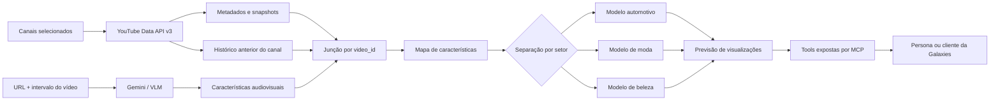

# Galaxies — previsão de desempenho de criativos

## Como eu entendo o projeto

O objetivo deste projeto é prever o desempenho de um criativo antes de ele ser
publicado. Minha variável-alvo será baseada em visualizações, e as entradas do
modelo serão formadas por informações que eu realmente poderia conhecer antes da
publicação: características do conteúdo, contexto do canal e histórico anterior
daquele canal.

Eu estou trabalhando com três setores: **automotivo, moda e beleza**. Minha decisão
inicial é treinar um modelo preditivo para cada setor. Os formatos, públicos e
padrões de consumo são diferentes, então não quero obrigar um único modelo a
aprender os três contextos como se fossem iguais. Essa separação, sozinha, não
elimina todos os vieses: a avaliação ainda precisa respeitar tempo e canal para o
modelo não memorizar criadores ou enxergar o futuro.

Eu vejo o projeto como a união de duas frentes de dados:

1. A **YouTube Data API v3** fornece identidade, datas, metadados e snapshots de
   métricas do vídeo e do canal.
2. O **Gemini, usado como VLM**, observa um intervalo do conteúdo audiovisual e
   devolve características estruturadas sobre o que aparece e o que é ouvido.

As duas frentes são ligadas pelo `video_id`. Depois dessa junção, cada vídeo passa
a ter um mapa de características que poderá ser transformado em uma linha da base
de modelagem.



## O que já foi coletado pela API

A coleta começa pelo ID de cada canal, descobre sua playlist de uploads, enumera
os vídeos e consulta os detalhes de cada item. Para cada registro eu preservo:

- `video_id`, `channel_id`, ID da playlist e posição observada na playlist;
- setor e canal selecionado;
- título, descrição, tags e categoria;
- data de publicação e data/hora da coleta;
- duração e definição do vídeo;
- visualizações, curtidas e comentários observados na coleta;
- inscritos e quantidade de vídeos do canal observados na coleta;
- endpoints, arquivos brutos e configuração que deram origem ao registro;
- valores ausentes como ausentes, sem inventar zero.

Essas métricas são snapshots. Visualizações atuais não significam
automaticamente “visualizações no dia 30”, e os inscritos observados agora não
representam necessariamente os inscritos que o canal tinha quando um vídeo antigo
foi publicado.

O compartilhamento não está disponível como métrica pública pela YouTube Data API
v3 usada neste projeto.

## O que é feature e o que é alvo

Minha decisão é prever **visualizações**. Ainda preciso fechar a definição exata de
`y`, porque comparar a contagem atual de um vídeo novo com a de um vídeo antigo não
é justo. As alternativas que serão testadas incluem uma janela fixa de observação,
como visualizações em 7 ou 30 dias, ou uma medida relativa ao histórico do canal em
idades comparáveis.

As features candidatas estão divididas em grupos:

- características disponíveis antes da publicação, como duração, formato e
  atributos audiovisuais da abertura;
- histórico do canal calculado somente com publicações anteriores ao vídeo-alvo,
  como mediana e média de visualizações, curtidas e comentários anteriores;
- frequência de publicação, quantidade de vídeos anteriores e tendência recente;
- contexto do canal que seja temporalmente válido;
- no futuro, embeddings visuais, textuais ou sonoros.

Há uma regra central contra vazamento de dados: **curtidas, comentários e
visualizações do próprio vídeo não podem ser usados para prever esse mesmo vídeo
antes da publicação**. Esses valores podem ser alvos auxiliares, informações de
avaliação ou matéria-prima para o histórico de vídeos posteriores. Da mesma forma,
o histórico de um vídeo só pode usar registros publicados antes dele.

Também vou comparar grupos de features e não apenas jogar tudo no modelo. A ideia
é medir o ganho trazido por metadados, histórico do canal, características
audiovisuais e, depois, embeddings.

## Como a abertura é analisada pelo Gemini

O piloto atual envia a URL pública do YouTube para a Gemini API junto com o
intervalo que deve ser analisado. Ele não baixa o arquivo do vídeo, não extrai
imagens localmente e não envia título, descrição, nome do canal ou métricas de
desempenho ao modelo.

Na conversa eu vinha tratando essa etapa como “os primeiros quatro segundos”, mas
o protocolo implementado hoje analisa **de 0 a 3 segundos**, com **4 FPS
solicitados**. É uma janela de três segundos. Se esse intervalo mudar, a versão do
protocolo também precisa mudar para manter os resultados comparáveis.

O JSON devolvido separa:

- observações visuais: primeiro elemento visível, pessoas e rostos, produto ou
  objeto em foco, texto na tela, ambiente, enquadramento, movimento da câmera,
  mudanças de cena e intensidade de movimento;
- observações de áudio: presença e início de fala, pequeno trecho transcrito,
  idioma, música, efeitos sonoros e observações;
- interpretações controladas: tipo de abertura, destaque do produto e chamada
  para ação;
- evidências com timestamps, confiança e incertezas.

Os tipos de abertura permitidos no protocolo atual são `question`, `statement`,
`demonstration`, `product_reveal`, `person_speaking`, `montage`, `text_hook`,
`other` e `unknown`. Essa saída é uma anotação produzida por modelo, não uma
verdade automática; por isso eu validei manualmente uma amostra de dois vídeos por
setor.

## Decisão de não armazenar frames

Eu decidi não guardar os frames neste momento. Armazenar imagens de todos os vídeos
aumentaria bastante o volume do projeto e não é necessário para o piloto que estou
construindo.

Para manter a rastreabilidade sem salvar as imagens, eu guardo:

- o `video_id` e a URL de origem;
- o intervalo analisado e o FPS solicitado;
- o modelo, a versão do prompt e os horários da extração;
- o JSON estruturado, as evidências com timestamps e as incertezas;
- o caminho do registro de origem e da resposta bruta da API do extrator.

Isso permite voltar ao trecho original enquanto ele continuar acessível e repetir
a extração com o mesmo protocolo. Também deixa claro o limite da decisão: se o
vídeo for removido ou alterado, eu não terei uma cópia visual para reproduzir a
análise exatamente.

Embeddings poderão ser armazenados mais adiante, mas eles serão representações
numéricas para comparação e modelagem. Um embedding não é uma cópia reversível do
frame e não substitui a imagem como evidência visual.

## Mapa de características por vídeo

Os dados originais continuam separados por fonte. O mapa abaixo representa o
contrato planejado para juntar as features e o alvo sem perder a linhagem:

```json
{
  "schema_version": "0.1.0",
  "identity": {
    "video_id": "VIDEO_ID",
    "channel_id": "CHANNEL_ID",
    "sector": "automotivo|moda|beleza",
    "published_at": "ISO-8601"
  },
  "features": {
    "video_prepublication": {
      "duration_seconds": null,
      "definition": null
    },
    "channel_history": {
      "cutoff_at": "ISO-8601",
      "prior_video_count": null,
      "prior_views_median": null,
      "prior_likes_median": null,
      "prior_comments_median": null
    },
    "opening_vlm": {
      "protocol_version": "galaxies-opening-v0.1.0",
      "result_reference": "data/features/runs/.../opening_vlm.json"
    },
    "embeddings": null
  },
  "target": {
    "name": "view_count",
    "value": null,
    "observed_at": "ISO-8601",
    "video_age_days": null
  },
  "provenance": {
    "youtube_record": "data/youtube/runs/.../<video_id>.json",
    "feature_result": "data/features/runs/.../opening_vlm.json"
  }
}
```

Esse mapa ainda não é uma tabela pronta para treino. Antes disso, eu preciso
definir o horizonte do alvo, construir o histórico sem olhar o futuro, tratar
ausências, transformar categorias e estabelecer os cortes de treino, validação e
teste por tempo e por canal.

## Onde entram o modelo preditivo, o LLM e o MCP

São papéis diferentes:

- o **Gemini/VLM** é usado agora como extrator de características do conteúdo;
- o **modelo preditivo** será responsável por produzir a estimativa numérica de
  visualizações para cada setor;
- um **LLM** poderá orquestrar ferramentas, transformar a solicitação da persona
  em parâmetros, explicar a previsão e organizar recomendações, sem inventar a
  previsão;
- o **servidor MCP** será a interface que expõe operações como extrair
  características, consultar histórico, prever desempenho e explicar fatores do
  resultado;
- a **persona ou cliente da Galaxies** chama essas tools e recebe uma resposta
  rastreável.

Portanto, o LLM não substitui os três modelos preditivos. Ele entra na camada de
interpretação e orquestração. O número deve vir do pipeline estatístico e a
explicação deve apontar para as features realmente usadas.

## Organização do repositório

```text
case_galaxies/
├── config/                         # candidatos e canais selecionados
├── data/
│   ├── youtube/
│   │   ├── channel_resolution/     # resolução de nomes para IDs
│   │   └── runs/<timestamp>/       # respostas e registros por coleta
│   └── features/
│       ├── runs/<timestamp>/       # resultados locais do extrator
│       └── validation_sets/        # protocolo e validação manual
├── references/papers/              # artigos usados como referência
├── scripts/                        # coleta, organização e extração
├── .env                            # chaves locais; nunca versionado
├── .env.example                    # nomes das variáveis, sem segredos
└── README.md
```

Cada coleta do YouTube mantém duas camadas:

```text
raw/                                # resposta original, organizada por channel_id
curated/videos/<setor>/<canal>/     # um JSON rastreável por video_id
curated/manifest.json               # resumo, ausências e limitações
normalized_records.json             # representação intermediária
run_metadata.json                   # parâmetros e status da execução
```

Os diretórios de execução em `data/youtube/runs/` e `data/features/runs/` são
locais e estão no `.gitignore`. O código, os arquivos de seleção e os manifestos
de validação são versionados. O `.env` também é ignorado para que as chaves nunca
entrem em commits.

## Como executar

Na primeira vez, copie o modelo de ambiente e preencha as chaves localmente:

```powershell
Copy-Item .env.example .env
```

Para resolver canais, coletar os cinco uploads mais recentes de cada canal e
organizar os JSONs:

```powershell
python scripts/resolve_channels.py
python scripts/youtube_extract_batch.py
python scripts/organize_extraction.py
```

Para testar uma abertura já presente na coleta:

```powershell
python scripts/gemini_opening_pilot.py --video-id gmi2iRLj1Q4
```

Para planejar ou retomar um lote sem repetir vídeos concluídos:

```powershell
python scripts/gemini_opening_batch.py --dry-run
python scripts/gemini_opening_batch.py --run-id batch-opening-all-2026-10-12 --delay-seconds 2
```

O lote salva o progresso após cada vídeo e pausa no primeiro erro de cota. Uma
nova execução com o mesmo `run-id` reutiliza resultados válidos e tenta apenas o
que continua pendente.

## Estado atual

Em 12 de outubro de 2026, o projeto tem:

- 15 canais selecionados, cinco por setor;
- 75 vídeos coletados pela YouTube Data API v3;
- registros brutos, normalizados e curados ligados por IDs;
- oito resultados de abertura disponíveis localmente;
- seis vídeos, dois por setor, conferidos manualmente e aprovados;
- execução em lote retomável para continuar depois da renovação da cota.

Ainda não foram implementados a transcrição completa, os embeddings, o mapa final
de features, a engenharia temporal do alvo, o treinamento dos três modelos e o
servidor MCP. Essas etapas serão discutidas antes de serem construídas.

## Limites e cuidados

- A Data API não fornece o arquivo audiovisual.
- URL pública não resolve automaticamente permissão de armazenamento, reprodução
  ou criação de métricas derivadas; isso precisa ser validado antes de escalar.
- A primeira amostra contém os uploads mais recentes e não confirma, sozinha, que
  todos são Shorts.
- Métricas coletadas em idades diferentes não são diretamente comparáveis.
- O split do experimento deve ser temporal e controlar canal para medir
  generalização de verdade.
- Qualquer mudança de modelo, prompt, janela ou FPS cria uma nova versão do
  protocolo de extração.

## Referências de trabalho

Os artigos usados como base estão em `references/papers/`, incluindo os trabalhos
identificados por `2309.15379`, `2503.04446`, `2507.00950` e `2512.21402`. Eles são
referências para decisões de extração, representação e avaliação; nenhuma escolha
do pipeline deve ser atribuída a um paper sem conferir diretamente sua fonte.
