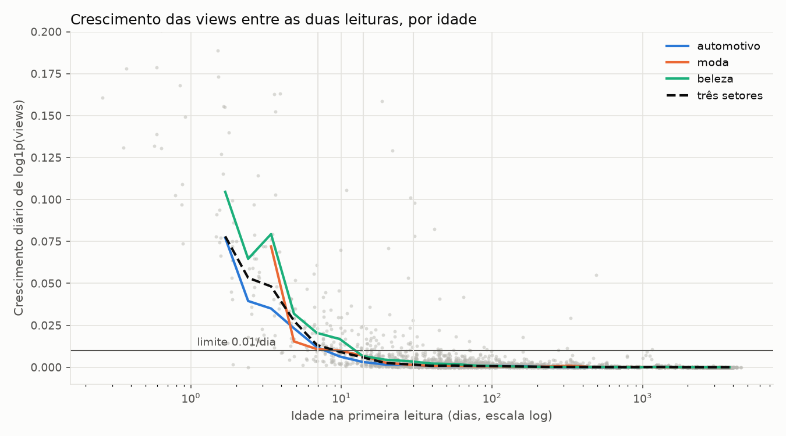
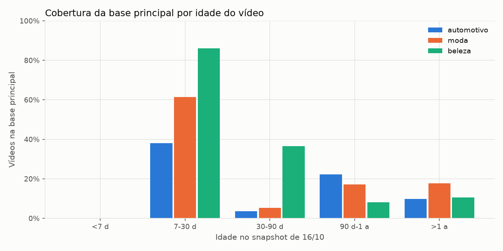
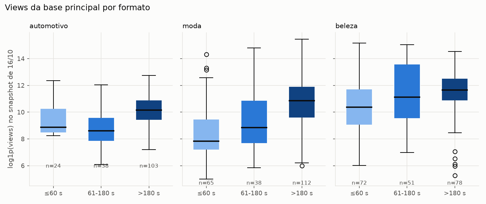

# Auditoria final da base — Parte 1

## Decisão

A base está **congelada e pronta para a Parte 2 (modelagem)**, mas nenhum modelo
deve ser promovido ainda. O recorte principal tem 581 vídeos com protocolo VLM
homogêneo, e as sensibilidades de idade e formato já estão definidas. A coleta
pode continuar separadamente; resultados posteriores a `2026-10-20T01:45:00Z`
não alteram esta versão da avaliação.

## Fonte e reprodutibilidade

- População Data API: 3.425 vídeos de 30 canais, em três setores.
- Dois snapshots completos preservados: 16/10 e 20/10/2026.
- VLMs no armazenamento no congelamento: 775 únicos; um é sintético e não tem
  registro da Data API.
- Base analítica: 714 vídeos, excluindo os 60 itens da fila caso-controle e
  exigindo Gemini 3.5 Flash-Lite, `galaxies-opening-v0.1.0`, intervalo 0–3 s e
  4 FPS.
- Manifesto, hashes de entrada e hash da base estão em
  [audit.json](auditoria/audit.json); a lista exata de vídeos está em
  [base_principal.csv](auditoria/base_principal.csv).

## Funil e corte de idade

| Etapa | Automotivo | Moda | Beleza | Total |
|---|---:|---:|---:|---:|
| Data API | 1.200 | 1.098 | 1.127 | 3.425 |
| Com VLM | 269 | 258 | 247 | 774 |
| Fora da fila caso-controle | 247 | 240 | 227 | 714 |
| Protocolo principal | 247 | 240 | 227 | 714 |
| Base principal, idade ≥ 7 dias | 165 | 215 | 201 | 581 |

A regra, definida antes de modelar, usa o crescimento diário de `log1p(views)`
entre os dois snapshots. O menor corte com mediana de até 0,01/dia foi 7 dias
(0,0098; IC95% bootstrap 0,0072–0,0118). Como o intervalo cruza o limite, 14 e
30 dias são sensibilidades obrigatórias, não evidência de que 7 dias seja uma
verdade definitiva.

| Recorte | Automotivo | Moda | Beleza | Total |
|---|---:|---:|---:|---:|
| Principal, ≥7 dias | 165 | 215 | 201 | 581 |
| Sensibilidade, ≥14 dias | 117 | 192 | 176 | 485 |
| Sensibilidade, ≥30 dias | 88 | 142 | 133 | 363 |
| Principal, até 180 s | 62 | 103 | 123 | 288 |

## Cobertura e viés de seleção

A cobertura VLM do público elegível é limitada: 14,8% em Automotivo, 20,0% em
Moda e 18,3% em Beleza. Portanto, os resultados descrevem os canais e vídeos
analisados — não todo o universo do YouTube. Embeddings de thumbnail cobrem 100%
da base principal; embeddings de título cobrem 66–74%; transcrição completa e
embedding título+descrição ainda têm cobertura zero. Eles não podem entrar na
comparação principal como se estivessem completos.

Há sinal de seleção em Automotivo: os vídeos analisados têm percentil médio de
desempenho intra-canal de 0,551, contra 0,496 nos não analisados. Moda (0,521 vs.
0,500) e Beleza (0,501 vs. 0,505) não mostram diferença clara nesta checagem. A
modelagem precisa reportar resultados por setor e não generalizar o resultado de
Automotivo.

## Features permitidas e bloqueadas

Os números de views, likes e comentários são pós-publicação: eles nunca entram
como features. Também ficam fora as métricas atuais de inscritos do canal, o
protocolo do extrator, proveniência e histórico baseado em métricas observadas
depois da publicação. A lista completa de papéis está em
[papeis_das_colunas.csv](auditoria/papeis_das_colunas.csv).

Antes do treinamento, o pipeline deve remover as colunas 100% ausentes ou
constantes dentro de cada setor. Os atributos específicos de setor estão 100%
ausentes no protocolo v0.1.0 e devem sair. `setting_observed` é constante;
`definition` é constante em Automotivo e Beleza. `brand_legible` e alguns sinais
de transcrição têm um único valor entre observados: devem ser recodificados como
booleanos de presença, mantendo a ausência como `False`, nunca imputados como uma
categoria textual. Veja [features_descartadas.csv](auditoria/features_descartadas.csv).

As categorias VLM livres foram medidas antes da normalização: `framing` tem 74
formas textuais brutas, mas seis após a taxonomia fechada. A tabela de
normalização deve ficar versionada e definida sem consultar o alvo; seleção de
features e qualquer codificação aprendida continuam restritas ao treino de cada
fold.

## Qualidade e limitações

- Não há `video_id` repetido na base principal; há um par de thumbnails muito
  similares e 16 títulos repetidos dentro de canal, preservados para inspeção.
- Dez contagens de views diminuíram entre snapshots; elas permanecem registradas
  como anomalia de origem, sem correção artificial.
- O efeito do formato é forte e varia por setor; duração/formato deve entrar na
  referência histórica e nas análises de erro.
- Com idade ≥30 dias, Automotivo fica com apenas três canais. Nesse recorte,
  holdout por canal não é defensável; use apenas validação temporal e marque a
  limitação.
- A VLM observa somente a abertura de três segundos. O projeto não deve alegar
  que mediu o conteúdo audiovisual completo enquanto a transcrição integral não
  existir.

## Próximo passo aceito

Construir a Parte 2 usando somente a lista congelada e os papéis de coluna desta
auditoria: pré-processamento dentro de cada fold, baselines, modelos por setor,
ablação de grupos de features, split temporal e por canal quando viável, e
intervalos de incerteza. SHAP só entra depois de existir um campeão escolhido sem
olhar os holdouts.
