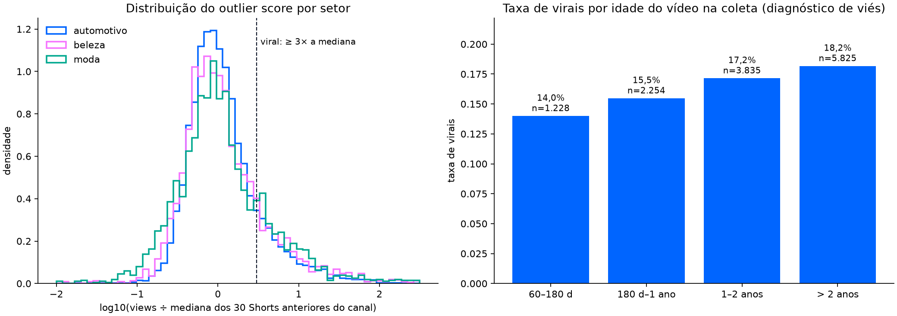

# Base v2 de Shorts: limpeza e rótulo de outlier

Gerado por `scripts/build_viral_dataset.py` a partir da coleta de 21/10/2026
(`normalized_records.json`). Nenhum modelo foi treinado nesta base ainda.

## Regras fixadas antes de qualquer modelo

- Short = público, publicado a partir de 12/07/2021 (lançamento global), com até 60 s
  antes de 15/10/2024 e até 180 s a partir dessa data.
- Período prospectivo (desde 21/10/2026) fica fora: é a validação final.
- Reupload: mesmo canal, título normalizado e duração; fica o primeiro publicado.
- Rótulo só para vídeos com pelo menos 60 dias na coleta (**HIPÓTESE**: views de Short
  estabilizam em cerca de 2 meses; não medido nesta base).
- `outlier_score` = views ÷ mediana das views dos 30 Shorts anteriores do mesmo canal
  (mínimo de 10 anteriores).
- `viral` = `outlier_score` ≥ 3 (**HIPÓTESE**: convenção de outlier "3× a mediana").
- Views só aparecem no rótulo, nunca como feature.

## Funil de limpeza

| etapa | removidos | restantes |
|---|---|---|
| coleta bruta | 0 | 22442 |
| não público | 0 | 22442 |
| período prospectivo (validação final) | 8 | 22434 |
| antes do lançamento global dos Shorts | 6048 | 16386 |
| sem duração ou views | 0 | 16386 |
| duração acima do limite de Short da época | 1965 | 14421 |
| ID duplicado | 0 | 14421 |
| reupload (canal, título e duração iguais) | 303 | 14118 |

## Rótulo

| situação | vídeos |
|---|---|
| rotulado | 13142 |
| jovem demais | 725 |
| histórico curto | 251 |

| sector | canais | rotulados | virais | taxa |
|---|---|---|---|---|
| automotivo | 10 | 7107 | 1066 | 15,0% |
| beleza | 8 | 3328 | 599 | 18,0% |
| moda | 6 | 2707 | 573 | 21,2% |

Sensibilidade da taxa de virais ao limiar k (descritivo; o k oficial continua 3):

| k | taxa_viral |
|---|---|
| 2.0 | 24,9% |
| 3.0 | 17,0% |
| 5.0 | 10,5% |
| 10.0 | 5,5% |

## Tipo de canal e auditoria de impulsionados

Tipo de canal é classificação manual (`config/selected_channels.json`). Na v3, Shorts com likes/view
abaixo de 10% da mediana dos 30 anteriores do canal saem do rótulo como `provável impulsionado`,
e canais com likes ocultos em mais da metade dos vídeos saem como `likes ocultos`.

| sector | channel_type | histórico curto | jovem demais | rotulado |
|---|---|---|---|---|
| automotivo | criador | 50 | 202 | 3648 |
| automotivo | marca | 10 | 57 | 926 |
| automotivo | mídia | 40 | 118 | 2533 |
| beleza | criador | 61 | 137 | 2541 |
| beleza | marca | 20 | 0 | 623 |
| beleza | mídia | 10 | 3 | 164 |
| moda | criador | 10 | 0 | 52 |
| moda | marca | 30 | 92 | 804 |
| moda | mídia | 20 | 116 | 1851 |

| sector | channel_type | canais | rotulados | taxa |
|---|---|---|---|---|
| automotivo | criador | 5 | 3648 | 16,3% |
| automotivo | marca | 1 | 926 | 15,3% |
| automotivo | mídia | 4 | 2533 | 13,0% |
| beleza | criador | 5 | 2541 | 18,3% |
| beleza | marca | 2 | 623 | 19,9% |
| beleza | mídia | 1 | 164 | 5,5% |
| moda | criador | 1 | 52 | 23,1% |
| moda | marca | 3 | 804 | 17,2% |
| moda | mídia | 2 | 1851 | 22,9% |

## Viés de idade (ler antes de modelar)

A linha de base usa Shorts mais antigos do canal, que tiveram mais tempo para acumular views.
Se a taxa de virais cresce com a idade, parte do rótulo é idade, e o modelo precisa ser
conferido contra esse atalho.

| faixa_idade | rotulados | taxa |
|---|---|---|
| 60–180 d | 1228 | 14,0% |
| 180 d–1 ano | 2254 | 15,5% |
| 1–2 anos | 3835 | 17,2% |
| > 2 anos | 5825 | 18,2% |

| ano | rotulados | taxa |
|---|---|---|
| 2021 | 129 | 12,4% |
| 2022 | 1110 | 17,1% |
| 2023 | 2401 | 18,1% |
| 2024 | 2843 | 18,7% |
| 2025 | 4192 | 16,6% |
| 2026 | 2467 | 14,9% |

## Por canal

| sector | canal | rotulados | virais | taxa | mediana_views |
|---|---|---|---|---|---|
| automotivo | Opinião Sincera | 1603 | 276 | 17,2% | 19482 |
| automotivo | Carros com Camanzi | 438 | 69 | 15,8% | 9030 |
| automotivo | Auto Super | 364 | 57 | 15,7% | 14310 |
| automotivo | Acelerados | 1215 | 190 | 15,6% | 13635 |
| automotivo | Webmotors | 926 | 142 | 15,3% | 2440 |
| automotivo | Quatro Rodas | 232 | 35 | 15,1% | 21207 |
| automotivo | Motor1 Brasil | 283 | 39 | 13,8% | 4725 |
| automotivo | AutoPapo | 2006 | 255 | 12,7% | 7526 |
| automotivo | FlatOut Brasil | 12 | 1 | 8,3% | 7182 |
| automotivo | FullpowerTV | 28 | 2 | 7,1% | 3360 |
| beleza | Franciny Ehlke | 227 | 54 | 23,8% | 1233010 |
| beleza | Beleza na Web | 617 | 124 | 20,1% | 718 |
| beleza | Mari Maria | 1290 | 258 | 20,0% | 139733 |
| beleza | Karen Bachini | 214 | 41 | 19,2% | 61060 |
| beleza | NiinaSecrets | 231 | 33 | 14,3% | 28802 |
| beleza | Jana Taffarel | 579 | 80 | 13,8% | 26204 |
| beleza | Tour da Beleza | 164 | 9 | 5,5% | 21459 |
| beleza | Vult | 6 | 0 | 0,0% | 245970 |
| moda | STEAL THE LOOK | 1770 | 414 | 23,4% | 1730 |
| moda | Isabella Fiorentino | 52 | 12 | 23,1% | 22434 |
| moda | cea | 306 | 64 | 20,9% | 782 |
| moda | EstiloRenner | 421 | 68 | 16,2% | 1460 |
| moda | Vogue Brasil | 81 | 9 | 11,1% | 1731 |
| moda | Riachuelo | 77 | 6 | 7,8% | 1258 |
