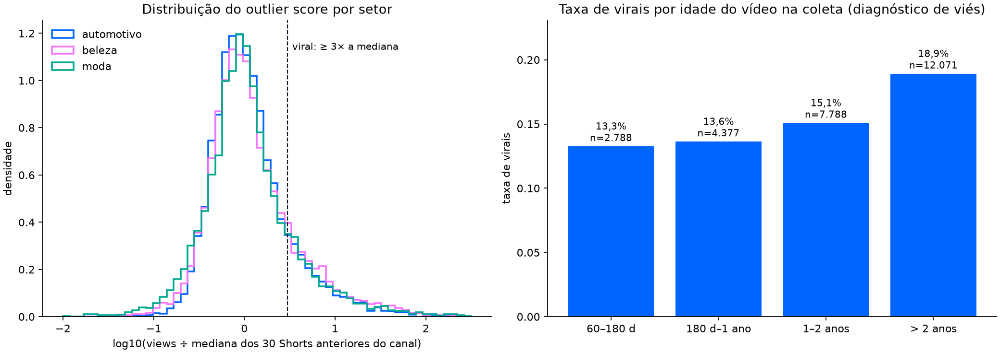

# Base v3 de Shorts: limpeza e rótulo de outlier

Gerado por `scripts/build_viral_dataset.py` a partir da coleta de 21/10/2026
(`normalized_records.json`). Nenhum modelo foi treinado nesta base ainda.

## Regras fixadas antes de qualquer modelo

- Short = público, publicado a partir de 12/07/2021 (lançamento global), com até 60 s
  antes de 15/10/2024 e até 180 s a partir dessa data.
- Período prospectivo (desde 21/10/2026) fica fora: é a validação final.
- Reupload: mesmo canal, título normalizado e duração; fica o primeiro publicado.
- Rótulo só para vídeos com pelo menos 60 dias na coleta (**HIPÓTESE**: views de Short
  estabilizam em cerca de 2 meses; não medido nesta base).
- `outlier_score` = views ÷ mediana das views dos 30 Shorts anteriores do mesmo canal
  (mínimo de 10 anteriores).
- `viral` = `outlier_score` ≥ 3 (**HIPÓTESE**: convenção de outlier "3× a mediana").
- Views só aparecem no rótulo, nunca como feature.

## Funil de limpeza

| etapa | removidos | restantes |
|---|---|---|
| coleta bruta | 0 | 40991 |
| não público | 0 | 40991 |
| período prospectivo (validação final) | 27 | 40964 |
| antes do lançamento global dos Shorts | 7147 | 33817 |
| sem duração ou views | 0 | 33817 |
| duração acima do limite de Short da época | 3222 | 30595 |
| ID duplicado | 0 | 30595 |
| reupload (canal, título e duração iguais) | 746 | 29849 |

## Rótulo

| situação | vídeos |
|---|---|
| rotulado | 27024 |
| jovem demais | 1558 |
| likes ocultos | 617 |
| histórico curto | 541 |
| provável impulsionado | 109 |

| sector | canais | rotulados | virais | taxa |
|---|---|---|---|---|
| automotivo | 10 | 7093 | 1053 | 14,8% |
| beleza | 23 | 9308 | 1649 | 17,7% |
| moda | 19 | 10623 | 1724 | 16,2% |

Sensibilidade da taxa de virais ao limiar k (descritivo; o k oficial continua 3):

| k | taxa_viral |
|---|---|
| 2.0 | 24,3% |
| 3.0 | 16,4% |
| 5.0 | 10,0% |
| 10.0 | 5,1% |

## Tipo de canal e auditoria de impulsionados

Tipo de canal é classificação manual (`config/selected_channels.json`). Na v3, Shorts com likes/view
abaixo de 10% da mediana dos 30 anteriores do canal saem do rótulo como `provável impulsionado`,
e canais com likes ocultos em mais da metade dos vídeos saem como `likes ocultos`.

| sector | channel_type | histórico curto | jovem demais | likes ocultos | provável impulsionado | rotulado |
|---|---|---|---|---|---|---|
| automotivo | criador | 50 | 202 | 0 | 1 | 3647 |
| automotivo | marca | 10 | 57 | 0 | 11 | 915 |
| automotivo | mídia | 40 | 118 | 0 | 2 | 2531 |
| beleza | criador | 211 | 492 | 0 | 14 | 8668 |
| beleza | marca | 20 | 0 | 617 | 0 | 6 |
| beleza | mídia | 20 | 18 | 0 | 1 | 634 |
| moda | criador | 130 | 446 | 0 | 36 | 7540 |
| moda | marca | 30 | 92 | 0 | 38 | 766 |
| moda | mídia | 30 | 133 | 0 | 6 | 2317 |

| sector | channel_type | canais | rotulados | taxa |
|---|---|---|---|---|
| automotivo | criador | 5 | 3647 | 16,3% |
| automotivo | marca | 1 | 915 | 14,4% |
| automotivo | mídia | 4 | 2531 | 13,0% |
| beleza | criador | 20 | 8668 | 17,8% |
| beleza | marca | 1 | 6 | 0,0% |
| beleza | mídia | 2 | 634 | 16,1% |
| moda | criador | 13 | 7540 | 15,2% |
| moda | marca | 3 | 766 | 13,3% |
| moda | mídia | 3 | 2317 | 20,5% |

## Viés de idade (ler antes de modelar)

A linha de base usa Shorts mais antigos do canal, que tiveram mais tempo para acumular views.
Se a taxa de virais cresce com a idade, parte do rótulo é idade, e o modelo precisa ser
conferido contra esse atalho.

| faixa_idade | rotulados | taxa |
|---|---|---|
| 60–180 d | 2788 | 13,3% |
| 180 d–1 ano | 4377 | 13,6% |
| 1–2 anos | 7788 | 15,1% |
| > 2 anos | 12071 | 18,9% |

| ano | rotulados | taxa |
|---|---|---|
| 2021 | 250 | 14,8% |
| 2022 | 2743 | 21,3% |
| 2023 | 4642 | 19,4% |
| 2024 | 5618 | 16,9% |
| 2025 | 8460 | 14,9% |
| 2026 | 5311 | 13,1% |

## Por canal

| sector | canal | rotulados | virais | taxa | mediana_views |
|---|---|---|---|---|---|
| automotivo | Opinião Sincera | 1602 | 275 | 17,2% | 19470 |
| automotivo | Carros com Camanzi | 438 | 69 | 15,8% | 9030 |
| automotivo | Auto Super | 364 | 57 | 15,7% | 14310 |
| automotivo | Acelerados | 1215 | 190 | 15,6% | 13635 |
| automotivo | Quatro Rodas | 232 | 35 | 15,1% | 21207 |
| automotivo | Webmotors | 915 | 132 | 14,4% | 2392 |
| automotivo | Motor1 Brasil | 283 | 39 | 13,8% | 4725 |
| automotivo | AutoPapo | 2004 | 253 | 12,6% | 7520 |
| automotivo | FlatOut Brasil | 12 | 1 | 8,3% | 7182 |
| automotivo | FullpowerTV | 28 | 2 | 7,1% | 3360 |
| beleza | Luisa Navajas MakeUp | 319 | 81 | 25,4% | 18873 |
| beleza | Bruna Malheiros | 77 | 19 | 24,7% | 35223 |
| beleza | Franciny Ehlke | 227 | 54 | 23,8% | 1233010 |
| beleza | Amanda Carneiro | 79 | 18 | 22,8% | 10506 |
| beleza | Thais Braz | 179 | 39 | 21,8% | 57202 |
| beleza | Fernanda Petrizi | 51 | 11 | 21,6% | 89291 |
| beleza | Bella Dias Makeup | 1280 | 275 | 21,5% | 274588 |
| beleza | Adam Mitch | 438 | 93 | 21,2% | 319126 |
| beleza | Dra. Hadra Banks  | 396 | 84 | 21,2% | 12153 |
| beleza | Mari Maria | 1290 | 258 | 20,0% | 139733 |
| beleza | Maquiagem Inspiradora | 470 | 93 | 19,8% | 4955 |
| beleza | Dr Ursinho Carinhoso | 260 | 47 | 18,1% | 36106 |
| beleza | Karen Bachini | 210 | 37 | 17,6% | 59402 |
| beleza | Dourada | 781 | 137 | 17,5% | 144031 |
| beleza | Dra. Marina Hayashida | 763 | 127 | 16,6% | 5314 |
| beleza | Alice Salazar | 225 | 32 | 14,2% | 25660 |
| beleza | Jana Taffarel | 578 | 79 | 13,7% | 26152 |
| beleza | NiinaSecrets | 229 | 31 | 13,5% | 28733 |
| beleza | Thassyane Miranda | 246 | 25 | 10,2% | 14084 |
| beleza | Tainara Reis | 964 | 94 | 9,8% | 13993 |
| beleza | Melissa Samways BR | 76 | 6 | 7,9% | 868 |
| beleza | Tour da Beleza | 164 | 9 | 5,5% | 21459 |
| beleza | Vult | 6 | 0 | 0,0% | 245970 |
| moda | Dede Leme | 511 | 123 | 24,1% | 10119 |
| moda | STEAL THE LOOK | 1765 | 410 | 23,2% | 1728 |
| moda | Isabella Fiorentino | 52 | 12 | 23,1% | 22434 |
| moda | Fábio Souza Carvalho | 1344 | 262 | 19,5% | 2996 |
| moda | Liane Marasca | 279 | 53 | 19,0% | 7447 |
| moda | Lídia Cardoso | 682 | 127 | 18,6% | 45804 |
| moda | Estilo Homem | 445 | 79 | 17,8% | 24928 |
| moda | cea | 293 | 52 | 17,7% | 759 |
| moda | Thi Martins | 582 | 103 | 17,7% | 3357 |
| moda | Julia Loha - Moda Sem Firulas | 369 | 60 | 16,3% | 3672 |
| moda | Ser Chique Cabe no Seu Bolso | 1229 | 164 | 13,3% | 12829 |
| moda | Vivian Palacio | 24 | 3 | 12,5% | 59909 |
| moda | EstiloRenner | 399 | 47 | 11,8% | 1391 |
| moda | Dicas & Cia Fashion | 471 | 55 | 11,7% | 15090 |
| moda | Vogue Brasil | 81 | 9 | 11,1% | 1731 |
| moda | Thaís Melo | 256 | 24 | 9,4% | 12320 |
| moda | HYPNOTIQUE by Fabíola Kassin | 1711 | 138 | 8,1% | 1961 |
| moda | Riachuelo | 74 | 3 | 4,1% | 1211 |
| moda | Michele Oliveira | 56 | 0 | 0,0% | 2900 |
