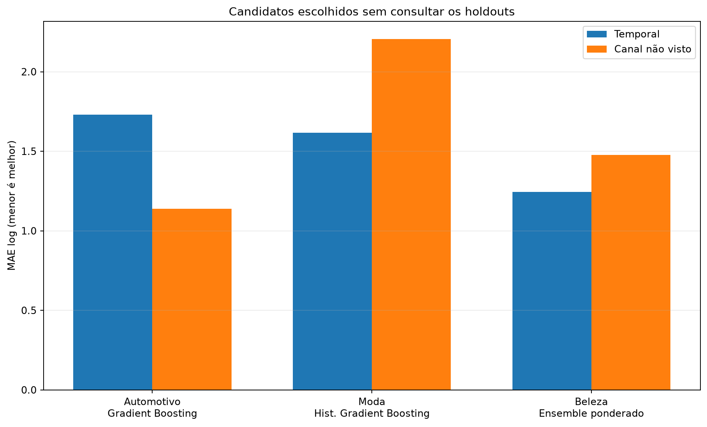
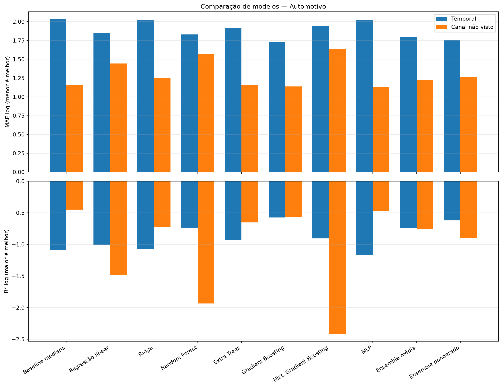
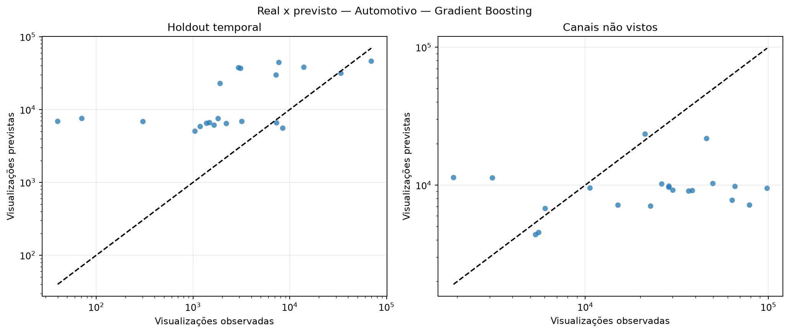
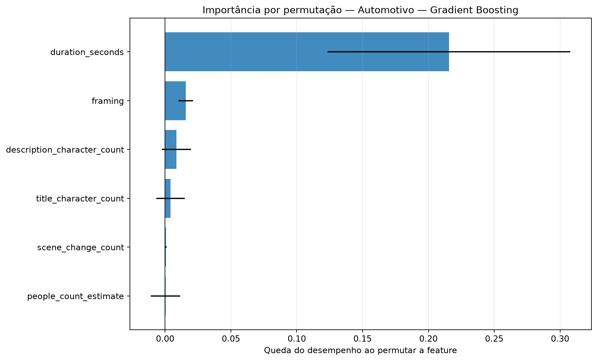
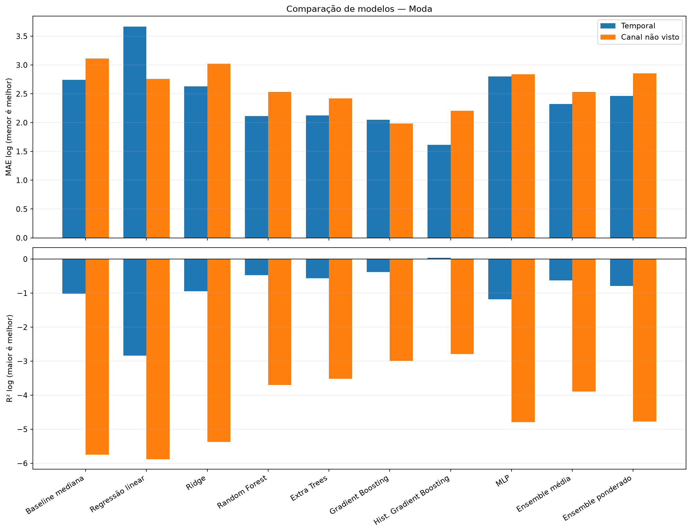
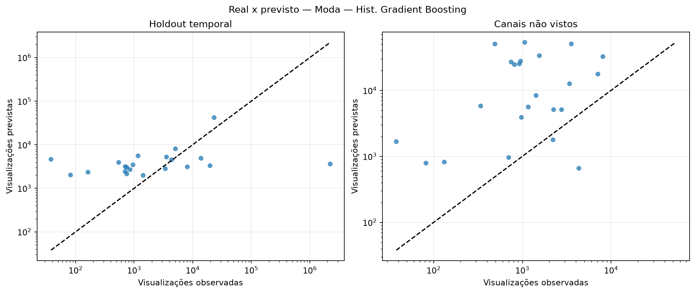
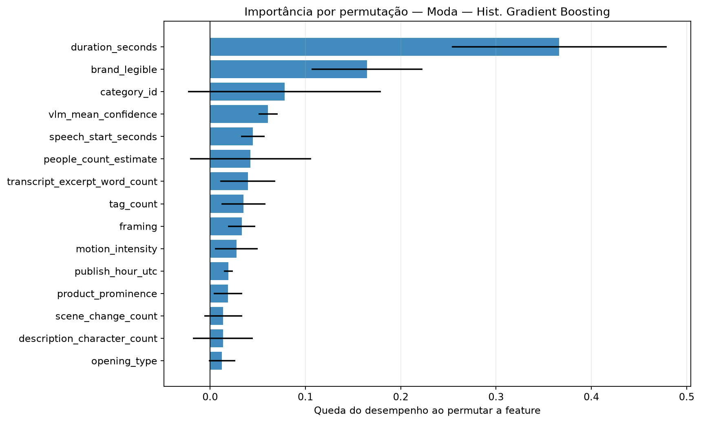
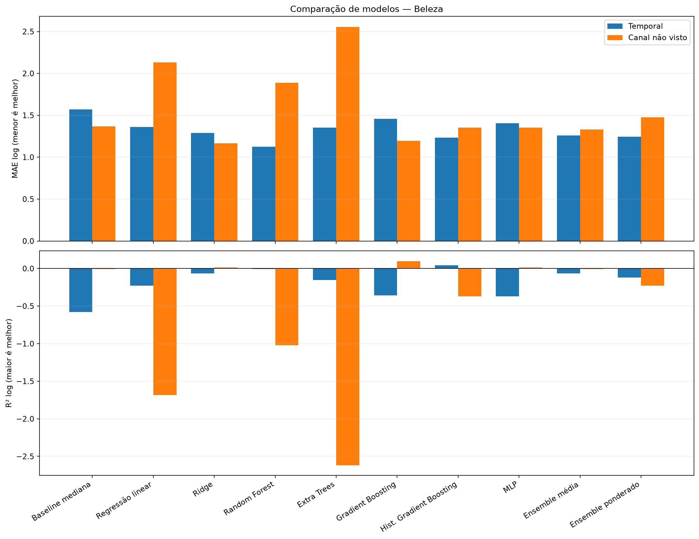
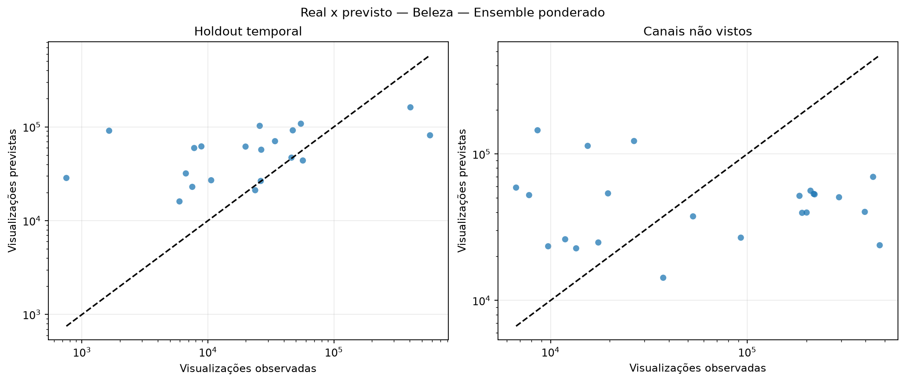
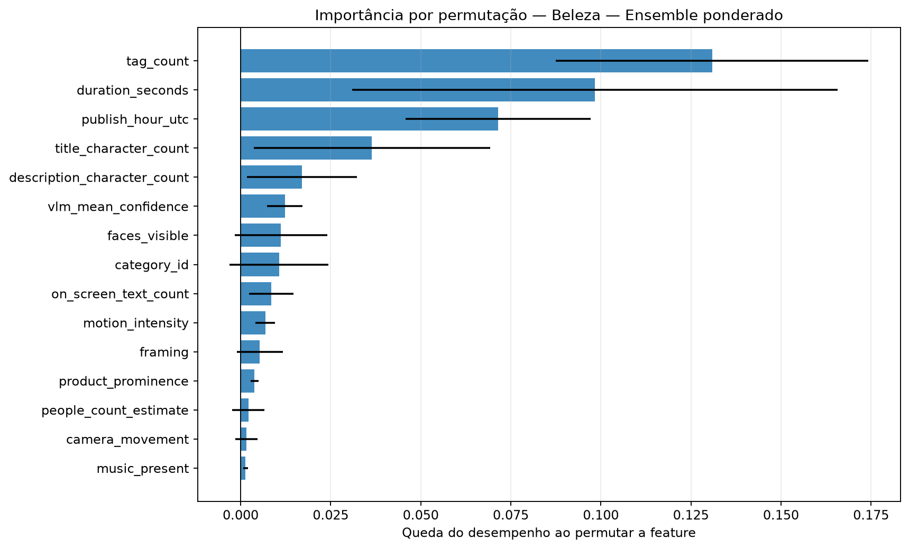

# Avaliação otimizada dos modelos de regressão

Execução: `optimized-model-evaluation-2026-10-15-v1`.

> **Resultado exploratório.** O alvo disponível ainda não representa visualizações observadas exatamente em 30 dias. Nenhum modelo desta execução deve ser promovido para produção.

## Método

A busca usa somente o treino temporal externo. Dentro dele, folds expanding-window ajustam hiperparâmetros e o percentual de features. Os holdouts temporal e de canais não vistos ficam isolados até a avaliação.

Os ensembles combinam Ridge, Random Forest, Gradient Boosting e MLP. Os pesos do ensemble ponderado são aprendidos em previsões out-of-fold com restrição de pesos não negativos.

## Resultados por setor

### Automotivo

Amostra comum: 101 vídeos, 10 canais e 0 alvos em horizonte fixo.

Escolha pela validação interna: **Gradient Boosting**. Melhor observado no holdout temporal: **Gradient Boosting**. Melhor observado em canais não vistos: **MLP**.

| Modelo | Tipo | MAE log interno | MAE log temporal | R² temporal | MAE log canal | R² canal | Spearman temporal |
|---|---|---:|---:|---:|---:|---:|---:|
| Baseline mediana | baseline | — | 2.030 | -1.096 | 1.162 | -0.449 | — |
| Regressão linear | base | 1.549 | 1.856 | -1.014 | 1.445 | -1.480 | 0.255 |
| Ridge | base | 1.005 | 2.021 | -1.073 | 1.255 | -0.719 | 0.374 |
| Random Forest | base | 0.818 | 1.830 | -0.734 | 1.571 | -1.936 | 0.527 |
| Extra Trees | base | 0.838 | 1.913 | -0.928 | 1.160 | -0.653 | 0.244 |
| Gradient Boosting | base | 0.774 | 1.729 | -0.573 | 1.139 | -0.562 | 0.495 |
| Hist. Gradient Boosting | base | 0.801 | 1.940 | -0.907 | 1.638 | -2.414 | 0.553 |
| MLP | base | 0.984 | 2.021 | -1.169 | 1.126 | -0.470 | 0.234 |
| Ensemble média | ensemble | 0.837 | 1.798 | -0.743 | 1.228 | -0.757 | 0.497 |
| Ensemble ponderado | ensemble | 0.774 | 1.755 | -0.621 | 1.266 | -0.903 | 0.529 |

### Moda

Amostra comum: 105 vídeos, 10 canais e 0 alvos em horizonte fixo.

Escolha pela validação interna: **Hist. Gradient Boosting**. Melhor observado no holdout temporal: **Hist. Gradient Boosting**. Melhor observado em canais não vistos: **Gradient Boosting**.

| Modelo | Tipo | MAE log interno | MAE log temporal | R² temporal | MAE log canal | R² canal | Spearman temporal |
|---|---|---:|---:|---:|---:|---:|---:|
| Baseline mediana | baseline | — | 2.745 | -1.017 | 3.115 | -5.750 | — |
| Regressão linear | base | 2.824 | 3.664 | -2.835 | 2.761 | -5.881 | -0.053 |
| Ridge | base | 1.858 | 2.627 | -0.941 | 3.020 | -5.377 | -0.419 |
| Random Forest | base | 1.664 | 2.116 | -0.471 | 2.531 | -3.697 | -0.130 |
| Extra Trees | base | 1.704 | 2.127 | -0.562 | 2.420 | -3.519 | -0.281 |
| Gradient Boosting | base | 1.680 | 2.050 | -0.384 | 1.988 | -2.990 | 0.065 |
| Hist. Gradient Boosting | base | 1.536 | 1.616 | 0.039 | 2.207 | -2.788 | 0.469 |
| MLP | base | 1.673 | 2.802 | -1.179 | 2.837 | -4.789 | -0.391 |
| Ensemble média | ensemble | 1.616 | 2.326 | -0.630 | 2.531 | -3.893 | -0.164 |
| Ensemble ponderado | ensemble | 1.731 | 2.465 | -0.791 | 2.857 | -4.773 | -0.357 |

### Beleza

Amostra comum: 100 vídeos, 10 canais e 0 alvos em horizonte fixo.

Escolha pela validação interna: **Ensemble ponderado**. Melhor observado no holdout temporal: **Random Forest**. Melhor observado em canais não vistos: **Ridge**.

| Modelo | Tipo | MAE log interno | MAE log temporal | R² temporal | MAE log canal | R² canal | Spearman temporal |
|---|---|---:|---:|---:|---:|---:|---:|
| Baseline mediana | baseline | — | 1.568 | -0.578 | 1.367 | -0.008 | — |
| Regressão linear | base | 2.531 | 1.362 | -0.227 | 2.132 | -1.686 | 0.523 |
| Ridge | base | 1.472 | 1.288 | -0.065 | 1.165 | 0.015 | 0.588 |
| Random Forest | base | 1.408 | 1.127 | -0.008 | 1.888 | -1.021 | 0.555 |
| Extra Trees | base | 1.741 | 1.354 | -0.153 | 2.553 | -2.619 | 0.444 |
| Gradient Boosting | base | 1.423 | 1.460 | -0.356 | 1.196 | 0.098 | 0.386 |
| Hist. Gradient Boosting | base | 1.410 | 1.234 | 0.043 | 1.353 | -0.372 | 0.582 |
| MLP | base | 1.542 | 1.405 | -0.369 | 1.352 | 0.015 | 0.394 |
| Ensemble média | ensemble | 1.357 | 1.259 | -0.066 | 1.329 | -0.006 | 0.582 |
| Ensemble ponderado | ensemble | 1.351 | 1.243 | -0.122 | 1.478 | -0.226 | 0.496 |

## Como interpretar

- A seleção principal usa MAE no alvo `log1p(views)`; menor é melhor.
- R² negativo indica desempenho quadrático pior que prever a média.
- Spearman mede a capacidade de ordenar criativos, não a precisão em views.
- Diferenças entre validação interna e holdout indicam instabilidade ou mudança de distribuição.
- A importância por permutação foi calculada apenas no holdout temporal e pode oscilar com a amostra pequena.

## Condição para uma decisão final

Repetir exatamente este protocolo quando houver `views_30d` e histórico do canal com timestamps válidos. Até lá, a execução serve para validar o método e comparar comportamento, não para declarar desempenho de produção.
