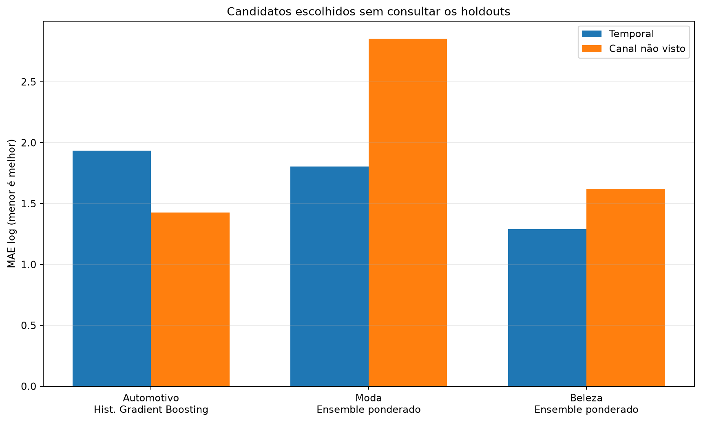
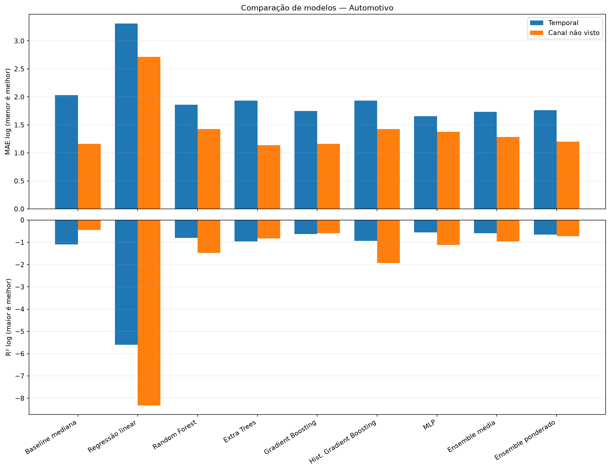
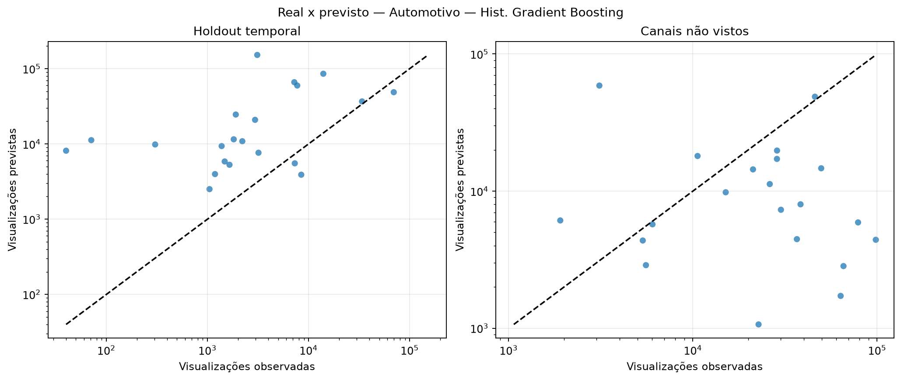
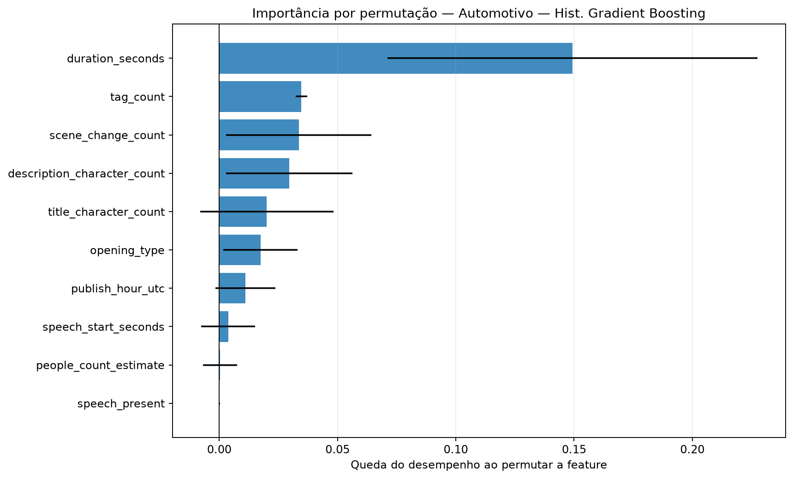
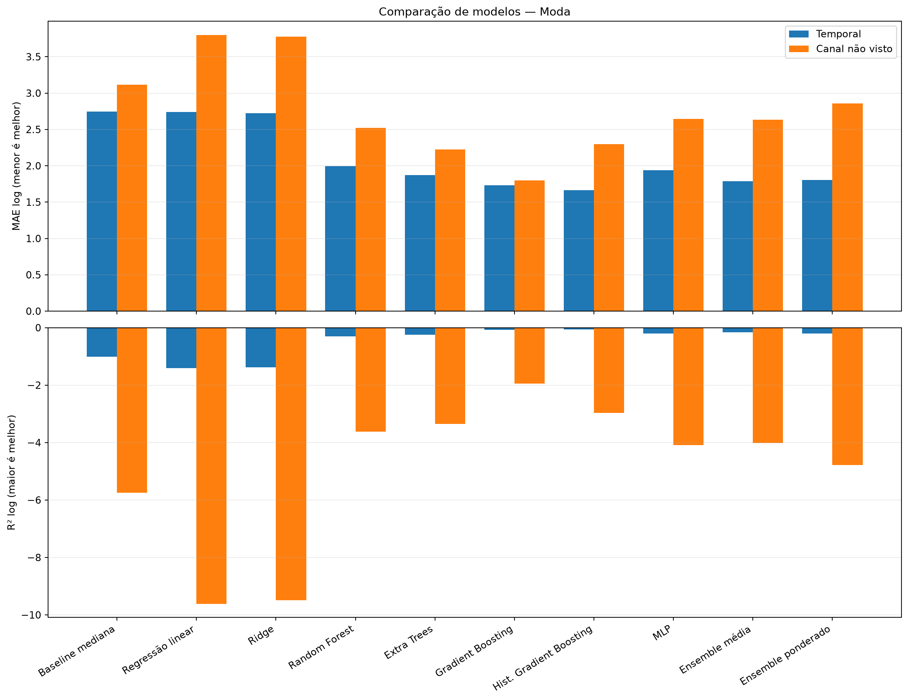
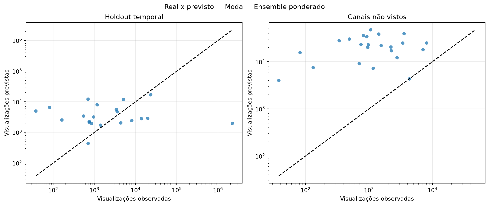
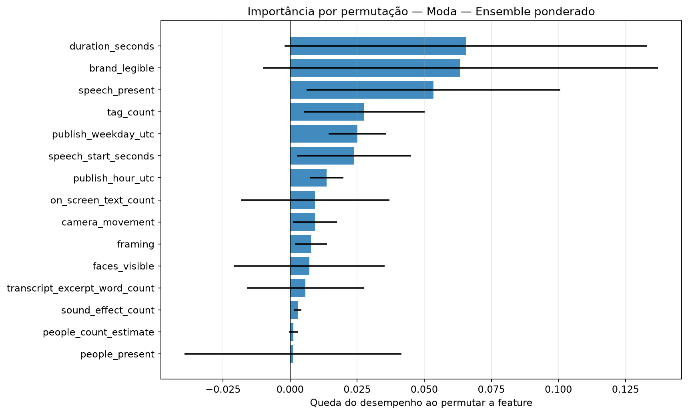
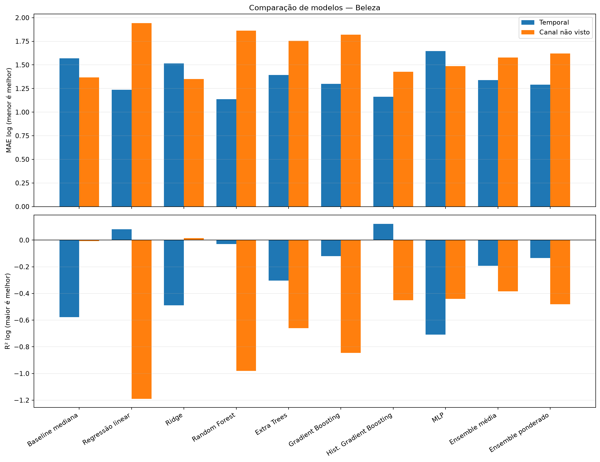
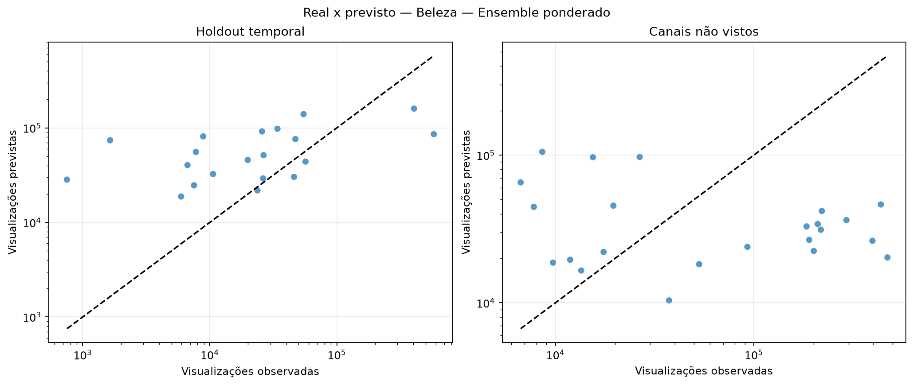
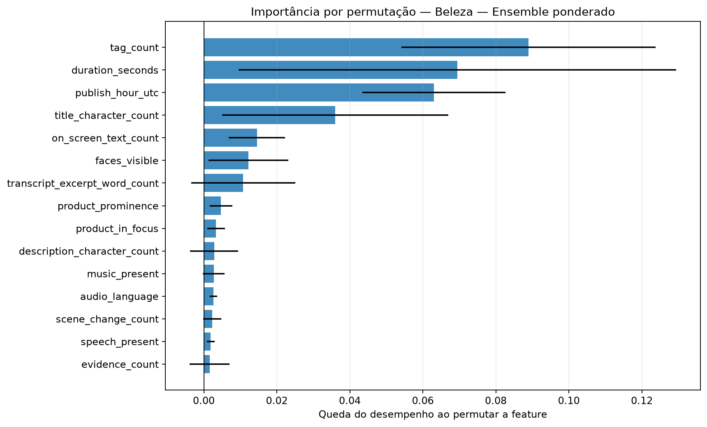

# Avaliação otimizada dos modelos de regressão

Execução: `optimized-model-evaluation-2026-10-16-robust-v2`.

> **Resultado exploratório.** O alvo disponível ainda não representa visualizações observadas exatamente em 30 dias. Nenhum modelo desta execução deve ser promovido para produção.

## Método

A busca usa somente o treino temporal externo. Dentro dele, folds expanding-window ajustam hiperparâmetros, escalonamento e seleção de features. Os holdouts temporal e de canais não vistos ficam isolados até a avaliação.

Colunas constantes são removidas com VarianceThreshold. A busca compara StandardScaler e RobustScaler e testa seleção por F-test, informação mútua e importância de Extra Trees.

Os ensembles combinam Ridge, Random Forest, Gradient Boosting e MLP. Os pesos do ensemble ponderado são aprendidos em previsões out-of-fold com restrição de pesos não negativos.

## Resultados por setor

### Automotivo

Amostra comum: 101 vídeos, 10 canais e 0 alvos em horizonte fixo.

Escolha pela validação interna: **Hist. Gradient Boosting**. Melhor observado no holdout temporal: **MLP**. Melhor observado em canais não vistos: **Extra Trees**.

| Modelo | Tipo | MAE log interno | MAE log temporal | R² temporal | MAE log canal | R² canal | Spearman temporal |
|---|---|---:|---:|---:|---:|---:|---:|
| Baseline mediana | baseline | — | 2.030 | -1.096 | 1.162 | -0.449 | — |
| Regressão linear | base | 1.126 | 3.309 | -5.601 | 2.715 | -8.321 | -0.209 |
| Random Forest | base | 0.817 | 1.860 | -0.802 | 1.426 | -1.476 | 0.494 |
| Extra Trees | base | 0.849 | 1.932 | -0.967 | 1.136 | -0.821 | 0.288 |
| Gradient Boosting | base | 0.784 | 1.747 | -0.631 | 1.160 | -0.592 | 0.447 |
| Hist. Gradient Boosting | base | 0.759 | 1.934 | -0.931 | 1.426 | -1.936 | 0.466 |
| MLP | base | 1.065 | 1.656 | -0.557 | 1.379 | -1.117 | 0.240 |
| Ensemble média | ensemble | 0.861 | 1.731 | -0.596 | 1.285 | -0.967 | 0.443 |
| Ensemble ponderado | ensemble | 0.781 | 1.765 | -0.658 | 1.201 | -0.727 | 0.443 |

### Moda

Amostra comum: 105 vídeos, 10 canais e 0 alvos em horizonte fixo.

Escolha pela validação interna: **Ensemble ponderado**. Melhor observado no holdout temporal: **Hist. Gradient Boosting**. Melhor observado em canais não vistos: **Gradient Boosting**.

| Modelo | Tipo | MAE log interno | MAE log temporal | R² temporal | MAE log canal | R² canal | Spearman temporal |
|---|---|---:|---:|---:|---:|---:|---:|
| Baseline mediana | baseline | — | 2.745 | -1.017 | 3.115 | -5.750 | — |
| Regressão linear | base | 1.892 | 2.738 | -1.403 | 3.798 | -9.611 | -0.062 |
| Ridge | base | 1.853 | 2.724 | -1.380 | 3.774 | -9.486 | -0.062 |
| Random Forest | base | 1.624 | 1.996 | -0.295 | 2.519 | -3.621 | 0.055 |
| Extra Trees | base | 1.696 | 1.873 | -0.251 | 2.222 | -3.344 | 0.084 |
| Gradient Boosting | base | 1.539 | 1.729 | -0.080 | 1.798 | -1.949 | 0.170 |
| Hist. Gradient Boosting | base | 1.500 | 1.667 | -0.065 | 2.295 | -2.967 | 0.262 |
| MLP | base | 1.716 | 1.939 | -0.207 | 2.647 | -4.094 | -0.535 |
| Ensemble média | ensemble | 1.412 | 1.789 | -0.165 | 2.634 | -4.011 | 0.075 |
| Ensemble ponderado | ensemble | 1.408 | 1.804 | -0.197 | 2.856 | -4.787 | -0.038 |

### Beleza

Amostra comum: 100 vídeos, 10 canais e 0 alvos em horizonte fixo.

Escolha pela validação interna: **Ensemble ponderado**. Melhor observado no holdout temporal: **Random Forest**. Melhor observado em canais não vistos: **Ridge**.

| Modelo | Tipo | MAE log interno | MAE log temporal | R² temporal | MAE log canal | R² canal | Spearman temporal |
|---|---|---:|---:|---:|---:|---:|---:|
| Baseline mediana | baseline | — | 1.568 | -0.578 | 1.367 | -0.008 | — |
| Regressão linear | base | 2.082 | 1.237 | 0.081 | 1.941 | -1.190 | 0.668 |
| Ridge | base | 1.534 | 1.515 | -0.489 | 1.352 | 0.015 | 0.457 |
| Random Forest | base | 1.398 | 1.138 | -0.029 | 1.863 | -0.980 | 0.534 |
| Extra Trees | base | 1.653 | 1.394 | -0.303 | 1.756 | -0.660 | 0.432 |
| Gradient Boosting | base | 1.349 | 1.298 | -0.120 | 1.819 | -0.845 | 0.486 |
| Hist. Gradient Boosting | base | 1.382 | 1.162 | 0.122 | 1.428 | -0.451 | 0.595 |
| MLP | base | 1.529 | 1.647 | -0.708 | 1.487 | -0.440 | 0.242 |
| Ensemble média | ensemble | 1.337 | 1.340 | -0.193 | 1.579 | -0.385 | 0.471 |
| Ensemble ponderado | ensemble | 1.315 | 1.290 | -0.135 | 1.621 | -0.481 | 0.540 |

## Como interpretar

- A seleção principal usa MAE no alvo `log1p(views)`; menor é melhor.
- R² negativo indica desempenho quadrático pior que prever a média.
- Spearman mede a capacidade de ordenar criativos, não a precisão em views.
- Diferenças entre validação interna e holdout indicam instabilidade ou mudança de distribuição.
- A importância por permutação foi calculada apenas no holdout temporal e pode oscilar com a amostra pequena.

## Condição para uma decisão final

Repetir exatamente este protocolo quando houver `views_30d` e histórico do canal com timestamps válidos. Até lá, a execução serve para validar o método e comparar comportamento, não para declarar desempenho de produção.
