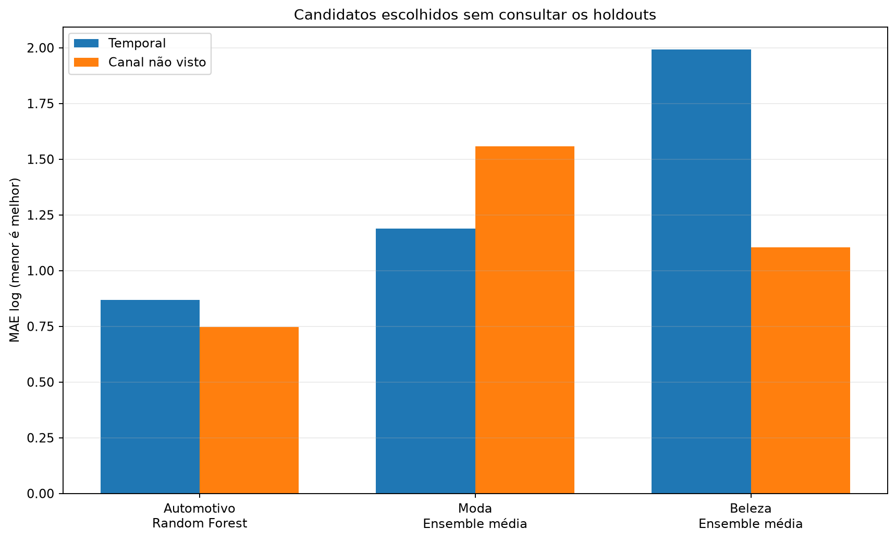
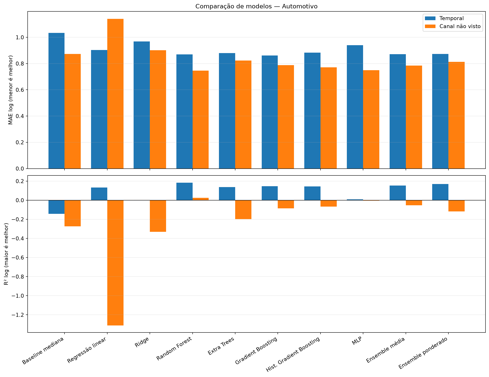
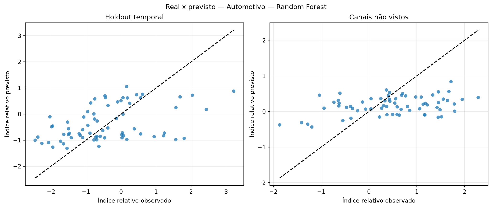
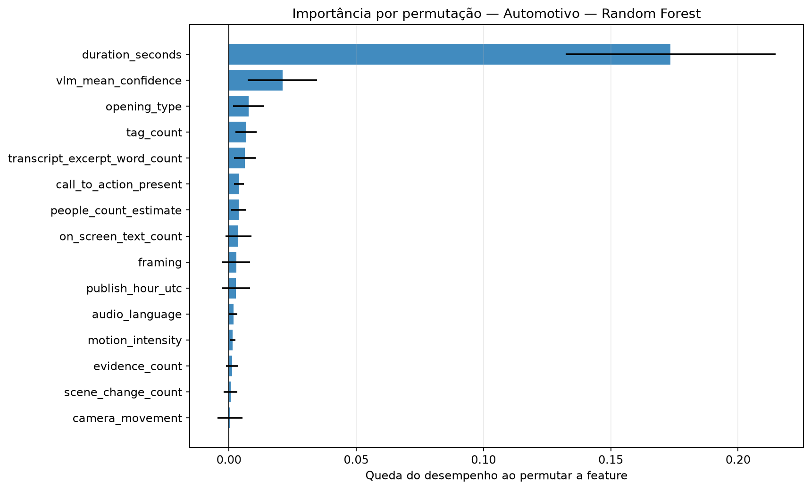
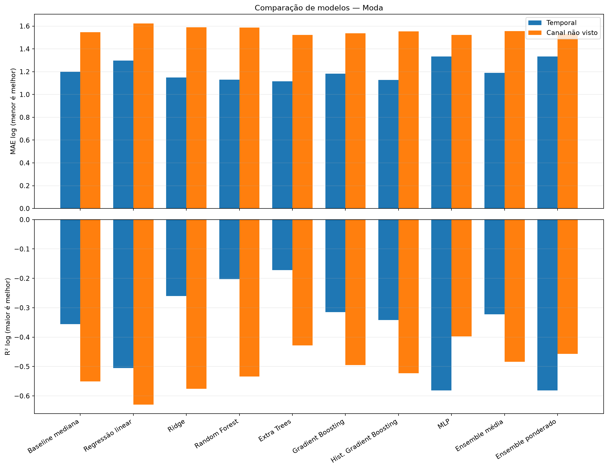
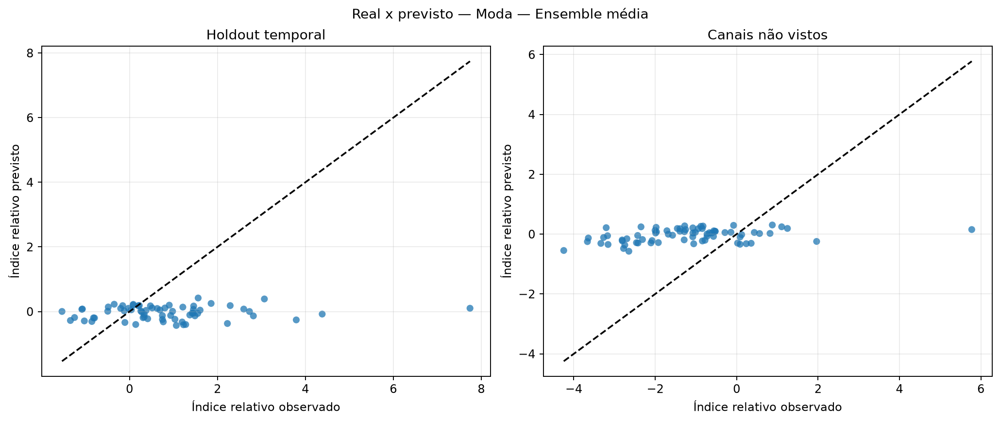
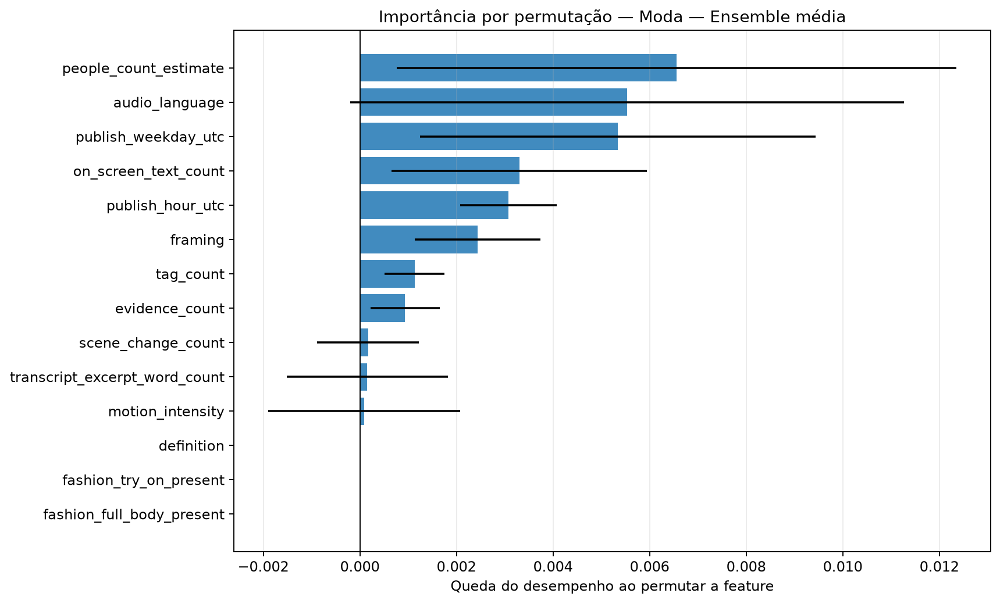
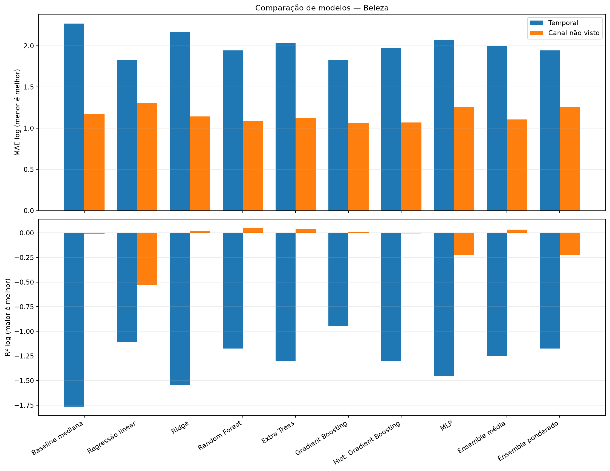
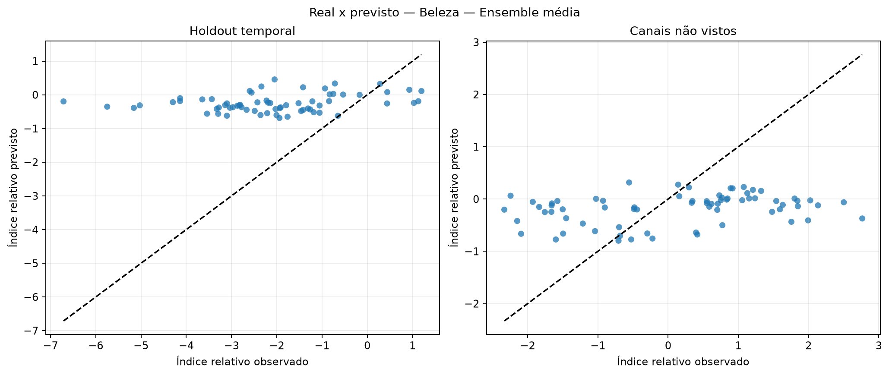
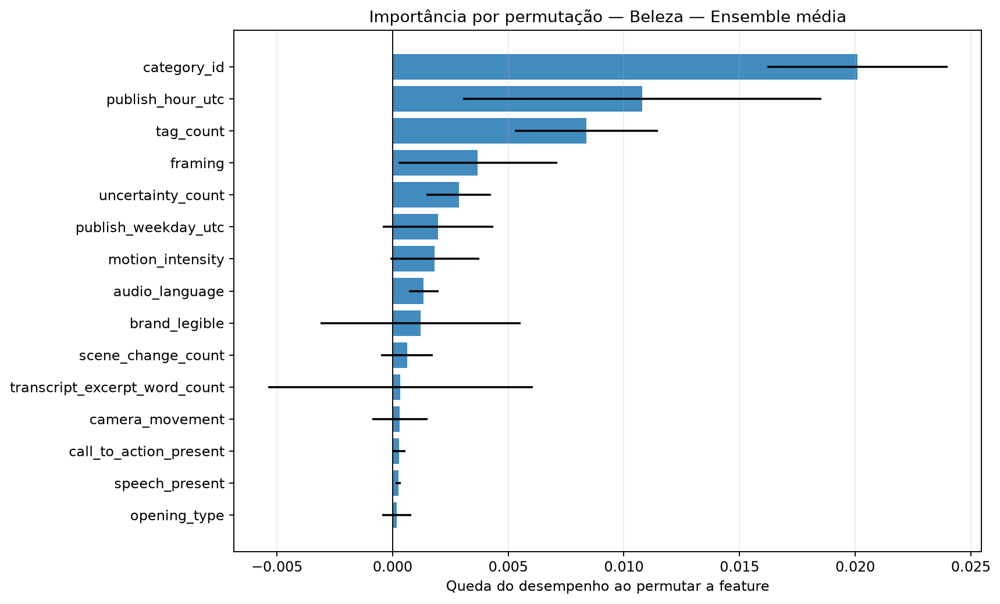

# Avaliação otimizada dos modelos de regressão

Execução: `optimized-vlm1001-relative-combined-20261020`.

> **Resultado exploratório.** O alvo é o desvio de desempenho após ajustar idade do vídeo e escala histórica do canal somente no treino. Isso permite comparar os snapshots atuais sem fingir que são views_30d.

## Método

A busca usa somente o treino temporal externo. Dentro dele, folds expanding-window ajustam hiperparâmetros, escalonamento e seleção de features. Para o corte por canal, uma busca interna separada usa exclusivamente os canais de treino. Os dois holdouts ficam isolados até a avaliação.

Colunas constantes são removidas com VarianceThreshold. A busca compara StandardScaler e RobustScaler e testa seleção por F-test, informação mútua e importância de Extra Trees.

Os ensembles combinam Ridge, Random Forest, Gradient Boosting e MLP. Os pesos do ensemble ponderado são aprendidos em previsões out-of-fold com restrição de pesos não negativos.

## Resultados por setor

### Automotivo

Amostra comum: 346 vídeos, 10 canais e 0 alvos em horizonte fixo.

Escolha pela validação interna: **Random Forest**. Melhor observado no holdout temporal: **Gradient Boosting**. Melhor observado em canais não vistos: **Random Forest**.

| Modelo | Tipo | MAE log interno | MAE log temporal | R² temporal | MAE log canal | R² canal | Spearman temporal |
|---|---|---:|---:|---:|---:|---:|---:|
| Baseline mediana | baseline | — | 1.033 | -0.142 | 0.873 | -0.275 | — |
| Regressão linear | base | 1.072 | 0.903 | 0.133 | 1.140 | -1.311 | 0.403 |
| Ridge | base | 0.916 | 0.968 | 0.003 | 0.901 | -0.332 | 0.385 |
| Random Forest | base | 0.843 | 0.869 | 0.184 | 0.746 | 0.025 | 0.432 |
| Extra Trees | base | 0.880 | 0.880 | 0.138 | 0.823 | -0.198 | 0.446 |
| Gradient Boosting | base | 0.847 | 0.861 | 0.147 | 0.788 | -0.085 | 0.460 |
| Hist. Gradient Boosting | base | 0.867 | 0.883 | 0.145 | 0.771 | -0.067 | 0.378 |
| MLP | base | 0.914 | 0.940 | 0.008 | 0.750 | -0.004 | 0.127 |
| Ensemble média | ensemble | 0.848 | 0.871 | 0.153 | 0.785 | -0.054 | 0.461 |
| Ensemble ponderado | ensemble | 0.848 | 0.873 | 0.169 | 0.813 | -0.118 | 0.465 |

### Moda

Amostra comum: 328 vídeos, 10 canais e 0 alvos em horizonte fixo.

Escolha pela validação interna: **Ensemble média**. Melhor observado no holdout temporal: **Extra Trees**. Melhor observado em canais não vistos: **Extra Trees**.

| Modelo | Tipo | MAE log interno | MAE log temporal | R² temporal | MAE log canal | R² canal | Spearman temporal |
|---|---|---:|---:|---:|---:|---:|---:|
| Baseline mediana | baseline | — | 1.199 | -0.356 | 1.547 | -0.551 | — |
| Regressão linear | base | 1.730 | 1.298 | -0.506 | 1.622 | -0.629 | 0.065 |
| Ridge | base | 1.250 | 1.148 | -0.260 | 1.588 | -0.575 | 0.088 |
| Random Forest | base | 1.271 | 1.129 | -0.203 | 1.587 | -0.534 | 0.186 |
| Extra Trees | base | 1.264 | 1.115 | -0.172 | 1.521 | -0.428 | 0.229 |
| Gradient Boosting | base | 1.281 | 1.184 | -0.315 | 1.536 | -0.495 | 0.091 |
| Hist. Gradient Boosting | base | 1.377 | 1.128 | -0.342 | 1.554 | -0.523 | 0.167 |
| MLP | base | 1.251 | 1.334 | -0.582 | 1.522 | -0.397 | -0.159 |
| Ensemble média | ensemble | 1.239 | 1.188 | -0.323 | 1.557 | -0.484 | 0.029 |
| Ensemble ponderado | ensemble | 1.251 | 1.334 | -0.582 | 1.531 | -0.457 | -0.159 |

### Beleza

Amostra comum: 326 vídeos, 10 canais e 0 alvos em horizonte fixo.

Escolha pela validação interna: **Ensemble média**. Melhor observado no holdout temporal: **Gradient Boosting**. Melhor observado em canais não vistos: **Gradient Boosting**.

| Modelo | Tipo | MAE log interno | MAE log temporal | R² temporal | MAE log canal | R² canal | Spearman temporal |
|---|---|---:|---:|---:|---:|---:|---:|
| Baseline mediana | baseline | — | 2.268 | -1.764 | 1.170 | -0.015 | — |
| Regressão linear | base | 1.283 | 1.832 | -1.111 | 1.306 | -0.526 | 0.241 |
| Ridge | base | 1.038 | 2.161 | -1.546 | 1.143 | 0.020 | 0.236 |
| Random Forest | base | 1.024 | 1.942 | -1.174 | 1.084 | 0.047 | 0.300 |
| Extra Trees | base | 1.030 | 2.029 | -1.300 | 1.121 | 0.038 | 0.180 |
| Gradient Boosting | base | 1.059 | 1.831 | -0.943 | 1.067 | 0.007 | 0.374 |
| Hist. Gradient Boosting | base | 1.119 | 1.977 | -1.303 | 1.070 | -0.005 | 0.122 |
| MLP | base | 1.096 | 2.067 | -1.452 | 1.254 | -0.228 | 0.130 |
| Ensemble média | ensemble | 1.020 | 1.994 | -1.253 | 1.105 | 0.034 | 0.238 |
| Ensemble ponderado | ensemble | 1.024 | 1.942 | -1.174 | 1.254 | -0.228 | 0.300 |

## Como interpretar

- A seleção principal usa MAE no índice relativo residual; menor é melhor.
- R² negativo indica desempenho quadrático pior que prever a média.
- Spearman mede a capacidade de ordenar criativos, não a precisão em views.
- Diferenças entre validação interna e holdout indicam instabilidade ou mudança de distribuição.
- A importância por permutação foi calculada apenas no holdout temporal e pode oscilar com a amostra pequena.

## Condição para uma decisão final

Usar este índice para comparar e ranquear criativos. A conversão para uma quantidade absoluta de views continua condicionada a um horizonte escolhido e à curva histórica do canal.
