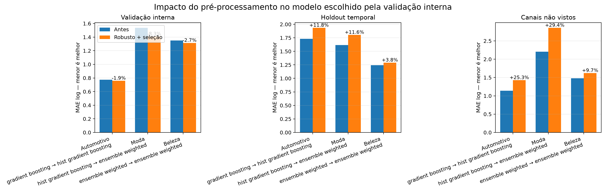

# Comparação do pré-processamento — 16 de outubro de 2026

## Conclusão executiva

O novo pré-processamento está tecnicamente mais correto: remove colunas constantes dentro dos folds, compara `StandardScaler` e `RobustScaler` e testa seleção por F-test, informação mútua e importância de Extra Trees. Entretanto, a busca mais ampla melhorou a validação interna e piorou os holdouts. Isso indica overfitting do processo de seleção na amostra pequena, não falha do encoding.

## Modelo escolhido pela validação interna

| Setor | Antes | Depois | Δ MAE interno | Δ MAE temporal | Δ MAE canal |
|---|---|---|---:|---:|---:|
| Automotivo | Gradient Boosting | HistGradientBoosting | -1,9% | +11,8% | +25,3% |
| Moda | HistGradientBoosting | Ensemble ponderado | -8,3% | +11,6% | +29,4% |
| Beleza | Ensemble ponderado | Ensemble ponderado | -2,7% | +3,8% | +9,7% |

Valores negativos representam redução do erro. A melhora interna não se repetiu fora dos folds usados na busca.

## Melhorias reais observadas no mesmo algoritmo

Comparar o mesmo algoritmo antes e depois isola melhor o efeito do pré-processamento:

| Setor | Algoritmo | Δ MAE temporal | Δ MAE canal | Leitura |
|---|---|---:|---:|---|
| Automotivo | MLP | -18,1% | +22,5% | Melhorou no tempo, mas perdeu generalização entre canais. |
| Automotivo | Ensemble ponderado | +0,5% | -5,1% | Mudança pequena; comportamento relativamente estável. |
| Moda | Gradient Boosting | -15,7% | -9,5% | Melhora consistente nos dois cortes. |
| Moda | Extra Trees | -11,9% | -8,2% | Melhora consistente, mas inferior ao Gradient Boosting. |
| Moda | MLP | -30,8% | -6,7% | MAE melhorou, porém os R² continuam negativos. |
| Beleza | Regressão linear | -9,2% | -9,0% | Melhora consistente, mas canal ainda tem R² negativo. |
| Beleza | Random Forest | +1,0% | -1,3% | Praticamente estável. |
| Beleza | HistGradientBoosting | -5,8% | +5,6% | Ganho temporal com perda entre canais. |

O caso mais convincente foi Gradient Boosting em moda: MAE temporal caiu de 2,050 para 1,729 e MAE de canal caiu de 1,988 para 1,798. O R² temporal passou de -0,384 para -0,080, ainda insuficiente para produção.

## Features e tratamento escolhidos

- Automotivo: duração continuou sendo a feature dominante; MLP preferiu `RobustScaler` com seleção por Extra Trees.
- Moda: duração, marca legível, presença de fala, tags e momento de publicação ficaram entre as features mais relevantes.
- Beleza: tags, duração, hora de publicação, tamanho do título, texto na tela e rosto visível tiveram maior importância.
- Colunas 100% ausentes ou constantes são agora eliminadas por `VarianceThreshold` dentro de cada fold.
- Ausências continuam preservadas na fonte e são imputadas somente no pipeline de treino.

## Efeito de `views_30d`

| Setor | Linhas exploratórias | Linhas com `views_30d` comprovado |
|---|---:|---:|
| Automotivo | 101 | 0 |
| Moda | 105 | 0 |
| Beleza | 100 | 0 |

Não existe comparação de métricas com `views_30d` ainda. Ao aplicar o filtro correto de 29 a 31 dias, a base de treino fica vazia. Estimar esse alvo a partir do snapshot atual criaria um resultado artificial.

## Decisão recomendada

1. Manter remoção de constantes, imputação dentro do fold e busca entre escalonadores.
2. Não promover o vencedor da validação interna atual: a busca de features está sobreajustando a amostra.
3. Adotar validação aninhada com múltiplos cortes temporais e múltiplos grupos de canal.
4. Usar Gradient Boosting como candidato principal provisório para moda.
5. Manter uma shortlist para automotivo e beleza até existir `views_30d`: ensemble/Extra Trees/MLP em automotivo e HistGradientBoosting/Random Forest em beleza.
6. Repetir a comparação quando houver alvos fixos e, então, congelar o algoritmo por setor.

## Artefatos

- Avaliação anterior: `optimized-model-evaluation-2026-10-15-v1`
- Avaliação robusta: `optimized-model-evaluation-2026-10-16-robust-v2`
- Métricas completas: `data/modeling/evaluations/optimized-model-evaluation-2026-10-16-robust-v2/model_metrics.csv`
- Previsões por vídeo: `data/modeling/evaluations/optimized-model-evaluation-2026-10-16-robust-v2/predictions.csv`
