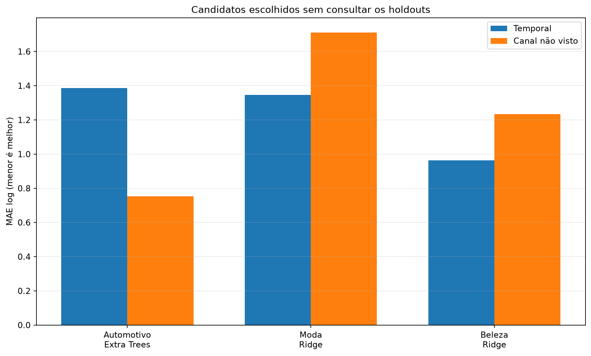
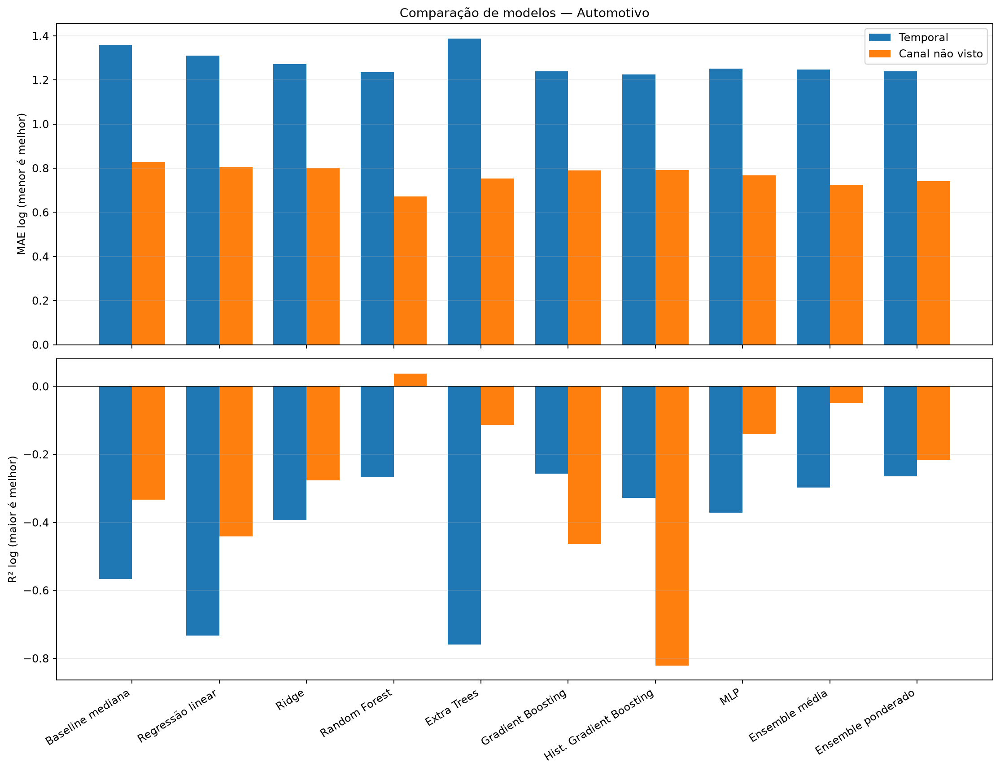
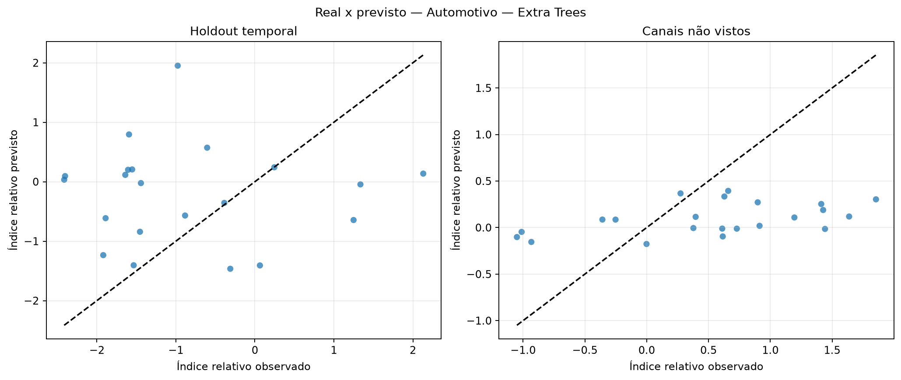
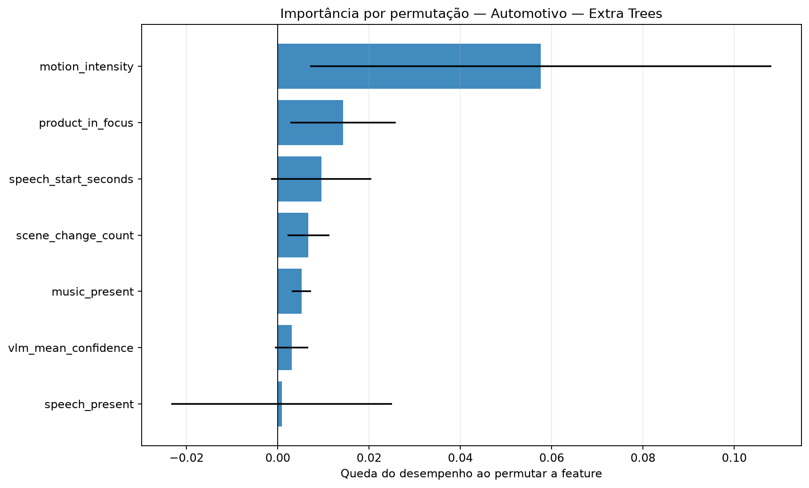
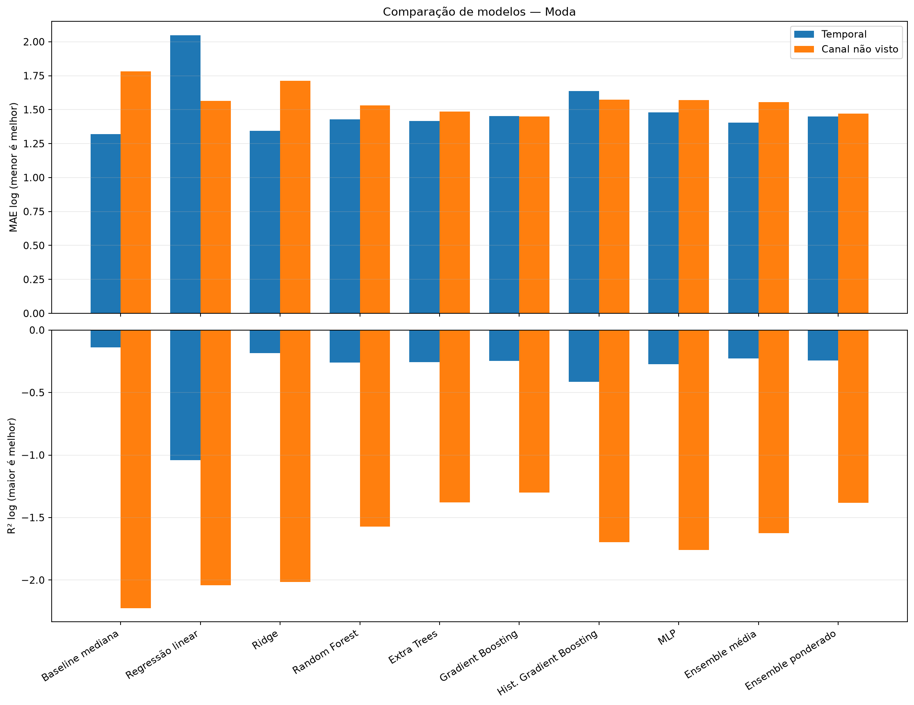
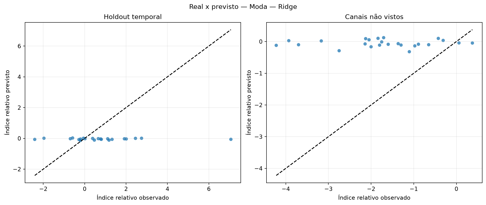
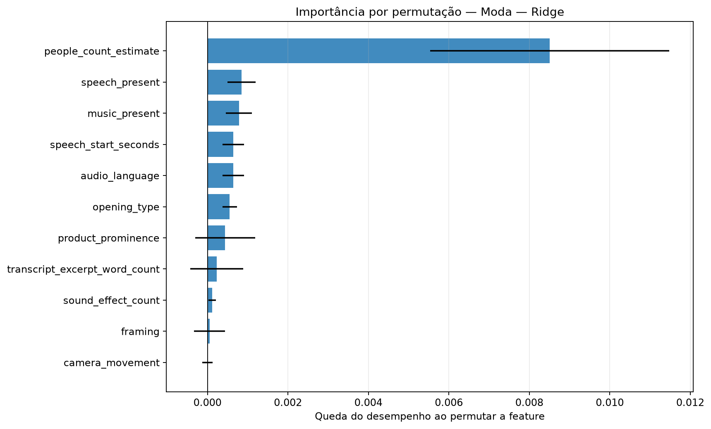
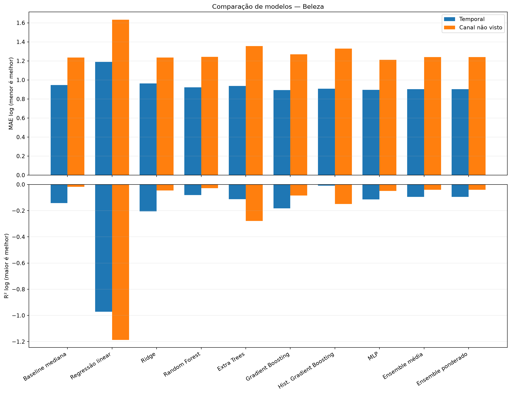
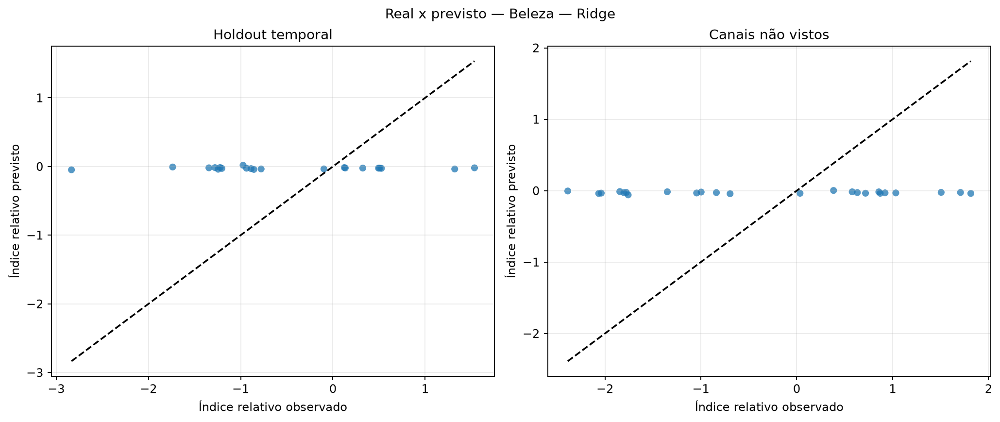
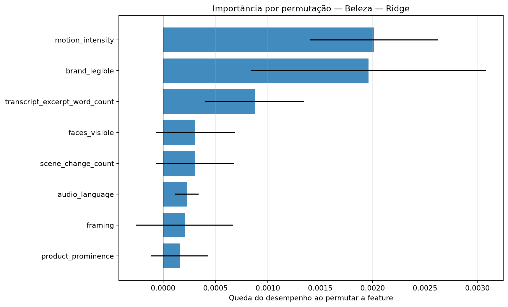

# Avaliação otimizada dos modelos de regressão

Execução: `relative-ablation-audiovisual-314-2026-10-16`.

> **Resultado exploratório.** O alvo é o desvio de desempenho após ajustar idade do vídeo e escala histórica do canal somente no treino. Isso permite comparar os snapshots atuais sem fingir que são views_30d.

## Método

A busca usa somente o treino temporal externo. Dentro dele, folds expanding-window ajustam hiperparâmetros, escalonamento e seleção de features. Para o corte por canal, uma busca interna separada usa exclusivamente os canais de treino. Os dois holdouts ficam isolados até a avaliação.

Colunas constantes são removidas com VarianceThreshold. A busca compara StandardScaler e RobustScaler e testa seleção por F-test, informação mútua e importância de Extra Trees.

Os ensembles combinam Ridge, Random Forest, Gradient Boosting e MLP. Os pesos do ensemble ponderado são aprendidos em previsões out-of-fold com restrição de pesos não negativos.

## Resultados por setor

### Automotivo

Amostra comum: 104 vídeos, 10 canais e 0 alvos em horizonte fixo.

Escolha pela validação interna: **Extra Trees**. Melhor observado no holdout temporal: **Hist. Gradient Boosting**. Melhor observado em canais não vistos: **Random Forest**.

| Modelo | Tipo | MAE log interno | MAE log temporal | R² temporal | MAE log canal | R² canal | Spearman temporal |
|---|---|---:|---:|---:|---:|---:|---:|
| Baseline mediana | baseline | — | 1.359 | -0.566 | 0.829 | -0.334 | — |
| Regressão linear | base | 0.852 | 1.310 | -0.732 | 0.806 | -0.442 | 0.291 |
| Ridge | base | 0.846 | 1.273 | -0.394 | 0.801 | -0.276 | 0.040 |
| Random Forest | base | 0.788 | 1.236 | -0.267 | 0.672 | 0.038 | 0.281 |
| Extra Trees | base | 0.774 | 1.387 | -0.760 | 0.753 | -0.113 | -0.082 |
| Gradient Boosting | base | 0.781 | 1.239 | -0.256 | 0.789 | -0.464 | 0.299 |
| Hist. Gradient Boosting | base | 0.849 | 1.225 | -0.328 | 0.792 | -0.821 | -0.003 |
| MLP | base | 0.799 | 1.251 | -0.372 | 0.768 | -0.139 | 0.088 |
| Ensemble média | ensemble | 0.788 | 1.248 | -0.297 | 0.724 | -0.049 | 0.239 |
| Ensemble ponderado | ensemble | 0.777 | 1.240 | -0.264 | 0.741 | -0.216 | 0.235 |

### Moda

Amostra comum: 107 vídeos, 10 canais e 0 alvos em horizonte fixo.

Escolha pela validação interna: **Ridge**. Melhor observado no holdout temporal: **Ridge**. Melhor observado em canais não vistos: **Gradient Boosting**.

| Modelo | Tipo | MAE log interno | MAE log temporal | R² temporal | MAE log canal | R² canal | Spearman temporal |
|---|---|---:|---:|---:|---:|---:|---:|
| Baseline mediana | baseline | — | 1.321 | -0.140 | 1.783 | -2.224 | — |
| Regressão linear | base | 1.148 | 2.047 | -1.042 | 1.565 | -2.042 | 0.159 |
| Ridge | base | 0.994 | 1.345 | -0.184 | 1.712 | -2.017 | -0.050 |
| Random Forest | base | 1.033 | 1.429 | -0.261 | 1.531 | -1.571 | -0.203 |
| Extra Trees | base | 1.065 | 1.416 | -0.258 | 1.487 | -1.378 | -0.171 |
| Gradient Boosting | base | 1.010 | 1.454 | -0.245 | 1.450 | -1.299 | 0.301 |
| Hist. Gradient Boosting | base | 1.035 | 1.638 | -0.413 | 1.572 | -1.698 | -0.149 |
| MLP | base | 1.059 | 1.481 | -0.273 | 1.569 | -1.759 | 0.034 |
| Ensemble média | ensemble | 0.996 | 1.403 | -0.226 | 1.556 | -1.623 | 0.153 |
| Ensemble ponderado | ensemble | 1.000 | 1.451 | -0.242 | 1.470 | -1.382 | 0.244 |

### Beleza

Amostra comum: 103 vídeos, 10 canais e 0 alvos em horizonte fixo.

Escolha pela validação interna: **Ridge**. Melhor observado no holdout temporal: **Gradient Boosting**. Melhor observado em canais não vistos: **MLP**.

| Modelo | Tipo | MAE log interno | MAE log temporal | R² temporal | MAE log canal | R² canal | Spearman temporal |
|---|---|---:|---:|---:|---:|---:|---:|
| Baseline mediana | baseline | — | 0.946 | -0.143 | 1.235 | -0.017 | — |
| Regressão linear | base | 1.425 | 1.188 | -0.971 | 1.632 | -1.186 | 0.281 |
| Ridge | base | 0.962 | 0.963 | -0.205 | 1.235 | -0.046 | -0.094 |
| Random Forest | base | 1.151 | 0.923 | -0.081 | 1.243 | -0.029 | 0.353 |
| Extra Trees | base | 1.187 | 0.936 | -0.112 | 1.356 | -0.278 | 0.288 |
| Gradient Boosting | base | 1.291 | 0.894 | -0.183 | 1.269 | -0.085 | 0.234 |
| Hist. Gradient Boosting | base | 1.132 | 0.907 | -0.008 | 1.329 | -0.149 | 0.249 |
| MLP | base | 1.083 | 0.895 | -0.113 | 1.211 | -0.049 | 0.140 |
| Ensemble média | ensemble | 1.090 | 0.904 | -0.094 | 1.240 | -0.040 | 0.287 |
| Ensemble ponderado | ensemble | 1.090 | 0.904 | -0.094 | 1.240 | -0.040 | 0.287 |

## Como interpretar

- A seleção principal usa MAE no índice relativo residual; menor é melhor.
- R² negativo indica desempenho quadrático pior que prever a média.
- Spearman mede a capacidade de ordenar criativos, não a precisão em views.
- Diferenças entre validação interna e holdout indicam instabilidade ou mudança de distribuição.
- A importância por permutação foi calculada apenas no holdout temporal e pode oscilar com a amostra pequena.

## Condição para uma decisão final

Usar este índice para comparar e ranquear criativos. A conversão para uma quantidade absoluta de views continua condicionada a um horizonte escolhido e à curva histórica do canal.
