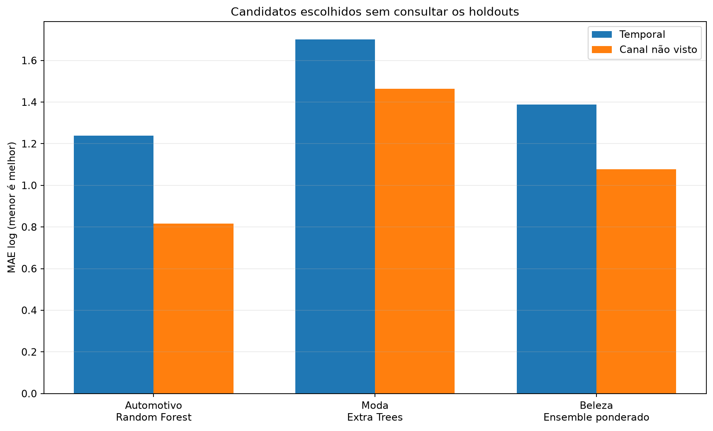
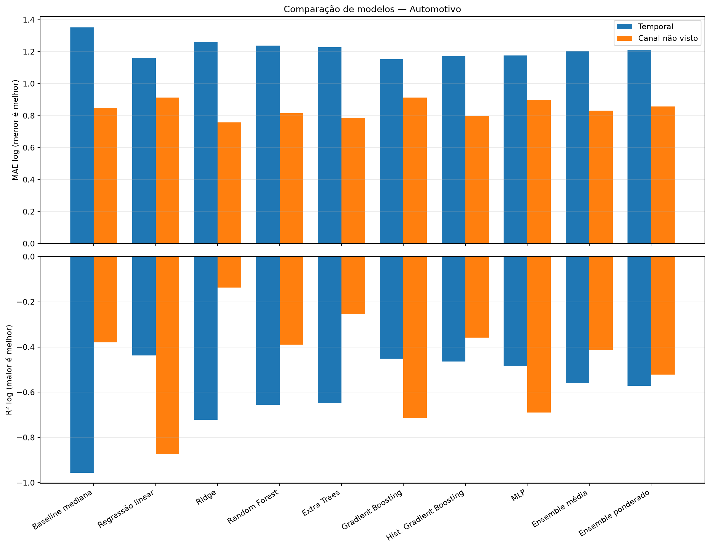
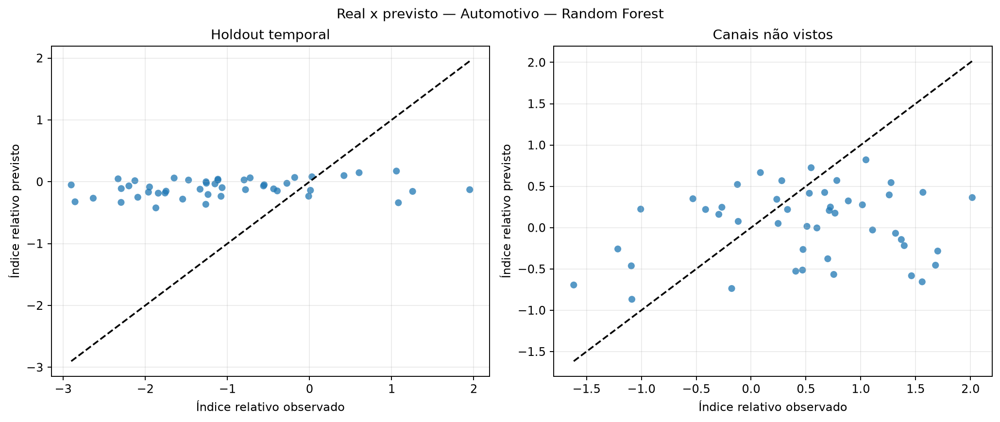
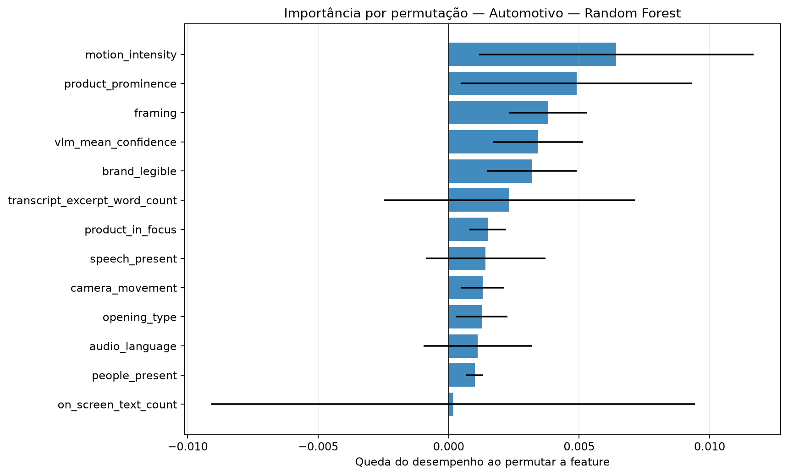
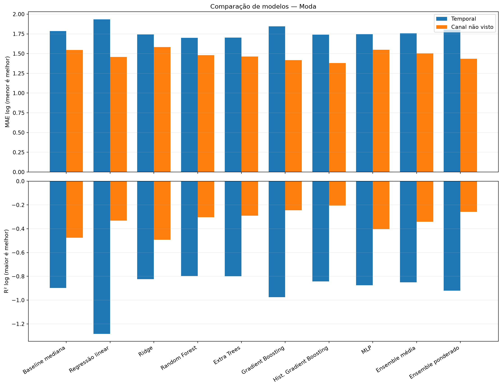
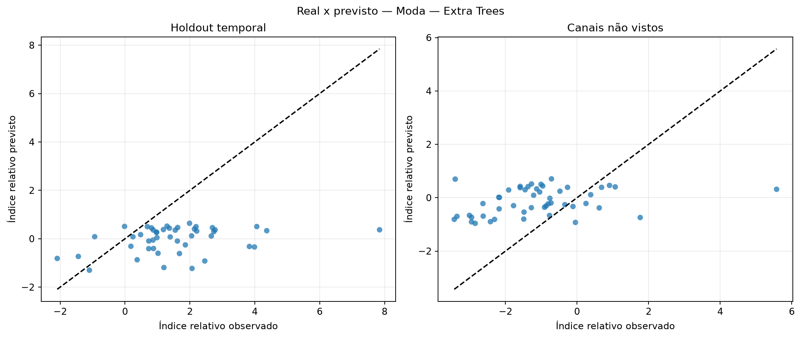
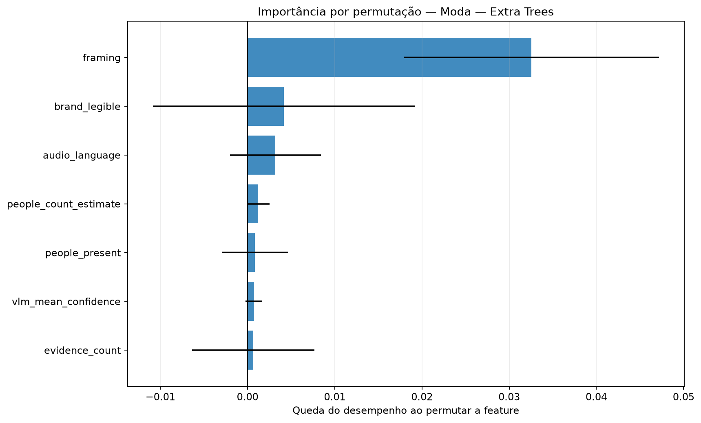
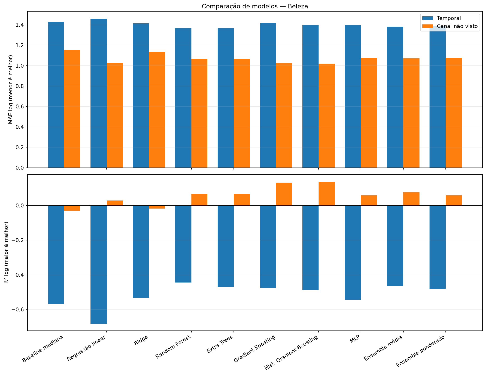
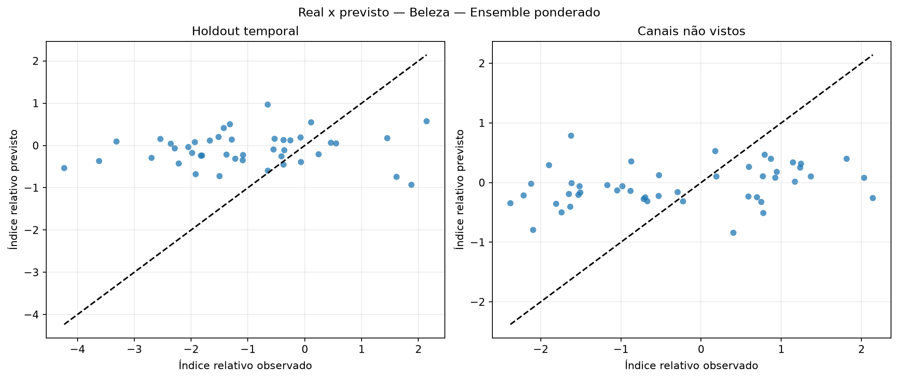
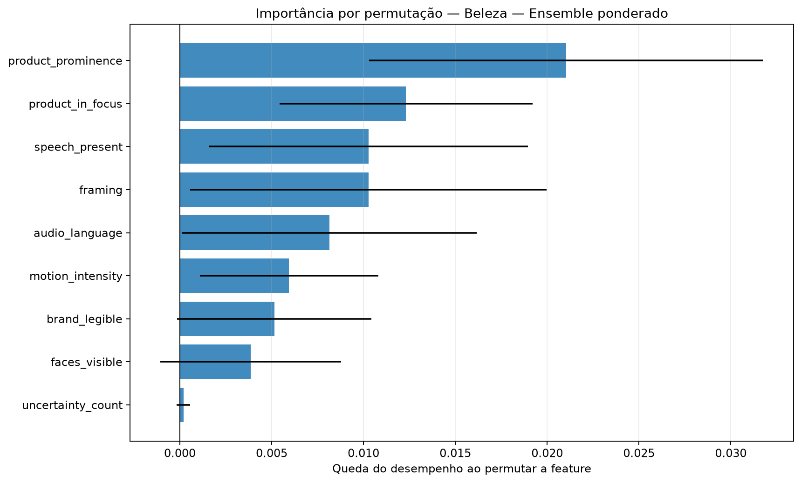

# Avaliação otimizada dos modelos de regressão

Execução: `relative-ablation-audiovisual-665-2026-10-16`.

> **Resultado exploratório.** O alvo é o desvio de desempenho após ajustar idade do vídeo e escala histórica do canal somente no treino. Isso permite comparar os snapshots atuais sem fingir que são views_30d.

## Método

A busca usa somente o treino temporal externo. Dentro dele, folds expanding-window ajustam hiperparâmetros, escalonamento e seleção de features. Para o corte por canal, uma busca interna separada usa exclusivamente os canais de treino. Os dois holdouts ficam isolados até a avaliação.

Colunas constantes são removidas com VarianceThreshold. A busca compara StandardScaler e RobustScaler e testa seleção por F-test, informação mútua e importância de Extra Trees.

Os ensembles combinam Ridge, Random Forest, Gradient Boosting e MLP. Os pesos do ensemble ponderado são aprendidos em previsões out-of-fold com restrição de pesos não negativos.

## Resultados por setor

### Automotivo

Amostra comum: 226 vídeos, 10 canais e 0 alvos em horizonte fixo.

Escolha pela validação interna: **Random Forest**. Melhor observado no holdout temporal: **Gradient Boosting**. Melhor observado em canais não vistos: **Ridge**.

| Modelo | Tipo | MAE log interno | MAE log temporal | R² temporal | MAE log canal | R² canal | Spearman temporal |
|---|---|---:|---:|---:|---:|---:|---:|
| Baseline mediana | baseline | — | 1.351 | -0.955 | 0.849 | -0.379 | — |
| Regressão linear | base | 0.998 | 1.162 | -0.437 | 0.913 | -0.872 | 0.384 |
| Ridge | base | 0.838 | 1.259 | -0.722 | 0.757 | -0.137 | 0.207 |
| Random Forest | base | 0.832 | 1.239 | -0.655 | 0.816 | -0.390 | 0.294 |
| Extra Trees | base | 0.844 | 1.228 | -0.648 | 0.786 | -0.254 | 0.320 |
| Gradient Boosting | base | 0.854 | 1.152 | -0.451 | 0.913 | -0.714 | 0.203 |
| Hist. Gradient Boosting | base | 0.837 | 1.172 | -0.465 | 0.800 | -0.358 | 0.410 |
| MLP | base | 0.853 | 1.176 | -0.486 | 0.899 | -0.690 | 0.383 |
| Ensemble média | ensemble | 0.835 | 1.203 | -0.560 | 0.832 | -0.414 | 0.296 |
| Ensemble ponderado | ensemble | 0.834 | 1.207 | -0.572 | 0.858 | -0.523 | 0.334 |

### Moda

Amostra comum: 226 vídeos, 10 canais e 0 alvos em horizonte fixo.

Escolha pela validação interna: **Extra Trees**. Melhor observado no holdout temporal: **Random Forest**. Melhor observado em canais não vistos: **Hist. Gradient Boosting**.

| Modelo | Tipo | MAE log interno | MAE log temporal | R² temporal | MAE log canal | R² canal | Spearman temporal |
|---|---|---:|---:|---:|---:|---:|---:|
| Baseline mediana | baseline | — | 1.786 | -0.898 | 1.546 | -0.475 | — |
| Regressão linear | base | 1.355 | 1.933 | -1.283 | 1.458 | -0.332 | 0.201 |
| Ridge | base | 1.173 | 1.743 | -0.823 | 1.583 | -0.493 | 0.262 |
| Random Forest | base | 1.191 | 1.701 | -0.798 | 1.481 | -0.303 | 0.249 |
| Extra Trees | base | 1.157 | 1.702 | -0.799 | 1.464 | -0.289 | 0.264 |
| Gradient Boosting | base | 1.171 | 1.846 | -0.975 | 1.419 | -0.245 | 0.214 |
| Hist. Gradient Boosting | base | 1.207 | 1.741 | -0.843 | 1.379 | -0.205 | 0.357 |
| MLP | base | 1.169 | 1.747 | -0.876 | 1.549 | -0.404 | 0.210 |
| Ensemble média | ensemble | 1.165 | 1.757 | -0.851 | 1.504 | -0.341 | 0.258 |
| Ensemble ponderado | ensemble | 1.169 | 1.804 | -0.921 | 1.434 | -0.259 | 0.262 |

### Beleza

Amostra comum: 213 vídeos, 10 canais e 0 alvos em horizonte fixo.

Escolha pela validação interna: **Ensemble ponderado**. Melhor observado no holdout temporal: **Random Forest**. Melhor observado em canais não vistos: **Hist. Gradient Boosting**.

| Modelo | Tipo | MAE log interno | MAE log temporal | R² temporal | MAE log canal | R² canal | Spearman temporal |
|---|---|---:|---:|---:|---:|---:|---:|
| Baseline mediana | baseline | — | 1.430 | -0.570 | 1.154 | -0.030 | — |
| Regressão linear | base | 1.402 | 1.459 | -0.683 | 1.027 | 0.029 | 0.102 |
| Ridge | base | 1.031 | 1.414 | -0.533 | 1.137 | -0.018 | 0.138 |
| Random Forest | base | 1.090 | 1.366 | -0.445 | 1.069 | 0.066 | 0.126 |
| Extra Trees | base | 1.085 | 1.368 | -0.470 | 1.068 | 0.066 | 0.121 |
| Gradient Boosting | base | 1.124 | 1.417 | -0.475 | 1.025 | 0.131 | 0.100 |
| Hist. Gradient Boosting | base | 1.091 | 1.397 | -0.487 | 1.019 | 0.137 | -0.049 |
| MLP | base | 1.013 | 1.397 | -0.545 | 1.077 | 0.059 | 0.166 |
| Ensemble média | ensemble | 0.992 | 1.384 | -0.464 | 1.072 | 0.076 | 0.165 |
| Ensemble ponderado | ensemble | 0.979 | 1.387 | -0.480 | 1.077 | 0.059 | 0.137 |

## Como interpretar

- A seleção principal usa MAE no índice relativo residual; menor é melhor.
- R² negativo indica desempenho quadrático pior que prever a média.
- Spearman mede a capacidade de ordenar criativos, não a precisão em views.
- Diferenças entre validação interna e holdout indicam instabilidade ou mudança de distribuição.
- A importância por permutação foi calculada apenas no holdout temporal e pode oscilar com a amostra pequena.

## Condição para uma decisão final

Usar este índice para comparar e ranquear criativos. A conversão para uma quantidade absoluta de views continua condicionada a um horizonte escolhido e à curva histórica do canal.
