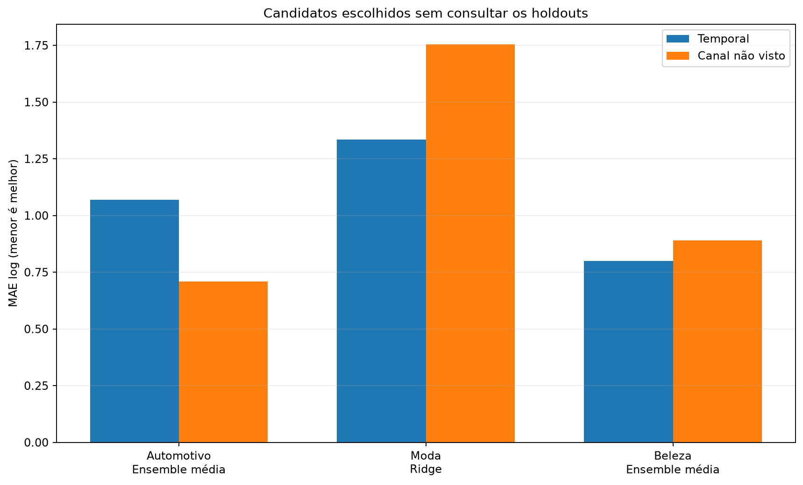
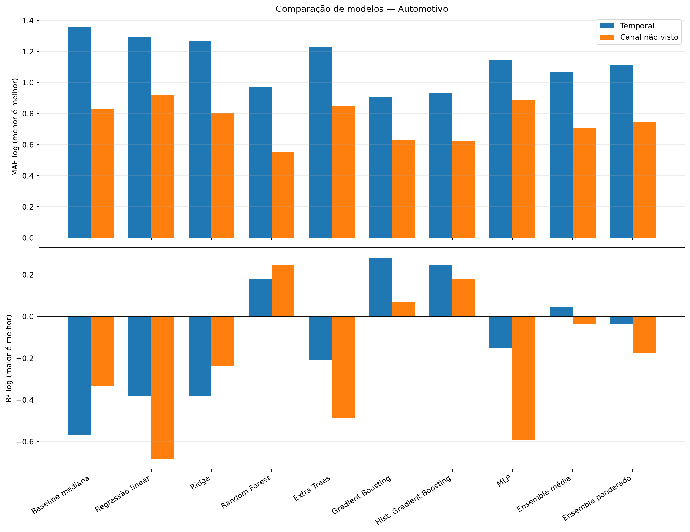
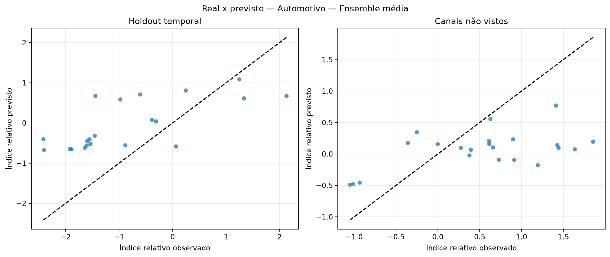
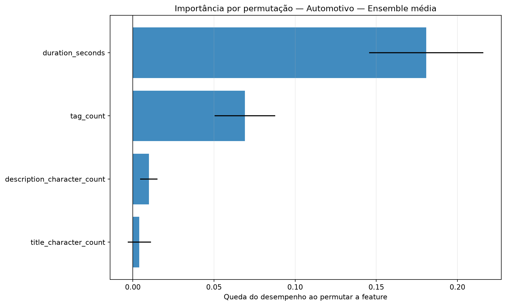
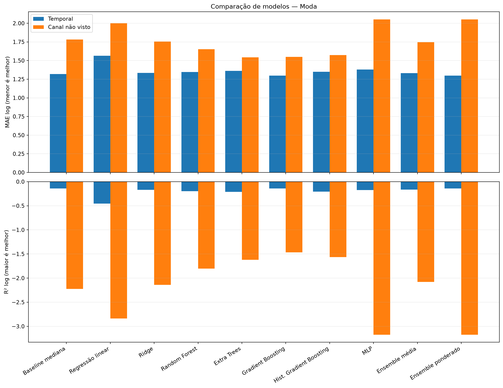
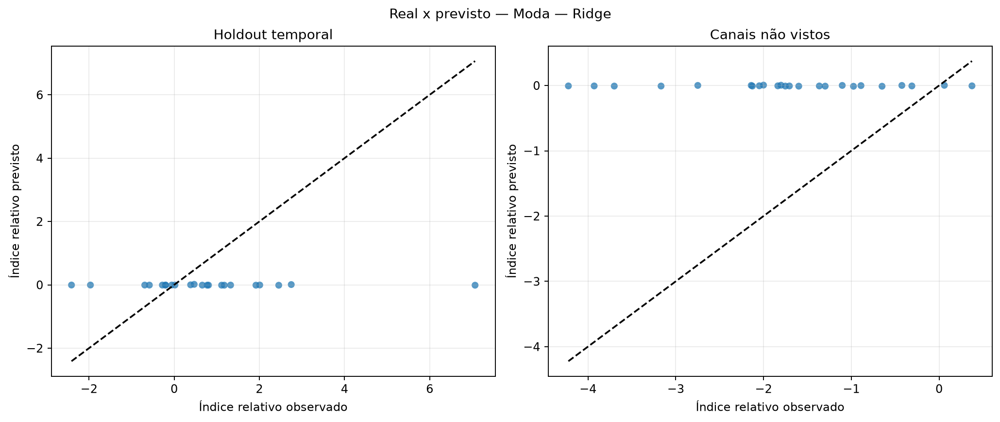
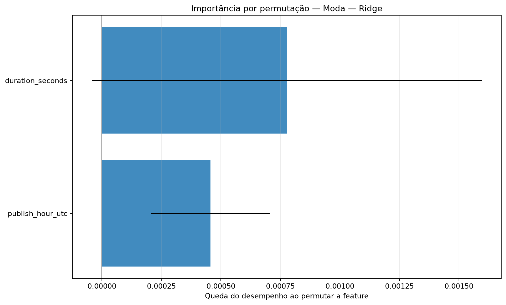
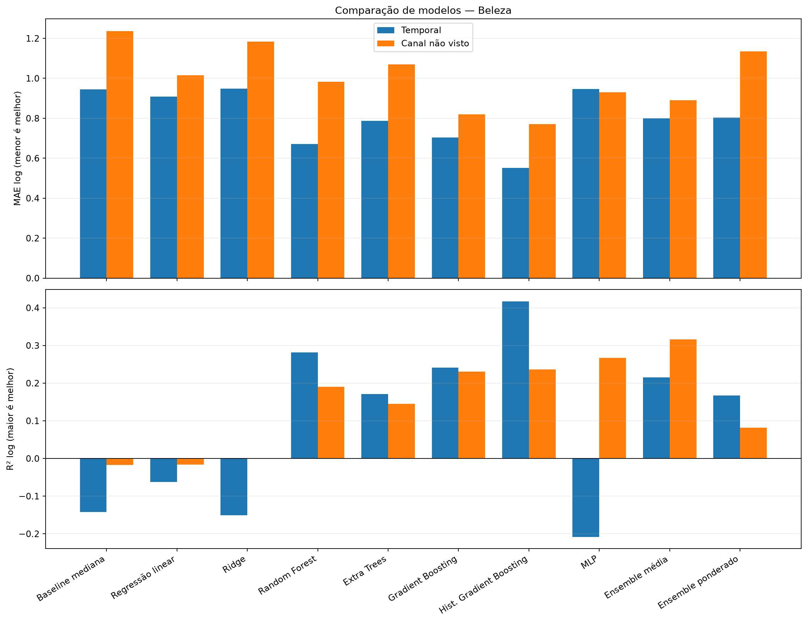
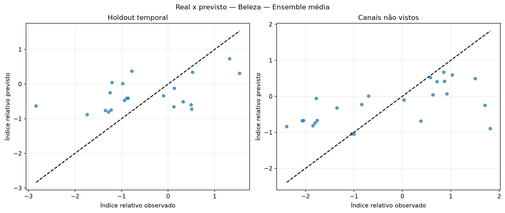
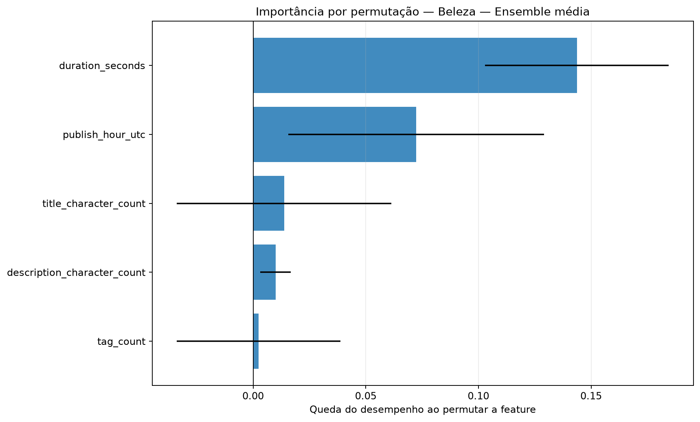

# Avaliação otimizada dos modelos de regressão

Execução: `relative-ablation-metadata-314-2026-10-16`.

> **Resultado exploratório.** O alvo é o desvio de desempenho após ajustar idade do vídeo e escala histórica do canal somente no treino. Isso permite comparar os snapshots atuais sem fingir que são views_30d.

## Método

A busca usa somente o treino temporal externo. Dentro dele, folds expanding-window ajustam hiperparâmetros, escalonamento e seleção de features. Para o corte por canal, uma busca interna separada usa exclusivamente os canais de treino. Os dois holdouts ficam isolados até a avaliação.

Colunas constantes são removidas com VarianceThreshold. A busca compara StandardScaler e RobustScaler e testa seleção por F-test, informação mútua e importância de Extra Trees.

Os ensembles combinam Ridge, Random Forest, Gradient Boosting e MLP. Os pesos do ensemble ponderado são aprendidos em previsões out-of-fold com restrição de pesos não negativos.

## Resultados por setor

### Automotivo

Amostra comum: 104 vídeos, 10 canais e 0 alvos em horizonte fixo.

Escolha pela validação interna: **Ensemble média**. Melhor observado no holdout temporal: **Gradient Boosting**. Melhor observado em canais não vistos: **Random Forest**.

| Modelo | Tipo | MAE log interno | MAE log temporal | R² temporal | MAE log canal | R² canal | Spearman temporal |
|---|---|---:|---:|---:|---:|---:|---:|
| Baseline mediana | baseline | — | 1.359 | -0.566 | 0.829 | -0.334 | — |
| Regressão linear | base | 1.089 | 1.295 | -0.384 | 0.917 | -0.684 | 0.552 |
| Ridge | base | 0.844 | 1.266 | -0.380 | 0.802 | -0.239 | 0.643 |
| Random Forest | base | 0.733 | 0.973 | 0.181 | 0.552 | 0.245 | 0.792 |
| Extra Trees | base | 0.766 | 1.226 | -0.206 | 0.849 | -0.489 | 0.700 |
| Gradient Boosting | base | 0.742 | 0.909 | 0.281 | 0.633 | 0.068 | 0.639 |
| Hist. Gradient Boosting | base | 0.758 | 0.932 | 0.247 | 0.620 | 0.180 | 0.721 |
| MLP | base | 0.790 | 1.146 | -0.151 | 0.890 | -0.594 | 0.673 |
| Ensemble média | ensemble | 0.708 | 1.068 | 0.047 | 0.710 | -0.037 | 0.719 |
| Ensemble ponderado | ensemble | 0.727 | 1.115 | -0.037 | 0.748 | -0.177 | 0.683 |

### Moda

Amostra comum: 107 vídeos, 10 canais e 0 alvos em horizonte fixo.

Escolha pela validação interna: **Ridge**. Melhor observado no holdout temporal: **Gradient Boosting**. Melhor observado em canais não vistos: **Extra Trees**.

| Modelo | Tipo | MAE log interno | MAE log temporal | R² temporal | MAE log canal | R² canal | Spearman temporal |
|---|---|---:|---:|---:|---:|---:|---:|
| Baseline mediana | baseline | — | 1.321 | -0.140 | 1.783 | -2.224 | — |
| Regressão linear | base | 1.125 | 1.565 | -0.456 | 1.999 | -2.837 | -0.036 |
| Ridge | base | 0.991 | 1.334 | -0.167 | 1.755 | -2.142 | -0.354 |
| Random Forest | base | 1.024 | 1.347 | -0.200 | 1.652 | -1.804 | 0.356 |
| Extra Trees | base | 1.021 | 1.363 | -0.213 | 1.542 | -1.622 | 0.143 |
| Gradient Boosting | base | 1.027 | 1.297 | -0.140 | 1.548 | -1.464 | 0.261 |
| Hist. Gradient Boosting | base | 1.016 | 1.350 | -0.208 | 1.572 | -1.563 | 0.255 |
| MLP | base | 1.001 | 1.379 | -0.175 | 2.051 | -3.173 | 0.374 |
| Ensemble média | ensemble | 1.006 | 1.331 | -0.163 | 1.745 | -2.081 | 0.301 |
| Ensemble ponderado | ensemble | 1.027 | 1.297 | -0.140 | 2.051 | -3.173 | 0.261 |

### Beleza

Amostra comum: 103 vídeos, 10 canais e 0 alvos em horizonte fixo.

Escolha pela validação interna: **Ensemble média**. Melhor observado no holdout temporal: **Hist. Gradient Boosting**. Melhor observado em canais não vistos: **Hist. Gradient Boosting**.

| Modelo | Tipo | MAE log interno | MAE log temporal | R² temporal | MAE log canal | R² canal | Spearman temporal |
|---|---|---:|---:|---:|---:|---:|---:|
| Baseline mediana | baseline | — | 0.946 | -0.143 | 1.235 | -0.017 | — |
| Regressão linear | base | 0.987 | 0.908 | -0.062 | 1.016 | -0.017 | 0.129 |
| Ridge | base | 0.942 | 0.949 | -0.151 | 1.184 | 0.000 | 0.448 |
| Random Forest | base | 0.942 | 0.671 | 0.282 | 0.983 | 0.191 | 0.595 |
| Extra Trees | base | 0.930 | 0.787 | 0.171 | 1.070 | 0.145 | 0.530 |
| Gradient Boosting | base | 1.005 | 0.703 | 0.242 | 0.819 | 0.230 | 0.535 |
| Hist. Gradient Boosting | base | 0.979 | 0.552 | 0.417 | 0.770 | 0.237 | 0.713 |
| MLP | base | 0.908 | 0.947 | -0.208 | 0.931 | 0.267 | 0.275 |
| Ensemble média | ensemble | 0.858 | 0.800 | 0.215 | 0.891 | 0.316 | 0.526 |
| Ensemble ponderado | ensemble | 0.861 | 0.803 | 0.167 | 1.135 | 0.082 | 0.514 |

## Como interpretar

- A seleção principal usa MAE no índice relativo residual; menor é melhor.
- R² negativo indica desempenho quadrático pior que prever a média.
- Spearman mede a capacidade de ordenar criativos, não a precisão em views.
- Diferenças entre validação interna e holdout indicam instabilidade ou mudança de distribuição.
- A importância por permutação foi calculada apenas no holdout temporal e pode oscilar com a amostra pequena.

## Condição para uma decisão final

Usar este índice para comparar e ranquear criativos. A conversão para uma quantidade absoluta de views continua condicionada a um horizonte escolhido e à curva histórica do canal.
