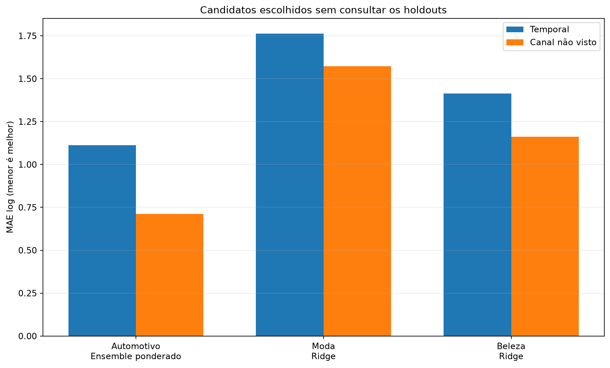
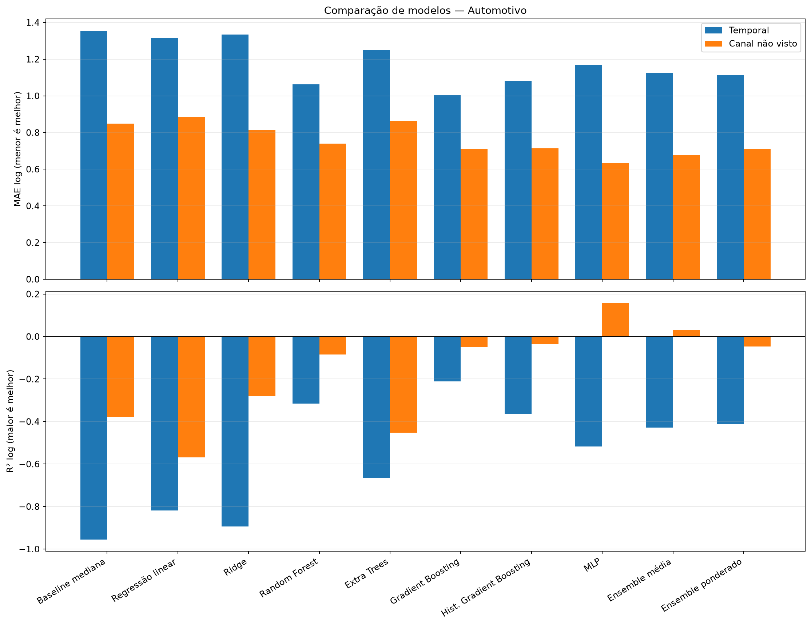
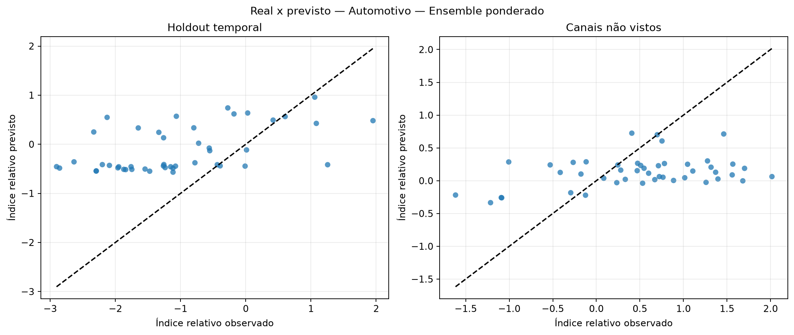
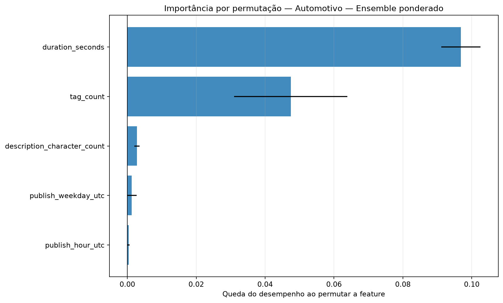
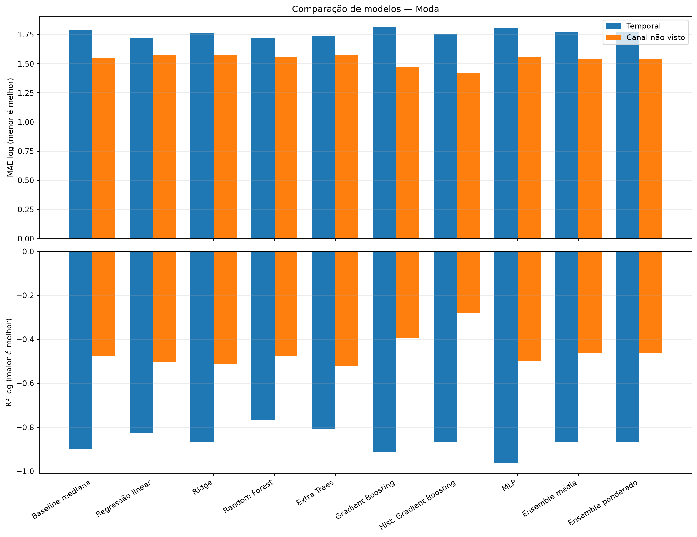
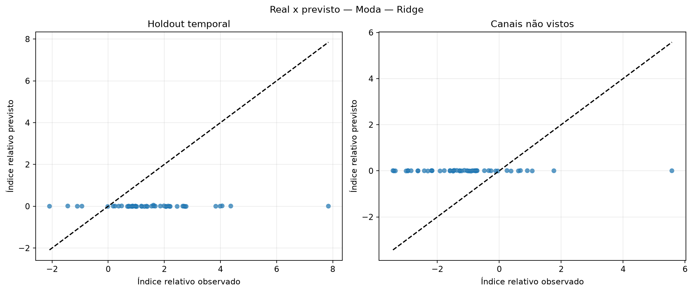
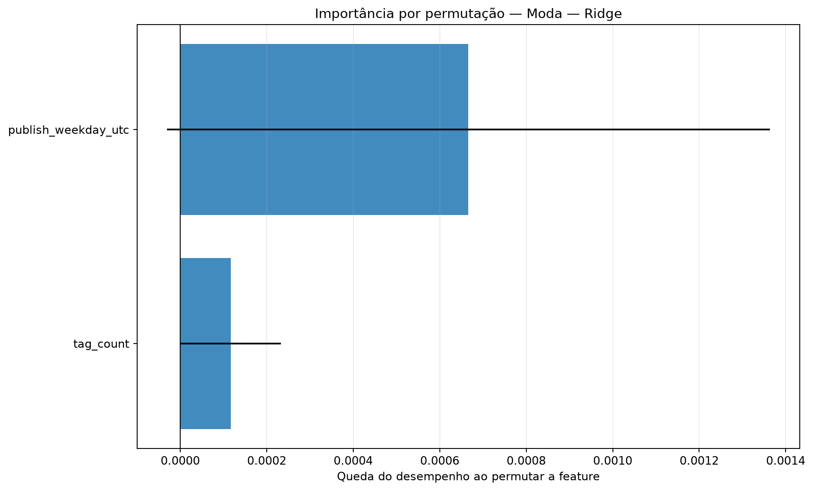
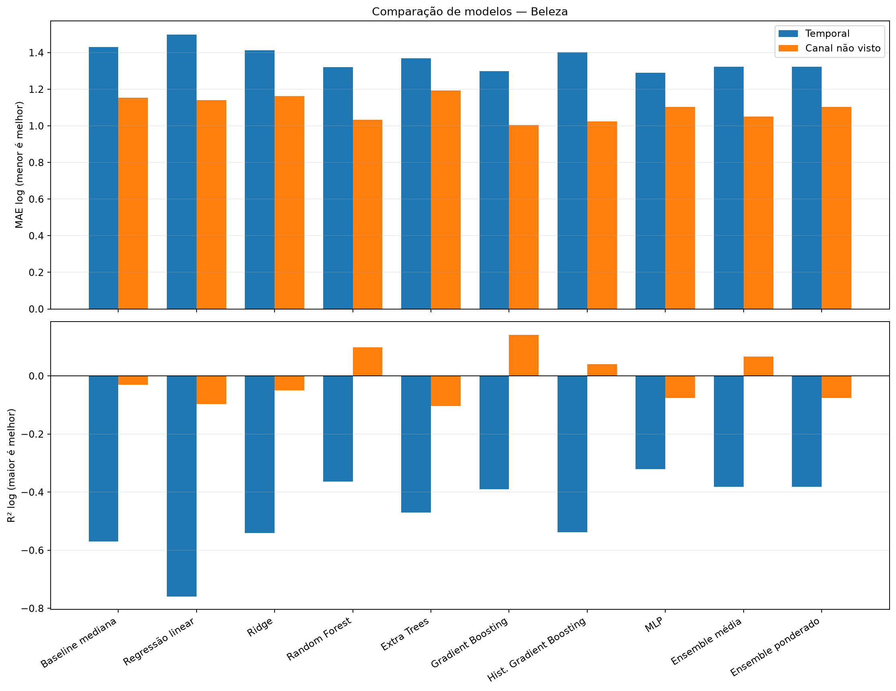
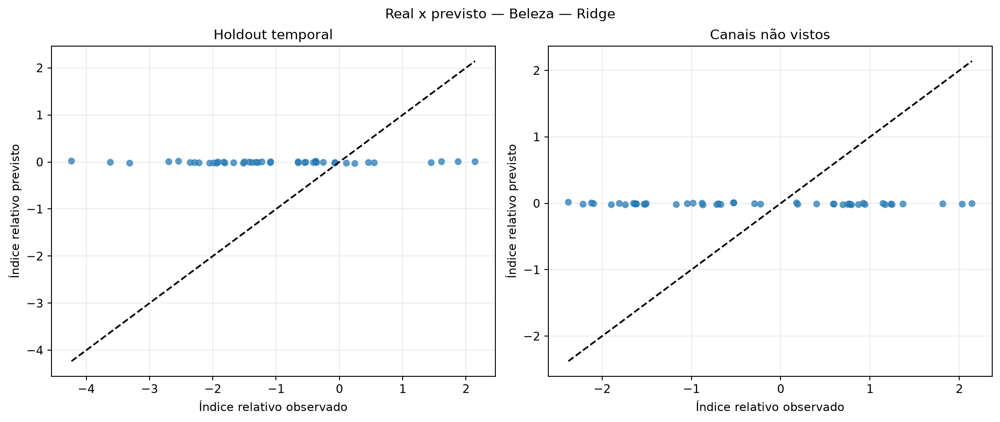
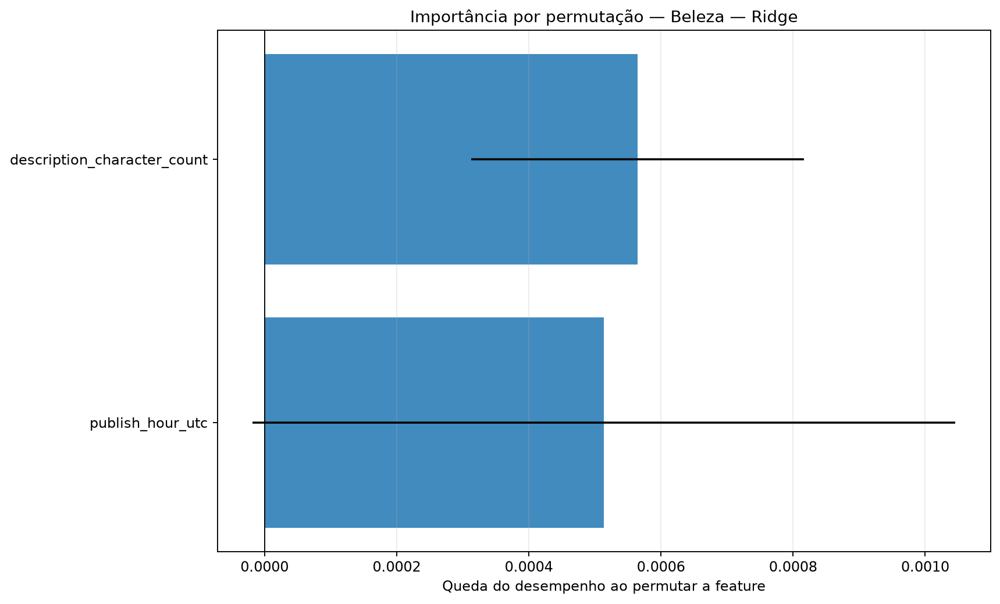

# Avaliação otimizada dos modelos de regressão

Execução: `relative-ablation-metadata-665-2026-10-16`.

> **Resultado exploratório.** O alvo é o desvio de desempenho após ajustar idade do vídeo e escala histórica do canal somente no treino. Isso permite comparar os snapshots atuais sem fingir que são views_30d.

## Método

A busca usa somente o treino temporal externo. Dentro dele, folds expanding-window ajustam hiperparâmetros, escalonamento e seleção de features. Para o corte por canal, uma busca interna separada usa exclusivamente os canais de treino. Os dois holdouts ficam isolados até a avaliação.

Colunas constantes são removidas com VarianceThreshold. A busca compara StandardScaler e RobustScaler e testa seleção por F-test, informação mútua e importância de Extra Trees.

Os ensembles combinam Ridge, Random Forest, Gradient Boosting e MLP. Os pesos do ensemble ponderado são aprendidos em previsões out-of-fold com restrição de pesos não negativos.

## Resultados por setor

### Automotivo

Amostra comum: 226 vídeos, 10 canais e 0 alvos em horizonte fixo.

Escolha pela validação interna: **Ensemble ponderado**. Melhor observado no holdout temporal: **Gradient Boosting**. Melhor observado em canais não vistos: **MLP**.

| Modelo | Tipo | MAE log interno | MAE log temporal | R² temporal | MAE log canal | R² canal | Spearman temporal |
|---|---|---:|---:|---:|---:|---:|---:|
| Baseline mediana | baseline | — | 1.351 | -0.955 | 0.849 | -0.379 | — |
| Regressão linear | base | 0.964 | 1.314 | -0.818 | 0.885 | -0.568 | 0.546 |
| Ridge | base | 0.828 | 1.334 | -0.893 | 0.815 | -0.282 | 0.504 |
| Random Forest | base | 0.756 | 1.063 | -0.316 | 0.740 | -0.084 | 0.472 |
| Extra Trees | base | 0.772 | 1.249 | -0.665 | 0.863 | -0.453 | 0.422 |
| Gradient Boosting | base | 0.720 | 1.004 | -0.212 | 0.712 | -0.051 | 0.524 |
| Hist. Gradient Boosting | base | 0.779 | 1.081 | -0.364 | 0.714 | -0.035 | 0.300 |
| MLP | base | 0.802 | 1.168 | -0.518 | 0.635 | 0.158 | 0.446 |
| Ensemble média | ensemble | 0.733 | 1.126 | -0.429 | 0.678 | 0.030 | 0.505 |
| Ensemble ponderado | ensemble | 0.718 | 1.113 | -0.413 | 0.711 | -0.048 | 0.534 |

### Moda

Amostra comum: 226 vídeos, 10 canais e 0 alvos em horizonte fixo.

Escolha pela validação interna: **Ridge**. Melhor observado no holdout temporal: **Regressão linear**. Melhor observado em canais não vistos: **Hist. Gradient Boosting**.

| Modelo | Tipo | MAE log interno | MAE log temporal | R² temporal | MAE log canal | R² canal | Spearman temporal |
|---|---|---:|---:|---:|---:|---:|---:|
| Baseline mediana | baseline | — | 1.786 | -0.898 | 1.546 | -0.475 | — |
| Regressão linear | base | 1.354 | 1.719 | -0.827 | 1.574 | -0.505 | -0.057 |
| Ridge | base | 1.174 | 1.764 | -0.865 | 1.573 | -0.511 | 0.024 |
| Random Forest | base | 1.255 | 1.721 | -0.769 | 1.561 | -0.475 | 0.508 |
| Extra Trees | base | 1.236 | 1.740 | -0.806 | 1.574 | -0.524 | 0.478 |
| Gradient Boosting | base | 1.231 | 1.815 | -0.915 | 1.469 | -0.396 | 0.472 |
| Hist. Gradient Boosting | base | 1.272 | 1.758 | -0.866 | 1.420 | -0.281 | 0.295 |
| MLP | base | 1.198 | 1.804 | -0.964 | 1.554 | -0.498 | -0.009 |
| Ensemble média | ensemble | 1.194 | 1.775 | -0.866 | 1.539 | -0.463 | 0.440 |
| Ensemble ponderado | ensemble | 1.194 | 1.775 | -0.866 | 1.539 | -0.463 | 0.440 |

### Beleza

Amostra comum: 213 vídeos, 10 canais e 0 alvos em horizonte fixo.

Escolha pela validação interna: **Ridge**. Melhor observado no holdout temporal: **MLP**. Melhor observado em canais não vistos: **Gradient Boosting**.

| Modelo | Tipo | MAE log interno | MAE log temporal | R² temporal | MAE log canal | R² canal | Spearman temporal |
|---|---|---:|---:|---:|---:|---:|---:|
| Baseline mediana | baseline | — | 1.430 | -0.570 | 1.154 | -0.030 | — |
| Regressão linear | base | 1.400 | 1.498 | -0.759 | 1.140 | -0.096 | -0.013 |
| Ridge | base | 1.032 | 1.414 | -0.540 | 1.162 | -0.049 | 0.062 |
| Random Forest | base | 1.112 | 1.321 | -0.364 | 1.034 | 0.099 | 0.236 |
| Extra Trees | base | 1.052 | 1.370 | -0.470 | 1.193 | -0.103 | 0.062 |
| Gradient Boosting | base | 1.274 | 1.298 | -0.391 | 1.005 | 0.142 | 0.402 |
| Hist. Gradient Boosting | base | 1.142 | 1.402 | -0.538 | 1.024 | 0.041 | 0.075 |
| MLP | base | 1.131 | 1.291 | -0.321 | 1.103 | -0.076 | 0.297 |
| Ensemble média | ensemble | 1.093 | 1.323 | -0.382 | 1.050 | 0.067 | 0.382 |
| Ensemble ponderado | ensemble | 1.093 | 1.323 | -0.382 | 1.103 | -0.076 | 0.382 |

## Como interpretar

- A seleção principal usa MAE no índice relativo residual; menor é melhor.
- R² negativo indica desempenho quadrático pior que prever a média.
- Spearman mede a capacidade de ordenar criativos, não a precisão em views.
- Diferenças entre validação interna e holdout indicam instabilidade ou mudança de distribuição.
- A importância por permutação foi calculada apenas no holdout temporal e pode oscilar com a amostra pequena.

## Condição para uma decisão final

Usar este índice para comparar e ranquear criativos. A conversão para uma quantidade absoluta de views continua condicionada a um horizonte escolhido e à curva histórica do canal.
