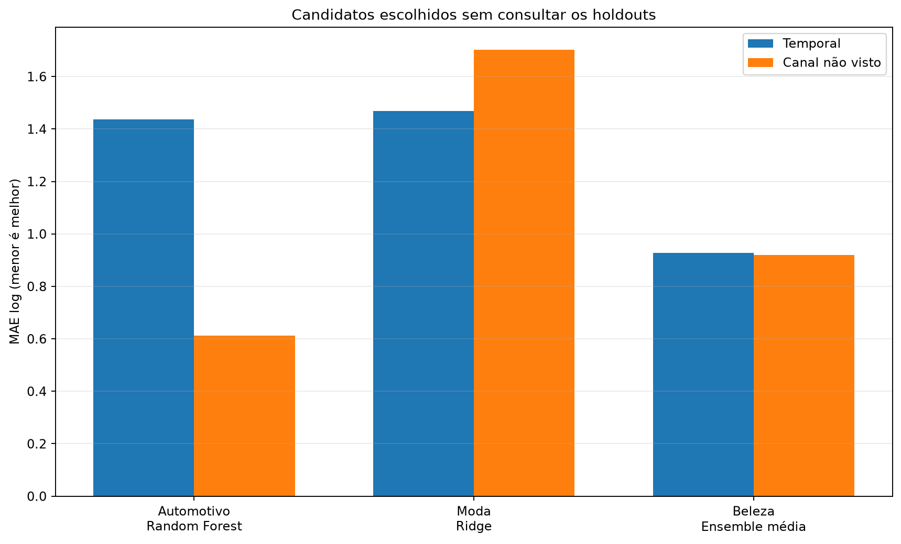
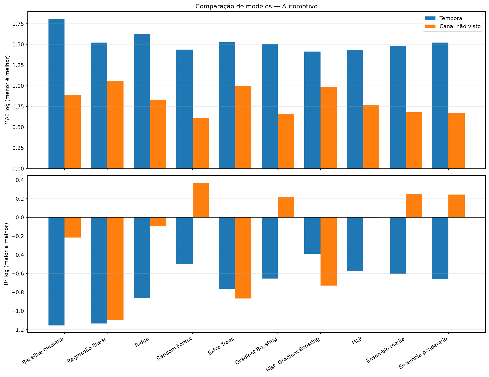
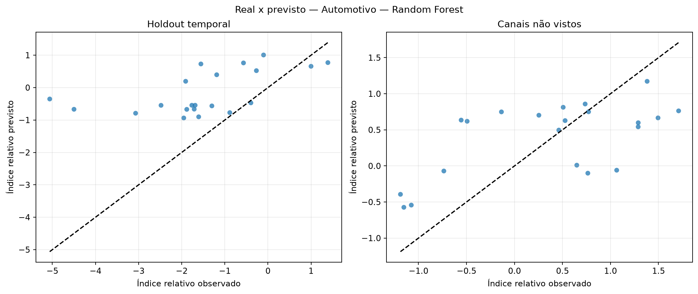
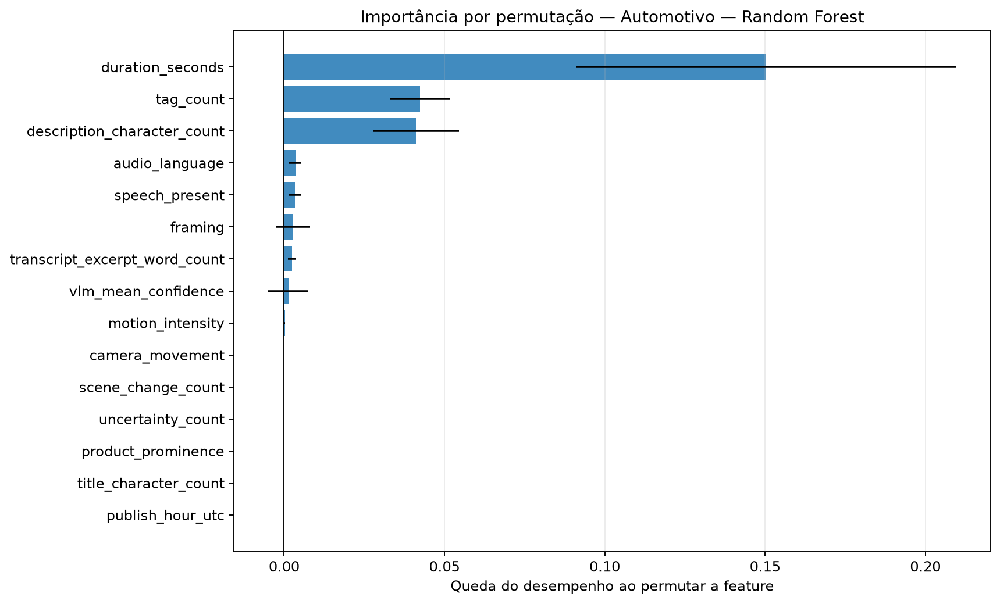
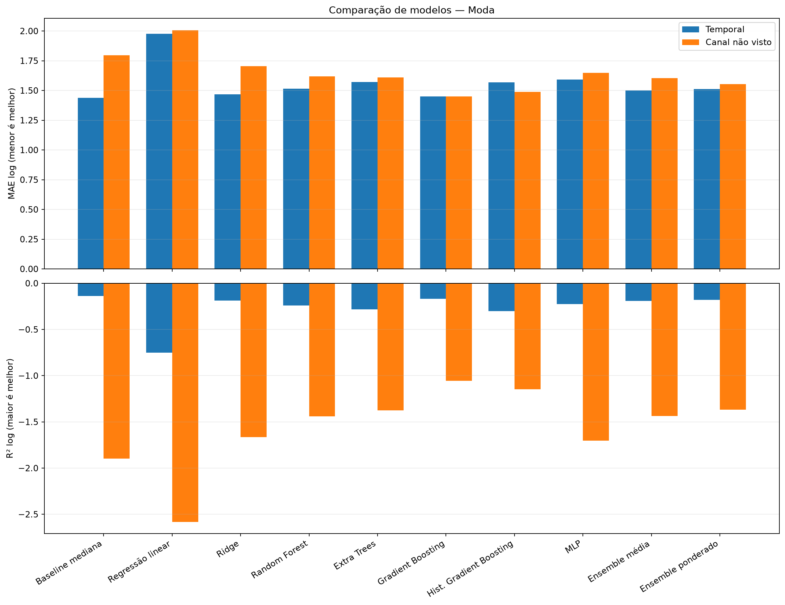
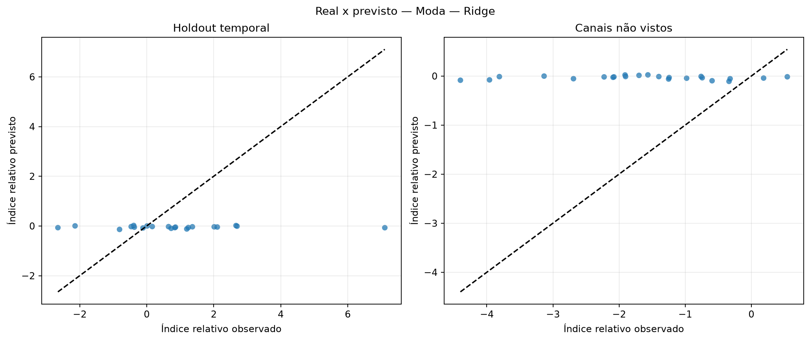
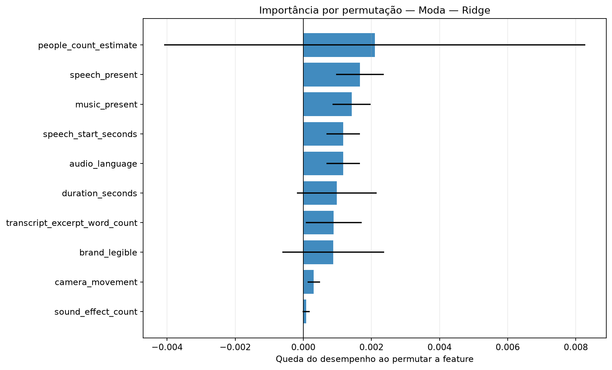
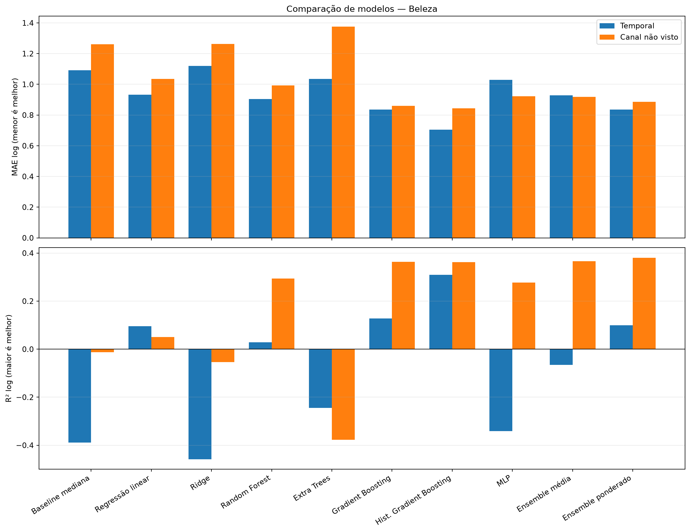
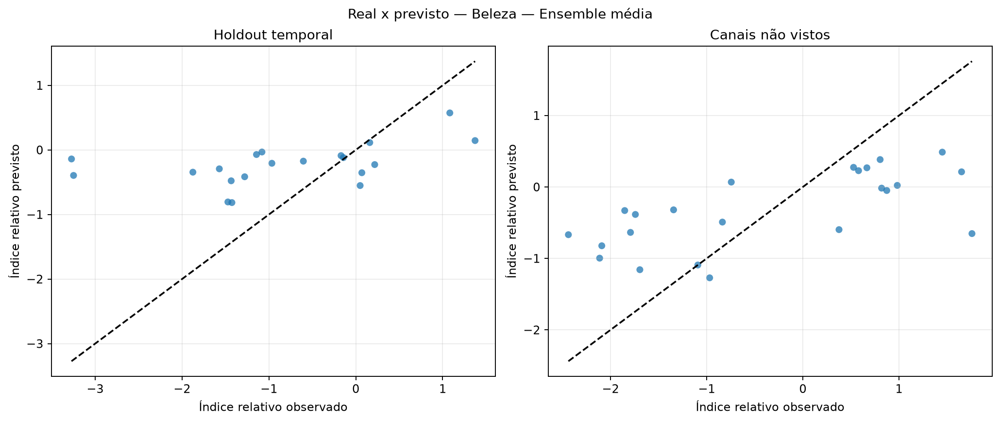
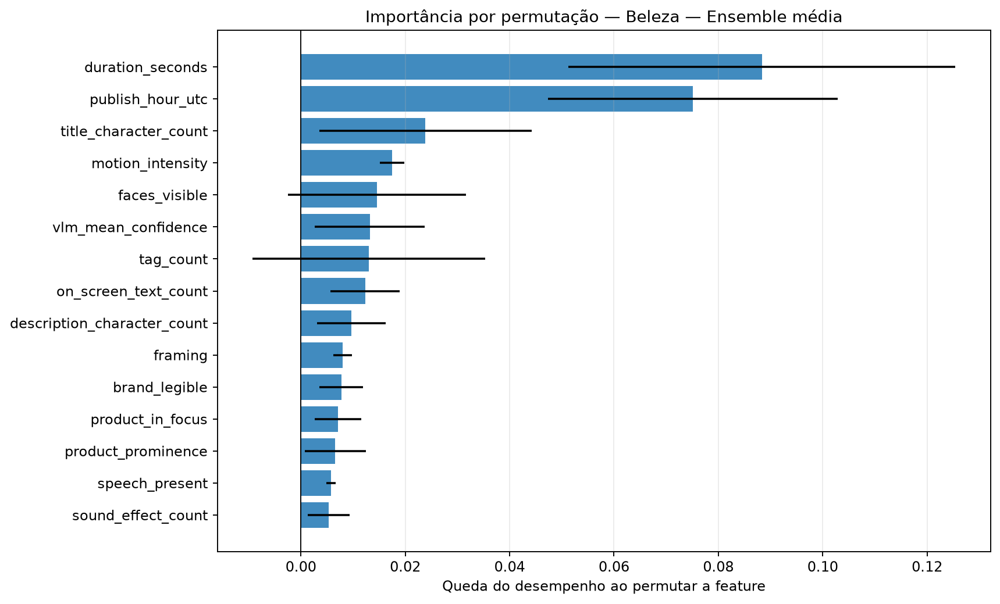

# Avaliação otimizada dos modelos de regressão

Execução: `relative-performance-evaluation-2026-10-16-v1`.

> **Resultado exploratório.** O alvo é o desvio de desempenho após ajustar idade do vídeo e escala histórica do canal somente no treino. Isso permite comparar os snapshots atuais sem fingir que são views_30d.

## Método

A busca usa somente o treino temporal externo. Dentro dele, folds expanding-window ajustam hiperparâmetros, escalonamento e seleção de features. Os holdouts temporal e de canais não vistos ficam isolados até a avaliação.

Colunas constantes são removidas com VarianceThreshold. A busca compara StandardScaler e RobustScaler e testa seleção por F-test, informação mútua e importância de Extra Trees.

Os ensembles combinam Ridge, Random Forest, Gradient Boosting e MLP. Os pesos do ensemble ponderado são aprendidos em previsões out-of-fold com restrição de pesos não negativos.

## Resultados por setor

### Automotivo

Amostra comum: 101 vídeos, 10 canais e 0 alvos em horizonte fixo.

Escolha pela validação interna: **Random Forest**. Melhor observado no holdout temporal: **Hist. Gradient Boosting**. Melhor observado em canais não vistos: **Random Forest**.

| Modelo | Tipo | MAE log interno | MAE log temporal | R² temporal | MAE log canal | R² canal | Spearman temporal |
|---|---|---:|---:|---:|---:|---:|---:|
| Baseline mediana | baseline | — | 1.807 | -1.155 | 0.886 | -0.215 | — |
| Regressão linear | base | 0.836 | 1.523 | -1.135 | 1.057 | -1.098 | 0.340 |
| Ridge | base | 0.837 | 1.623 | -0.866 | 0.831 | -0.093 | 0.475 |
| Random Forest | base | 0.734 | 1.437 | -0.496 | 0.611 | 0.372 | 0.614 |
| Extra Trees | base | 0.788 | 1.526 | -0.761 | 0.999 | -0.866 | 0.448 |
| Gradient Boosting | base | 0.740 | 1.503 | -0.654 | 0.665 | 0.219 | 0.601 |
| Hist. Gradient Boosting | base | 0.770 | 1.413 | -0.387 | 0.987 | -0.728 | 0.596 |
| MLP | base | 0.838 | 1.433 | -0.571 | 0.774 | -0.005 | 0.545 |
| Ensemble média | ensemble | 0.762 | 1.486 | -0.609 | 0.680 | 0.251 | 0.590 |
| Ensemble ponderado | ensemble | 0.747 | 1.521 | -0.659 | 0.670 | 0.244 | 0.583 |

### Moda

Amostra comum: 105 vídeos, 10 canais e 0 alvos em horizonte fixo.

Escolha pela validação interna: **Ridge**. Melhor observado no holdout temporal: **Gradient Boosting**. Melhor observado em canais não vistos: **Gradient Boosting**.

| Modelo | Tipo | MAE log interno | MAE log temporal | R² temporal | MAE log canal | R² canal | Spearman temporal |
|---|---|---:|---:|---:|---:|---:|---:|
| Baseline mediana | baseline | — | 1.437 | -0.136 | 1.795 | -1.897 | — |
| Regressão linear | base | 1.197 | 1.975 | -0.751 | 2.005 | -2.581 | 0.087 |
| Ridge | base | 1.006 | 1.469 | -0.186 | 1.703 | -1.666 | 0.014 |
| Random Forest | base | 1.056 | 1.516 | -0.242 | 1.618 | -1.439 | -0.013 |
| Extra Trees | base | 1.061 | 1.570 | -0.281 | 1.610 | -1.375 | 0.282 |
| Gradient Boosting | base | 1.030 | 1.451 | -0.168 | 1.450 | -1.057 | 0.213 |
| Hist. Gradient Boosting | base | 1.060 | 1.567 | -0.303 | 1.488 | -1.148 | 0.020 |
| MLP | base | 1.039 | 1.591 | -0.225 | 1.648 | -1.702 | 0.126 |
| Ensemble média | ensemble | 1.024 | 1.499 | -0.192 | 1.604 | -1.435 | 0.157 |
| Ensemble ponderado | ensemble | 1.026 | 1.512 | -0.181 | 1.554 | -1.368 | 0.157 |

### Beleza

Amostra comum: 100 vídeos, 10 canais e 0 alvos em horizonte fixo.

Escolha pela validação interna: **Ensemble média**. Melhor observado no holdout temporal: **Hist. Gradient Boosting**. Melhor observado em canais não vistos: **Hist. Gradient Boosting**.

| Modelo | Tipo | MAE log interno | MAE log temporal | R² temporal | MAE log canal | R² canal | Spearman temporal |
|---|---|---:|---:|---:|---:|---:|---:|
| Baseline mediana | baseline | — | 1.093 | -0.388 | 1.260 | -0.012 | — |
| Regressão linear | base | 1.477 | 0.932 | 0.095 | 1.034 | 0.050 | 0.586 |
| Ridge | base | 0.956 | 1.119 | -0.458 | 1.263 | -0.054 | 0.287 |
| Random Forest | base | 1.000 | 0.905 | 0.029 | 0.993 | 0.294 | 0.585 |
| Extra Trees | base | 0.969 | 1.035 | -0.244 | 1.375 | -0.377 | 0.197 |
| Gradient Boosting | base | 0.975 | 0.835 | 0.128 | 0.860 | 0.363 | 0.621 |
| Hist. Gradient Boosting | base | 1.132 | 0.705 | 0.309 | 0.844 | 0.363 | 0.695 |
| MLP | base | 1.126 | 1.029 | -0.341 | 0.923 | 0.277 | -0.017 |
| Ensemble média | ensemble | 0.949 | 0.928 | -0.065 | 0.919 | 0.367 | 0.502 |
| Ensemble ponderado | ensemble | 0.974 | 0.835 | 0.099 | 0.887 | 0.381 | 0.653 |

## Como interpretar

- A seleção principal usa MAE no índice relativo residual; menor é melhor.
- R² negativo indica desempenho quadrático pior que prever a média.
- Spearman mede a capacidade de ordenar criativos, não a precisão em views.
- Diferenças entre validação interna e holdout indicam instabilidade ou mudança de distribuição.
- A importância por permutação foi calculada apenas no holdout temporal e pode oscilar com a amostra pequena.

## Condição para uma decisão final

Usar este índice para comparar e ranquear criativos. A conversão para uma quantidade absoluta de views continua condicionada a um horizonte escolhido e à curva histórica do canal.
