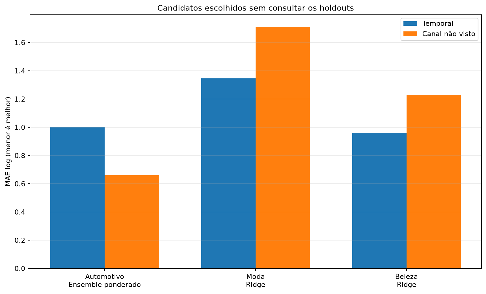
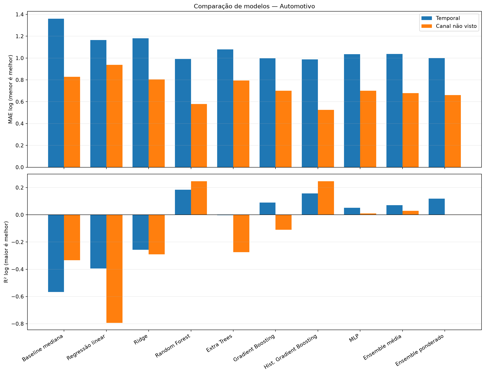
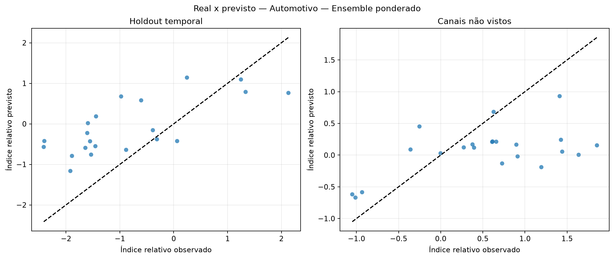
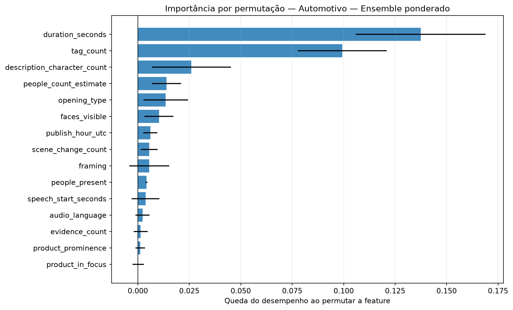
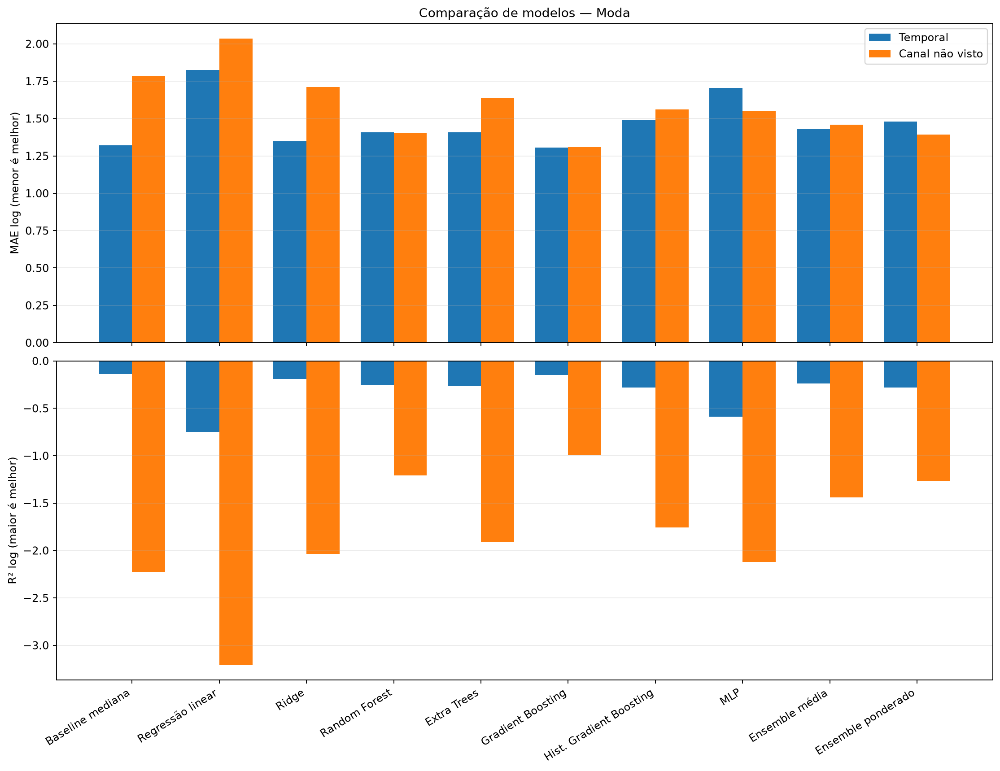
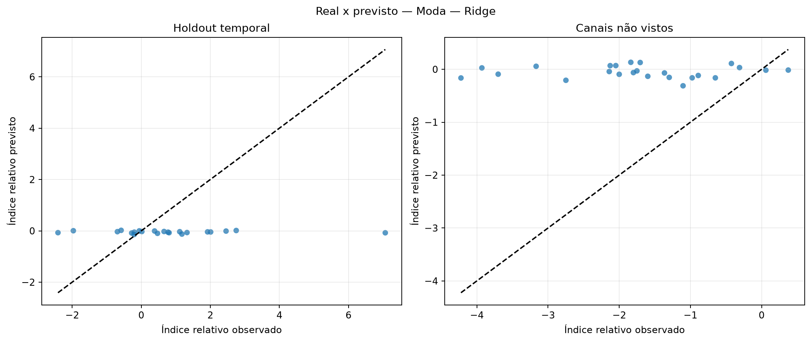
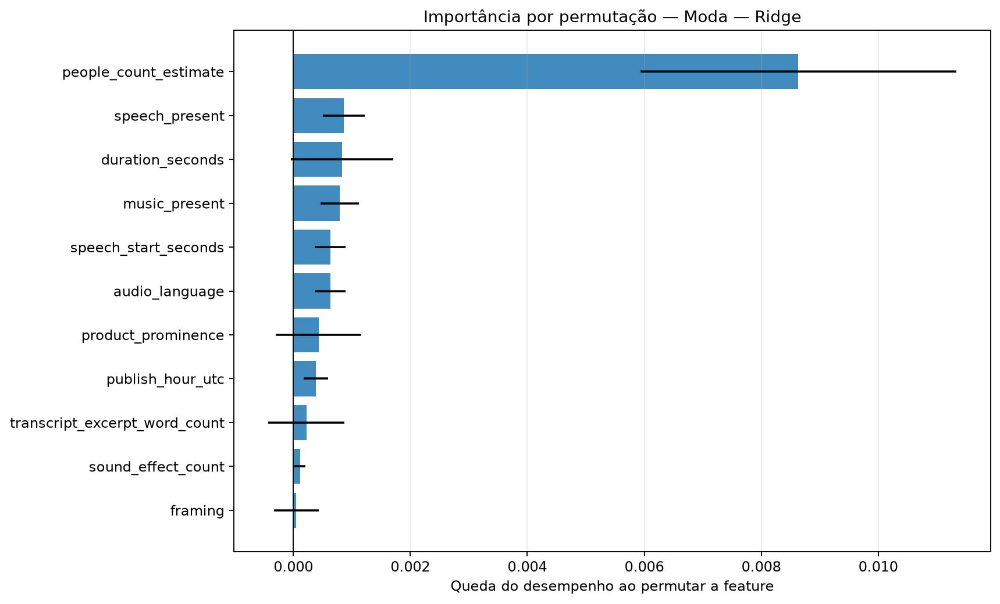
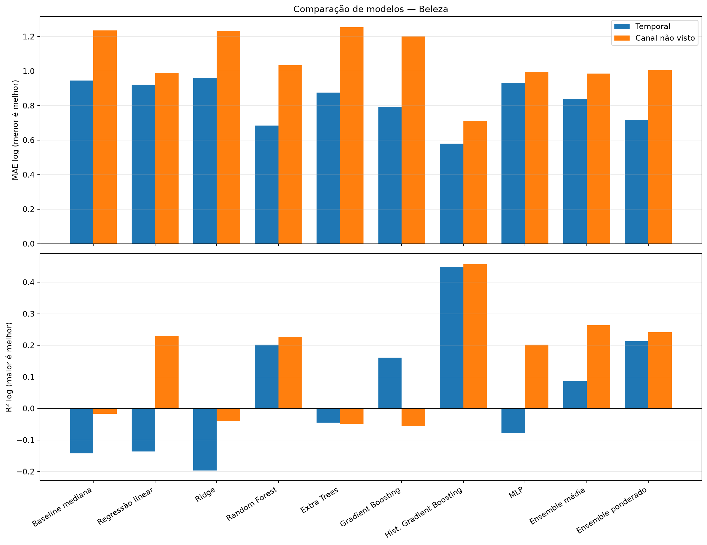
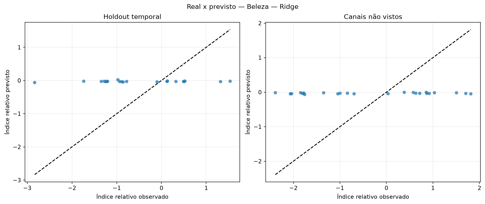
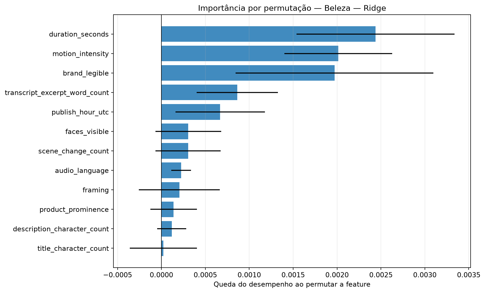

# Avaliação otimizada dos modelos de regressão

Execução: `relative-performance-nested-314-2026-10-16`.

> **Resultado exploratório.** O alvo é o desvio de desempenho após ajustar idade do vídeo e escala histórica do canal somente no treino. Isso permite comparar os snapshots atuais sem fingir que são views_30d.

## Método

A busca usa somente o treino temporal externo. Dentro dele, folds expanding-window ajustam hiperparâmetros, escalonamento e seleção de features. Os holdouts temporal e de canais não vistos ficam isolados até a avaliação.

Colunas constantes são removidas com VarianceThreshold. A busca compara StandardScaler e RobustScaler e testa seleção por F-test, informação mútua e importância de Extra Trees.

Os ensembles combinam Ridge, Random Forest, Gradient Boosting e MLP. Os pesos do ensemble ponderado são aprendidos em previsões out-of-fold com restrição de pesos não negativos.

## Resultados por setor

### Automotivo

Amostra comum: 104 vídeos, 10 canais e 0 alvos em horizonte fixo.

Escolha pela validação interna: **Ensemble ponderado**. Melhor observado no holdout temporal: **Hist. Gradient Boosting**. Melhor observado em canais não vistos: **Hist. Gradient Boosting**.

| Modelo | Tipo | MAE log interno | MAE log temporal | R² temporal | MAE log canal | R² canal | Spearman temporal |
|---|---|---:|---:|---:|---:|---:|---:|
| Baseline mediana | baseline | — | 1.359 | -0.566 | 0.829 | -0.334 | — |
| Regressão linear | base | 0.782 | 1.165 | -0.395 | 0.938 | -0.794 | 0.384 |
| Ridge | base | 0.812 | 1.182 | -0.257 | 0.805 | -0.290 | 0.494 |
| Random Forest | base | 0.726 | 0.992 | 0.184 | 0.578 | 0.247 | 0.686 |
| Extra Trees | base | 0.760 | 1.079 | -0.004 | 0.794 | -0.274 | 0.426 |
| Gradient Boosting | base | 0.719 | 0.997 | 0.090 | 0.700 | -0.110 | 0.670 |
| Hist. Gradient Boosting | base | 0.734 | 0.987 | 0.158 | 0.526 | 0.246 | 0.497 |
| MLP | base | 0.732 | 1.035 | 0.051 | 0.700 | 0.010 | 0.679 |
| Ensemble média | ensemble | 0.714 | 1.038 | 0.070 | 0.678 | 0.029 | 0.725 |
| Ensemble ponderado | ensemble | 0.692 | 0.999 | 0.119 | 0.661 | 0.001 | 0.697 |

### Moda

Amostra comum: 107 vídeos, 10 canais e 0 alvos em horizonte fixo.

Escolha pela validação interna: **Ridge**. Melhor observado no holdout temporal: **Gradient Boosting**. Melhor observado em canais não vistos: **Gradient Boosting**.

| Modelo | Tipo | MAE log interno | MAE log temporal | R² temporal | MAE log canal | R² canal | Spearman temporal |
|---|---|---:|---:|---:|---:|---:|---:|
| Baseline mediana | baseline | — | 1.321 | -0.140 | 1.783 | -2.224 | — |
| Regressão linear | base | 1.182 | 1.826 | -0.751 | 2.035 | -3.208 | 0.081 |
| Ridge | base | 0.995 | 1.347 | -0.189 | 1.712 | -2.035 | -0.073 |
| Random Forest | base | 1.033 | 1.409 | -0.251 | 1.404 | -1.209 | -0.150 |
| Extra Trees | base | 1.055 | 1.408 | -0.261 | 1.640 | -1.910 | -0.117 |
| Gradient Boosting | base | 1.017 | 1.306 | -0.147 | 1.309 | -0.993 | 0.301 |
| Hist. Gradient Boosting | base | 1.020 | 1.489 | -0.281 | 1.560 | -1.758 | -0.059 |
| MLP | base | 1.014 | 1.705 | -0.590 | 1.548 | -2.120 | 0.293 |
| Ensemble média | ensemble | 1.007 | 1.428 | -0.237 | 1.458 | -1.441 | 0.276 |
| Ensemble ponderado | ensemble | 1.010 | 1.479 | -0.278 | 1.394 | -1.264 | 0.326 |

### Beleza

Amostra comum: 103 vídeos, 10 canais e 0 alvos em horizonte fixo.

Escolha pela validação interna: **Ridge**. Melhor observado no holdout temporal: **Hist. Gradient Boosting**. Melhor observado em canais não vistos: **Hist. Gradient Boosting**.

| Modelo | Tipo | MAE log interno | MAE log temporal | R² temporal | MAE log canal | R² canal | Spearman temporal |
|---|---|---:|---:|---:|---:|---:|---:|
| Baseline mediana | baseline | — | 0.946 | -0.143 | 1.235 | -0.017 | — |
| Regressão linear | base | 1.178 | 0.921 | -0.137 | 0.990 | 0.230 | 0.217 |
| Ridge | base | 0.960 | 0.961 | -0.197 | 1.231 | -0.040 | 0.074 |
| Random Forest | base | 1.024 | 0.685 | 0.202 | 1.033 | 0.227 | 0.501 |
| Extra Trees | base | 1.011 | 0.876 | -0.045 | 1.253 | -0.049 | 0.291 |
| Gradient Boosting | base | 0.994 | 0.793 | 0.161 | 1.201 | -0.056 | 0.455 |
| Hist. Gradient Boosting | base | 0.979 | 0.580 | 0.448 | 0.712 | 0.458 | 0.671 |
| MLP | base | 1.049 | 0.933 | -0.078 | 0.995 | 0.202 | 0.195 |
| Ensemble média | ensemble | 0.963 | 0.839 | 0.086 | 0.986 | 0.263 | 0.464 |
| Ensemble ponderado | ensemble | 1.008 | 0.718 | 0.214 | 1.006 | 0.241 | 0.527 |

## Como interpretar

- A seleção principal usa MAE no índice relativo residual; menor é melhor.
- R² negativo indica desempenho quadrático pior que prever a média.
- Spearman mede a capacidade de ordenar criativos, não a precisão em views.
- Diferenças entre validação interna e holdout indicam instabilidade ou mudança de distribuição.
- A importância por permutação foi calculada apenas no holdout temporal e pode oscilar com a amostra pequena.

## Condição para uma decisão final

Usar este índice para comparar e ranquear criativos. A conversão para uma quantidade absoluta de views continua condicionada a um horizonte escolhido e à curva histórica do canal.
