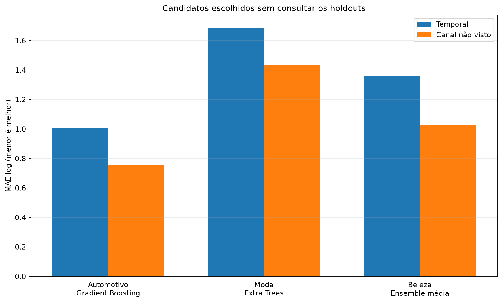
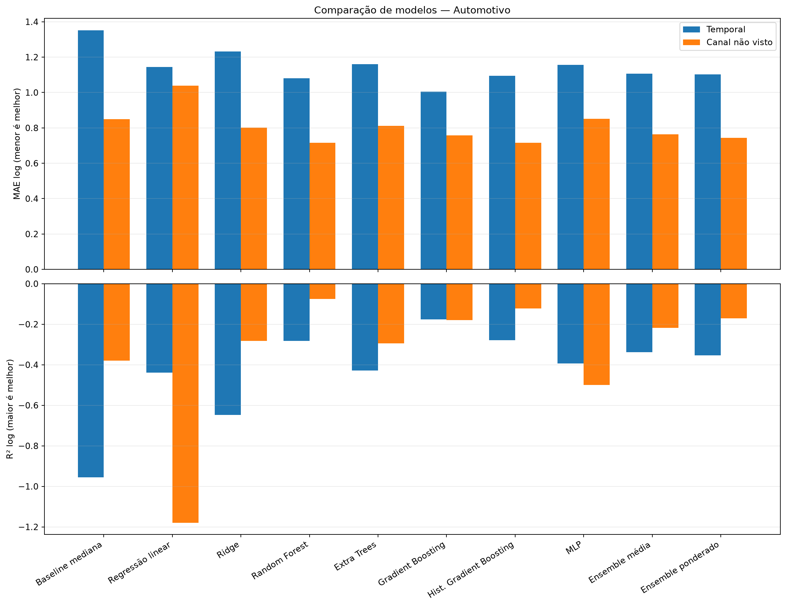
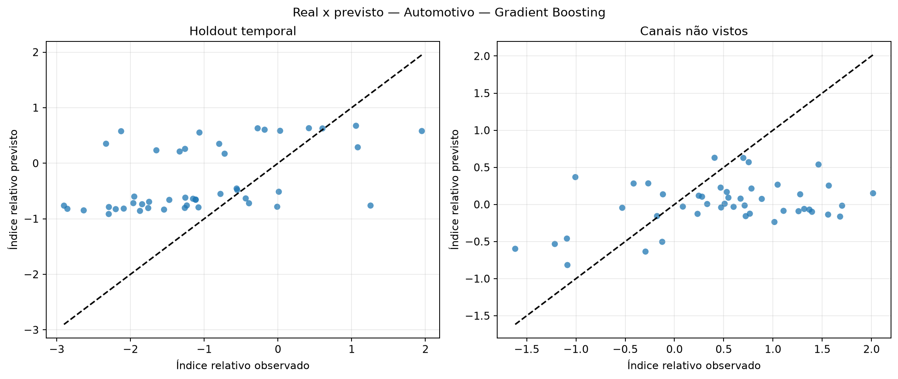
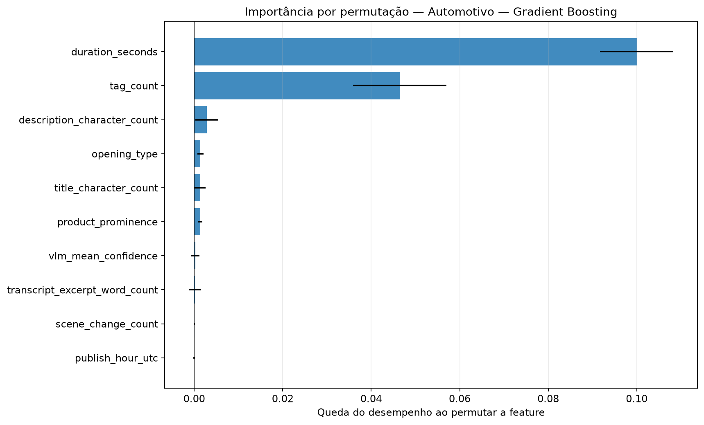
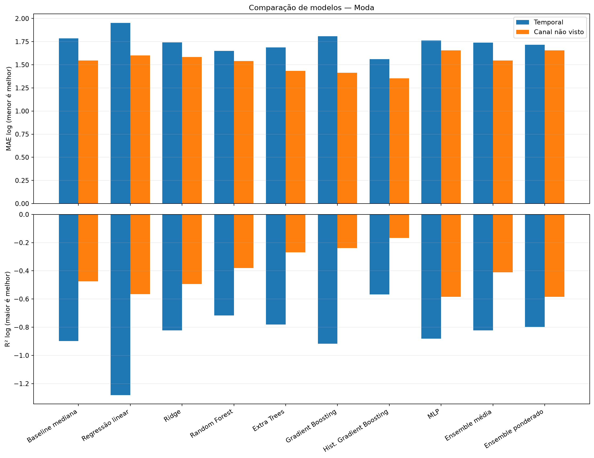
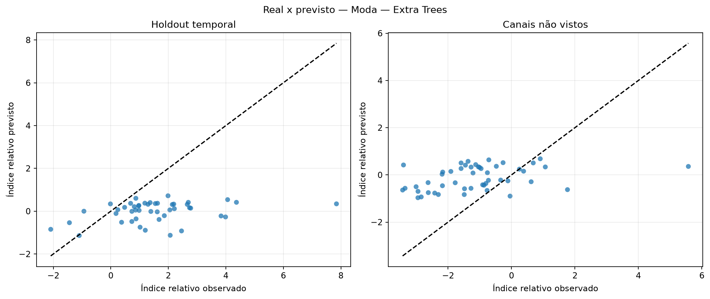
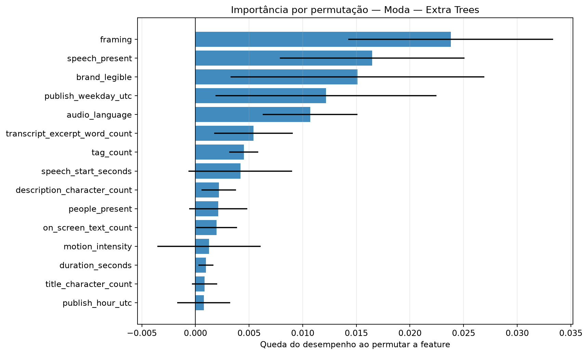
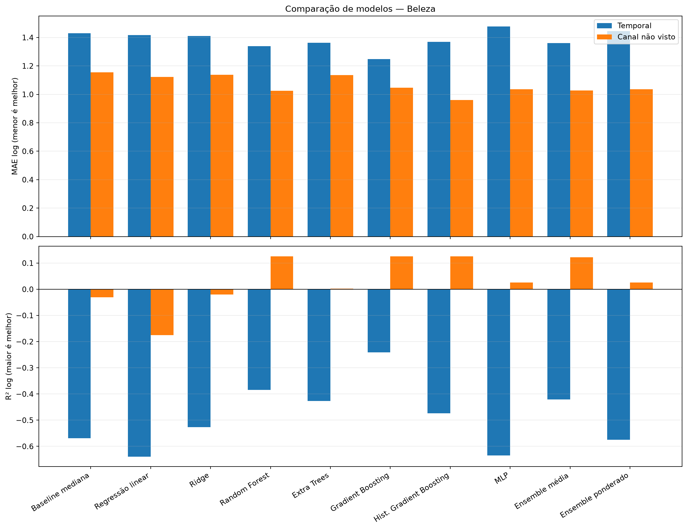
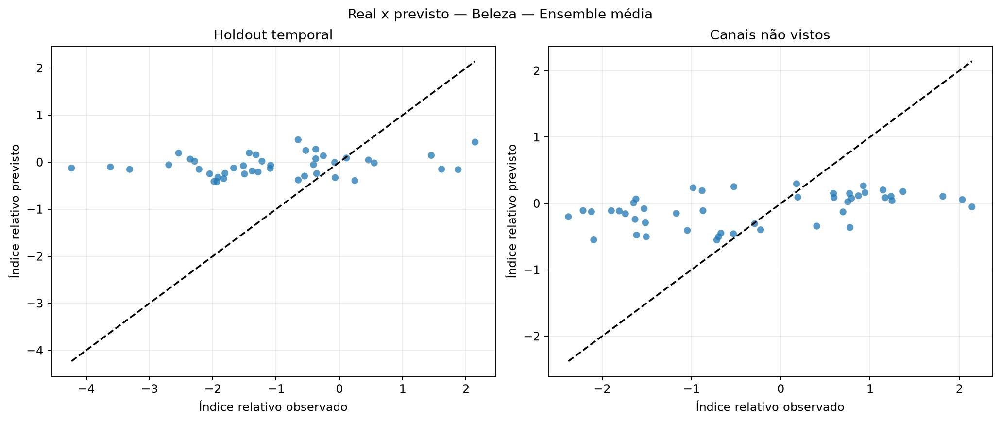
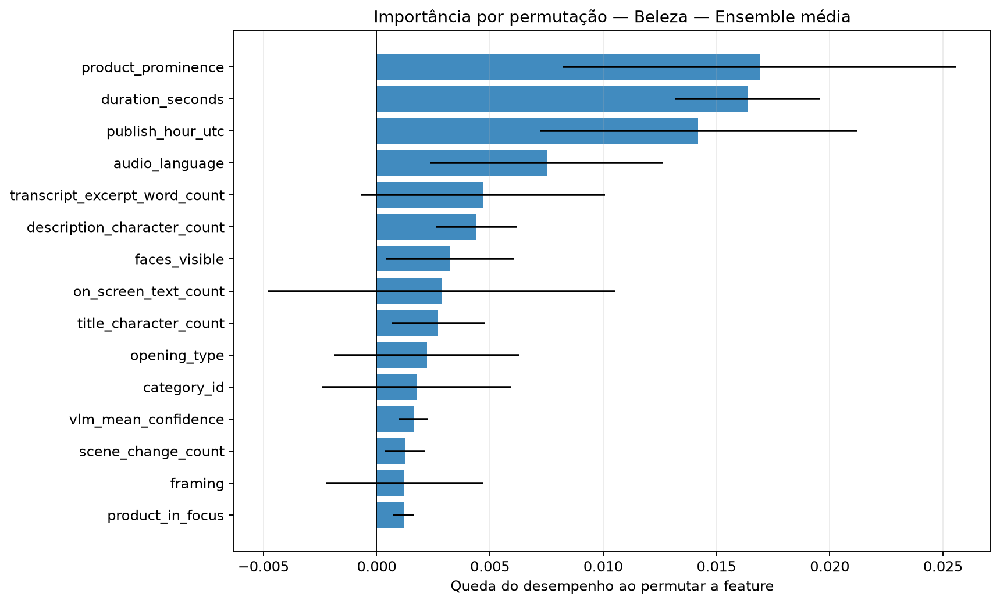

# Avaliação otimizada dos modelos de regressão

Execução: `relative-performance-nested-665-2026-10-16`.

> **Resultado exploratório.** O alvo é o desvio de desempenho após ajustar idade do vídeo e escala histórica do canal somente no treino. Isso permite comparar os snapshots atuais sem fingir que são views_30d.

## Método

A busca usa somente o treino temporal externo. Dentro dele, folds expanding-window ajustam hiperparâmetros, escalonamento e seleção de features. Para o corte por canal, uma busca interna separada usa exclusivamente os canais de treino. Os dois holdouts ficam isolados até a avaliação.

Colunas constantes são removidas com VarianceThreshold. A busca compara StandardScaler e RobustScaler e testa seleção por F-test, informação mútua e importância de Extra Trees.

Os ensembles combinam Ridge, Random Forest, Gradient Boosting e MLP. Os pesos do ensemble ponderado são aprendidos em previsões out-of-fold com restrição de pesos não negativos.

## Resultados por setor

### Automotivo

Amostra comum: 226 vídeos, 10 canais e 0 alvos em horizonte fixo.

Escolha pela validação interna: **Gradient Boosting**. Melhor observado no holdout temporal: **Gradient Boosting**. Melhor observado em canais não vistos: **Hist. Gradient Boosting**.

| Modelo | Tipo | MAE log interno | MAE log temporal | R² temporal | MAE log canal | R² canal | Spearman temporal |
|---|---|---:|---:|---:|---:|---:|---:|
| Baseline mediana | baseline | — | 1.351 | -0.955 | 0.849 | -0.379 | — |
| Regressão linear | base | 1.119 | 1.144 | -0.439 | 1.040 | -1.179 | 0.504 |
| Ridge | base | 0.802 | 1.232 | -0.648 | 0.801 | -0.281 | 0.518 |
| Random Forest | base | 0.749 | 1.081 | -0.283 | 0.715 | -0.075 | 0.628 |
| Extra Trees | base | 0.791 | 1.160 | -0.428 | 0.812 | -0.294 | 0.409 |
| Gradient Boosting | base | 0.735 | 1.006 | -0.177 | 0.758 | -0.180 | 0.592 |
| Hist. Gradient Boosting | base | 0.785 | 1.094 | -0.278 | 0.715 | -0.122 | 0.597 |
| MLP | base | 0.823 | 1.157 | -0.393 | 0.851 | -0.500 | 0.605 |
| Ensemble média | ensemble | 0.754 | 1.106 | -0.337 | 0.764 | -0.218 | 0.627 |
| Ensemble ponderado | ensemble | 0.747 | 1.102 | -0.353 | 0.743 | -0.170 | 0.596 |

### Moda

Amostra comum: 226 vídeos, 10 canais e 0 alvos em horizonte fixo.

Escolha pela validação interna: **Extra Trees**. Melhor observado no holdout temporal: **Hist. Gradient Boosting**. Melhor observado em canais não vistos: **Hist. Gradient Boosting**.

| Modelo | Tipo | MAE log interno | MAE log temporal | R² temporal | MAE log canal | R² canal | Spearman temporal |
|---|---|---:|---:|---:|---:|---:|---:|
| Baseline mediana | baseline | — | 1.786 | -0.898 | 1.546 | -0.475 | — |
| Regressão linear | base | 1.423 | 1.952 | -1.281 | 1.601 | -0.566 | 0.217 |
| Ridge | base | 1.174 | 1.742 | -0.822 | 1.584 | -0.493 | 0.255 |
| Random Forest | base | 1.197 | 1.650 | -0.716 | 1.540 | -0.381 | 0.311 |
| Extra Trees | base | 1.168 | 1.688 | -0.780 | 1.434 | -0.268 | 0.293 |
| Gradient Boosting | base | 1.178 | 1.808 | -0.917 | 1.413 | -0.239 | 0.266 |
| Hist. Gradient Boosting | base | 1.216 | 1.560 | -0.567 | 1.354 | -0.166 | 0.344 |
| MLP | base | 1.205 | 1.762 | -0.881 | 1.656 | -0.583 | 0.195 |
| Ensemble média | ensemble | 1.171 | 1.739 | -0.822 | 1.547 | -0.410 | 0.285 |
| Ensemble ponderado | ensemble | 1.182 | 1.716 | -0.798 | 1.656 | -0.583 | 0.306 |

### Beleza

Amostra comum: 213 vídeos, 10 canais e 0 alvos em horizonte fixo.

Escolha pela validação interna: **Ensemble média**. Melhor observado no holdout temporal: **Gradient Boosting**. Melhor observado em canais não vistos: **Hist. Gradient Boosting**.

| Modelo | Tipo | MAE log interno | MAE log temporal | R² temporal | MAE log canal | R² canal | Spearman temporal |
|---|---|---:|---:|---:|---:|---:|---:|
| Baseline mediana | baseline | — | 1.430 | -0.570 | 1.154 | -0.030 | — |
| Regressão linear | base | 1.473 | 1.417 | -0.639 | 1.121 | -0.175 | 0.140 |
| Ridge | base | 1.030 | 1.411 | -0.527 | 1.139 | -0.020 | 0.126 |
| Random Forest | base | 1.075 | 1.340 | -0.384 | 1.025 | 0.126 | 0.318 |
| Extra Trees | base | 1.059 | 1.362 | -0.426 | 1.136 | 0.003 | 0.269 |
| Gradient Boosting | base | 1.160 | 1.248 | -0.241 | 1.047 | 0.125 | 0.302 |
| Hist. Gradient Boosting | base | 1.133 | 1.370 | -0.474 | 0.960 | 0.126 | 0.162 |
| MLP | base | 1.062 | 1.476 | -0.635 | 1.035 | 0.026 | 0.011 |
| Ensemble média | ensemble | 1.008 | 1.360 | -0.421 | 1.028 | 0.122 | 0.216 |
| Ensemble ponderado | ensemble | 1.033 | 1.445 | -0.575 | 1.035 | 0.026 | 0.062 |

## Como interpretar

- A seleção principal usa MAE no índice relativo residual; menor é melhor.
- R² negativo indica desempenho quadrático pior que prever a média.
- Spearman mede a capacidade de ordenar criativos, não a precisão em views.
- Diferenças entre validação interna e holdout indicam instabilidade ou mudança de distribuição.
- A importância por permutação foi calculada apenas no holdout temporal e pode oscilar com a amostra pequena.

## Condição para uma decisão final

Usar este índice para comparar e ranquear criativos. A conversão para uma quantidade absoluta de views continua condicionada a um horizonte escolhido e à curva histórica do canal.
