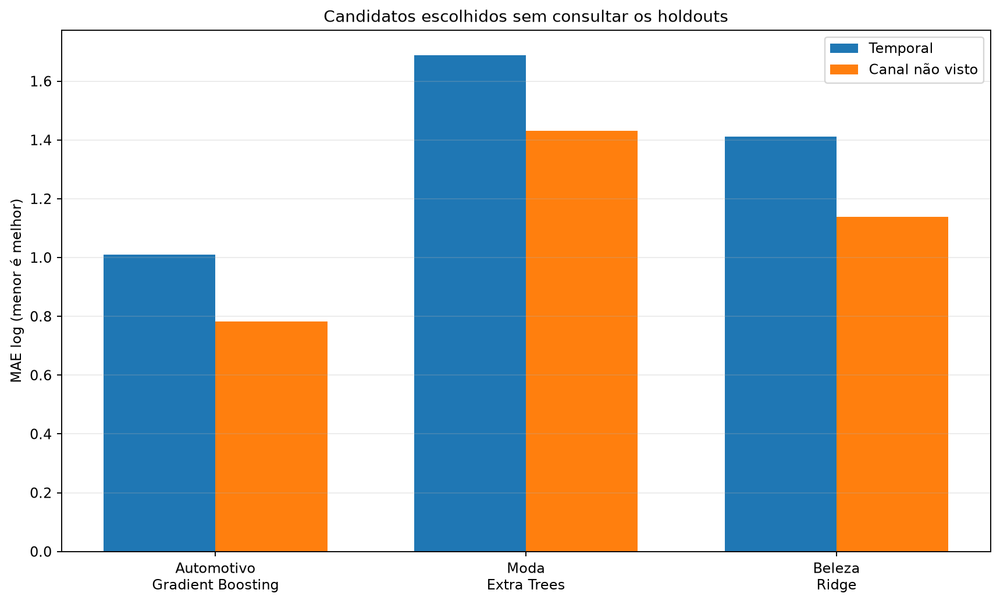
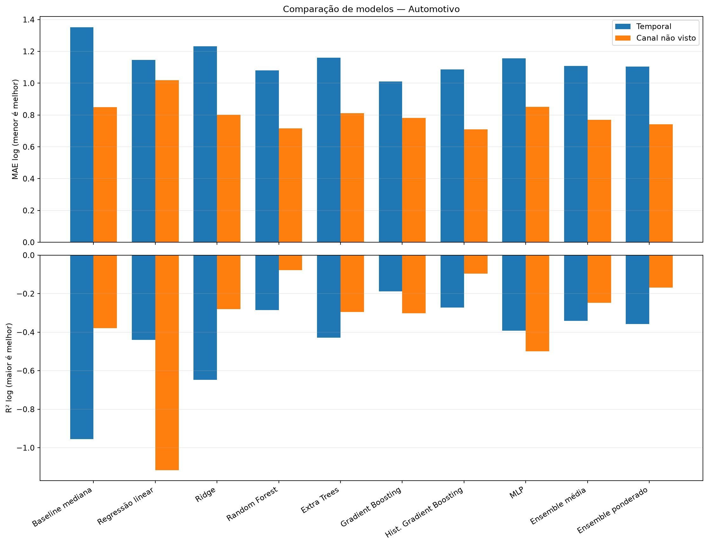
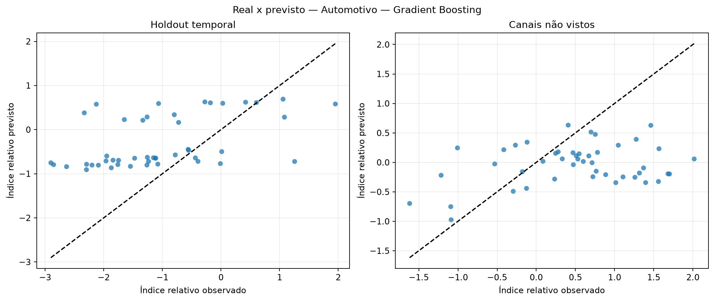
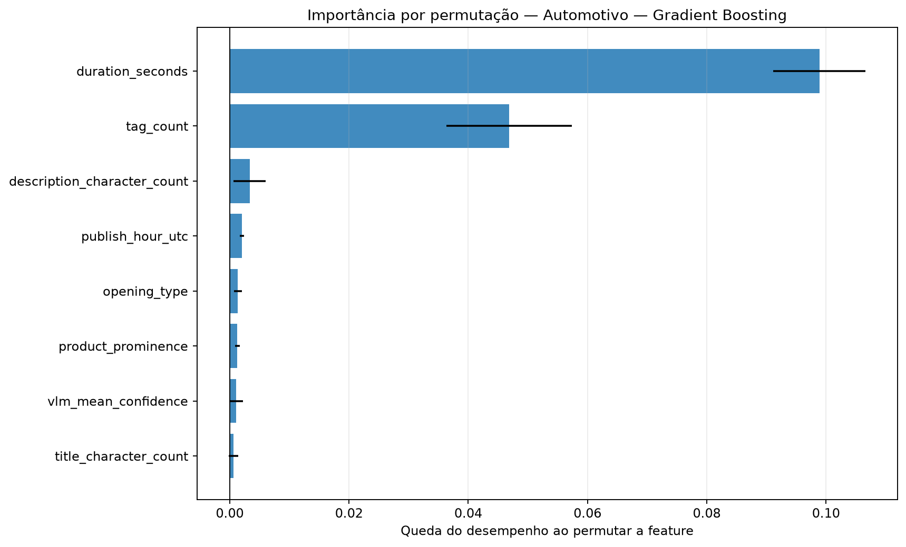
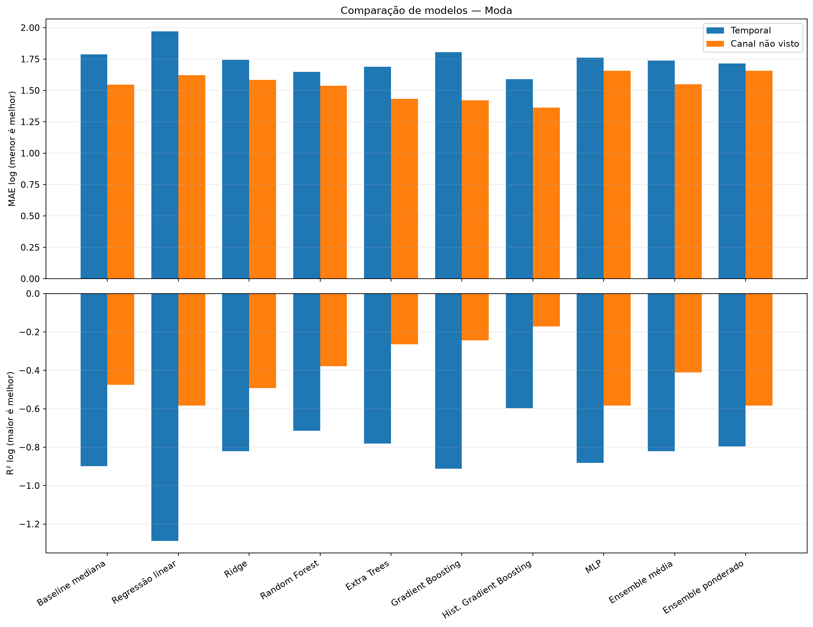
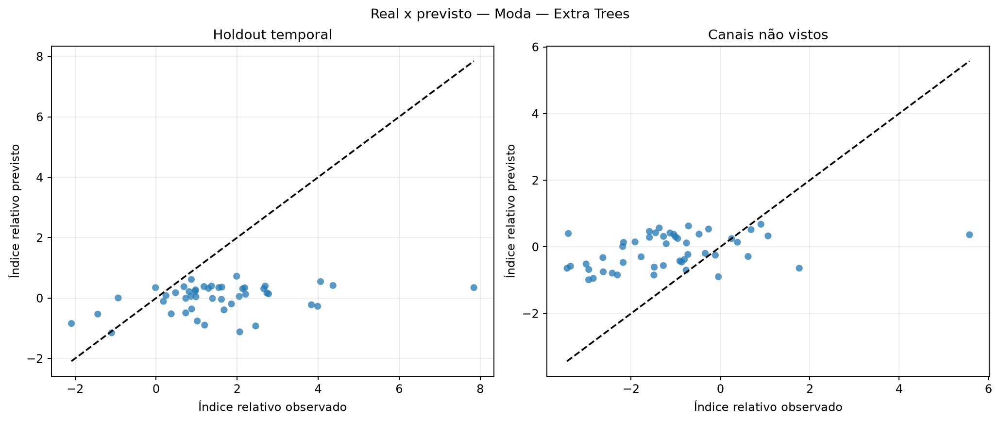
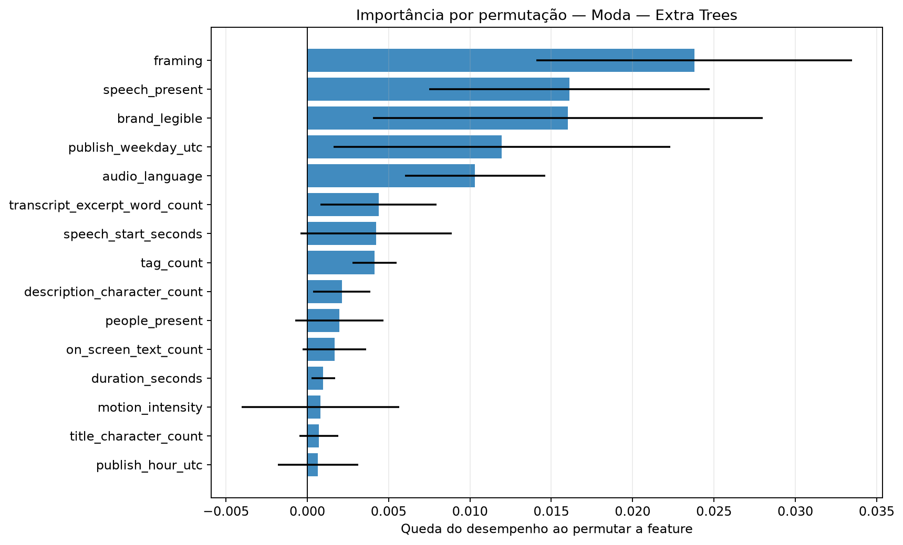
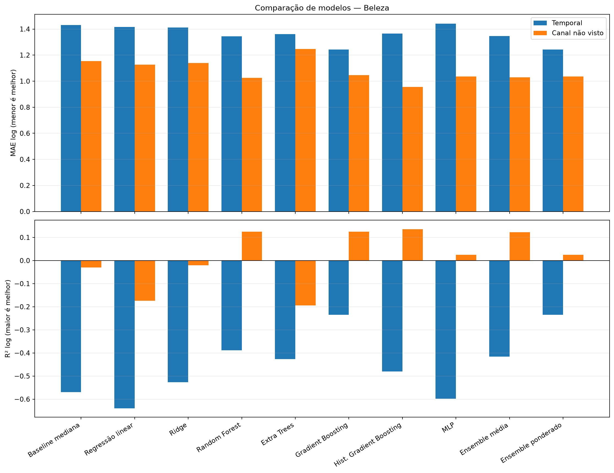
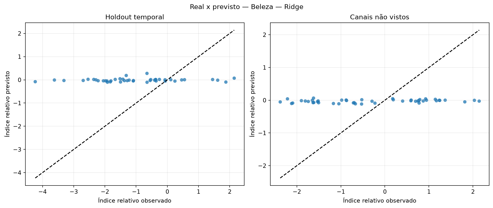
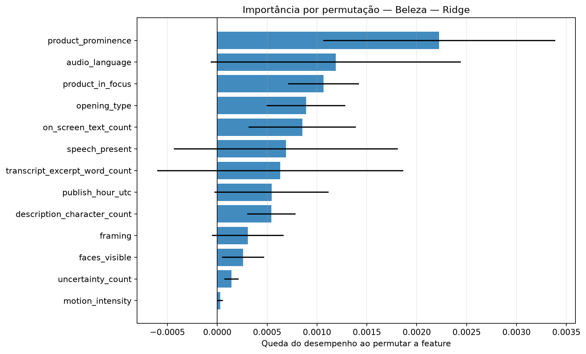

# Avaliação otimizada dos modelos de regressão

Execução: `relative-performance-transcript-665-2026-10-16`.

> **Resultado exploratório.** O alvo é o desvio de desempenho após ajustar idade do vídeo e escala histórica do canal somente no treino. Isso permite comparar os snapshots atuais sem fingir que são views_30d.

## Método

A busca usa somente o treino temporal externo. Dentro dele, folds expanding-window ajustam hiperparâmetros, escalonamento e seleção de features. Para o corte por canal, uma busca interna separada usa exclusivamente os canais de treino. Os dois holdouts ficam isolados até a avaliação.

Colunas constantes são removidas com VarianceThreshold. A busca compara StandardScaler e RobustScaler e testa seleção por F-test, informação mútua e importância de Extra Trees.

Os ensembles combinam Ridge, Random Forest, Gradient Boosting e MLP. Os pesos do ensemble ponderado são aprendidos em previsões out-of-fold com restrição de pesos não negativos.

## Resultados por setor

### Automotivo

Amostra comum: 226 vídeos, 10 canais e 0 alvos em horizonte fixo.

Escolha pela validação interna: **Gradient Boosting**. Melhor observado no holdout temporal: **Gradient Boosting**. Melhor observado em canais não vistos: **Hist. Gradient Boosting**.

| Modelo | Tipo | MAE log interno | MAE log temporal | R² temporal | MAE log canal | R² canal | Spearman temporal |
|---|---|---:|---:|---:|---:|---:|---:|
| Baseline mediana | baseline | — | 1.351 | -0.955 | 0.849 | -0.379 | — |
| Regressão linear | base | 1.119 | 1.145 | -0.440 | 1.019 | -1.116 | 0.501 |
| Ridge | base | 0.802 | 1.232 | -0.647 | 0.801 | -0.281 | 0.518 |
| Random Forest | base | 0.749 | 1.082 | -0.285 | 0.716 | -0.077 | 0.631 |
| Extra Trees | base | 0.792 | 1.161 | -0.429 | 0.812 | -0.294 | 0.400 |
| Gradient Boosting | base | 0.735 | 1.010 | -0.188 | 0.782 | -0.301 | 0.583 |
| Hist. Gradient Boosting | base | 0.785 | 1.087 | -0.273 | 0.710 | -0.096 | 0.605 |
| MLP | base | 0.823 | 1.157 | -0.393 | 0.851 | -0.500 | 0.605 |
| Ensemble média | ensemble | 0.754 | 1.108 | -0.341 | 0.770 | -0.248 | 0.631 |
| Ensemble ponderado | ensemble | 0.747 | 1.104 | -0.357 | 0.741 | -0.169 | 0.600 |

### Moda

Amostra comum: 226 vídeos, 10 canais e 0 alvos em horizonte fixo.

Escolha pela validação interna: **Extra Trees**. Melhor observado no holdout temporal: **Hist. Gradient Boosting**. Melhor observado em canais não vistos: **Hist. Gradient Boosting**.

| Modelo | Tipo | MAE log interno | MAE log temporal | R² temporal | MAE log canal | R² canal | Spearman temporal |
|---|---|---:|---:|---:|---:|---:|---:|
| Baseline mediana | baseline | — | 1.786 | -0.898 | 1.546 | -0.475 | — |
| Regressão linear | base | 1.424 | 1.970 | -1.287 | 1.622 | -0.583 | 0.214 |
| Ridge | base | 1.174 | 1.742 | -0.822 | 1.584 | -0.493 | 0.255 |
| Random Forest | base | 1.197 | 1.649 | -0.715 | 1.539 | -0.378 | 0.302 |
| Extra Trees | base | 1.168 | 1.689 | -0.780 | 1.432 | -0.264 | 0.289 |
| Gradient Boosting | base | 1.178 | 1.806 | -0.913 | 1.422 | -0.244 | 0.266 |
| Hist. Gradient Boosting | base | 1.216 | 1.590 | -0.597 | 1.364 | -0.170 | 0.316 |
| MLP | base | 1.205 | 1.762 | -0.881 | 1.657 | -0.584 | 0.199 |
| Ensemble média | ensemble | 1.171 | 1.739 | -0.821 | 1.550 | -0.411 | 0.285 |
| Ensemble ponderado | ensemble | 1.181 | 1.715 | -0.796 | 1.657 | -0.584 | 0.308 |

### Beleza

Amostra comum: 213 vídeos, 10 canais e 0 alvos em horizonte fixo.

Escolha pela validação interna: **Ridge**. Melhor observado no holdout temporal: **Gradient Boosting**. Melhor observado em canais não vistos: **Hist. Gradient Boosting**.

| Modelo | Tipo | MAE log interno | MAE log temporal | R² temporal | MAE log canal | R² canal | Spearman temporal |
|---|---|---:|---:|---:|---:|---:|---:|
| Baseline mediana | baseline | — | 1.430 | -0.570 | 1.154 | -0.030 | — |
| Regressão linear | base | 1.473 | 1.416 | -0.640 | 1.126 | -0.174 | 0.131 |
| Ridge | base | 1.030 | 1.411 | -0.527 | 1.139 | -0.020 | 0.126 |
| Random Forest | base | 1.074 | 1.343 | -0.389 | 1.026 | 0.125 | 0.324 |
| Extra Trees | base | 1.059 | 1.362 | -0.426 | 1.247 | -0.194 | 0.252 |
| Gradient Boosting | base | 1.155 | 1.243 | -0.235 | 1.047 | 0.125 | 0.325 |
| Hist. Gradient Boosting | base | 1.122 | 1.366 | -0.480 | 0.956 | 0.136 | 0.141 |
| MLP | base | 1.065 | 1.440 | -0.597 | 1.035 | 0.024 | 0.064 |
| Ensemble média | ensemble | 1.043 | 1.346 | -0.416 | 1.028 | 0.122 | 0.231 |
| Ensemble ponderado | ensemble | 1.155 | 1.243 | -0.235 | 1.035 | 0.024 | 0.325 |

## Como interpretar

- A seleção principal usa MAE no índice relativo residual; menor é melhor.
- R² negativo indica desempenho quadrático pior que prever a média.
- Spearman mede a capacidade de ordenar criativos, não a precisão em views.
- Diferenças entre validação interna e holdout indicam instabilidade ou mudança de distribuição.
- A importância por permutação foi calculada apenas no holdout temporal e pode oscilar com a amostra pequena.

## Condição para uma decisão final

Usar este índice para comparar e ranquear criativos. A conversão para uma quantidade absoluta de views continua condicionada a um horizonte escolhido e à curva histórica do canal.
